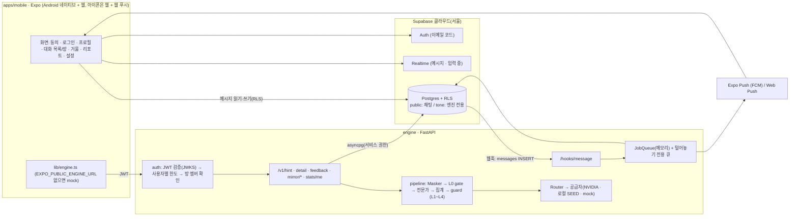

# AGENTS.md

이 저장소를 이어받는 AI 에이전트(Claude Code, Codex, Cursor, Gemini CLI 등)와 사람이 처음 읽는 문서다. 도구와 상관없이 같은 규칙으로 일한다. 기준: 2026-10-31, `main` = `land T-02`(dev Supabase 연결) 이후. land할 때마다 "2. 지금 상태"·"3. 진행 중"·"4. 다음 순서"를 같은 변경에서 고친다.

## 1. 무엇을 만드는가, 읽는 순서

1:1·그룹 채팅 앱(Expo 네이티브 + 웹)과, 보내려는 문장이 차갑게 읽힐 수 있으면 보내기 전에 보낸 사람에게만 조용히 알려 주는 AI 엔진(FastAPI)이다. CNU 26-2 어드벤처디자인 수업 프로젝트이고, 파일럿 20~30명 규모다. 출시는 목표가 아니다.

읽는 순서:

1. `AGENTS.md` (이 문서)
2. `CLAUDE.md` — **어기면 안 되는 규칙 16개**와 명령 표. Claude가 아닌 에이전트에도 그대로 적용된다.
3. `ARCHITECTURE.md` — 시스템 설계(화면, API, 데이터 모델, 엔진 레이어).
4. `docs/superpowers/specs/2026-10-27-tone-chat-scope-design.md` — 설계 보완(그룹방, 거울 API, 디자인 토큰).
5. `docs/tasks.md` — 작업 목록. 작업 단위는 이 표의 ID다.
6. 맡은 작업의 계획: `docs/superpowers/plans/2026-10-27-phase1-engine.md`, `…-phase1-app.md`(단계 0은 `…-phase0-foundation.md`, 끝남).

무엇이 이기는가: 사용자 지시 > `CLAUDE.md` 규칙 > `ARCHITECTURE.md` > spec > 이 문서의 "8. 결정" > 계획(plans). 8장은 계획보다 나중에 내려진 결정이라 계획을 덮는다. 아키텍처와 다르게 해야 할 이유가 생기면 코드보다 먼저 사용자에게 말하고, 합의되면 `ARCHITECTURE.md`를 같은 변경에서 고친다. 작업을 시작하기 전에 8장에서 그 작업 ID를 검색한다.

## 2. 지금 상태

`docs/tasks.md` 기준으로 직접 센 값이다(`-live` 행과 선택은 따로).

**배포 상태(2026-10-31):** 웹 `https://tone-chat.expo.app`, Android APK(EAS preview), 엔진은 학교 GPU 서버 상시 + Tailscale Funnel, DB는 서울 pilot 프로젝트(T-29b·T-29c·T-30a). 남은 것: pilot SMTP(로그인 메일), 실제 메시지 웹훅 확인, Android 푸시(FCM).

**필수 작업 48개 중 42개 완료.** `-live` 12개(전부 T-02 필요, 0개 완료). 선택 3개 중 1개 완료(T-38).

| 단계 | 필수 완료 | 남은 것 |
|---|---|---|
| 0. 기반 | 14 / 14 | (없음) |
| 1. 채팅 | 9 / 9 | (없음) |
| 2. AI 엔진 핵심 | 6 / 7 | T-16 (사람: 라벨) |
| 3. 앙상블과 살펴보기 | 3 / 5 | T-18, T-20 |
| 4. 털어놓기·거울·측정 | 10 / 10 | (없음) |
| 5. 파일럿과 발표 | 0 / 3 | T-29, T-30, T-31 |
| `-live` (단계 1·2) | 0 / 12 | T-07-live, T-08-live, T-09a-live, T-09b-live, T-09c-live, T-09d-live, T-10-live, T-15-live, T-17-live, T-22-live, T-25-live, T-28a-live |
| 선택 | 1 / 3 | T-32, T-33 |

(단계 0의 14개에는 이 문서를 만든 P-03이 들어 있다.)

검사 기준치(`scripts/check`, 병합된 main, 2026-10-31): 엔진 pytest 548 passed, 1 skipped · 앱 jest 717 passed(62 suites) · supabase(PGlite) 25 pass · tsc·lint 0 · 대비 OK.

영역별:

- **엔진**: 거의 끝. 실시간 힌트(`/v1/hint`), 살펴보기(`/v1/detail`), 털어놓기(`/v1/feedback`), 거울(`/v1/mirror/*`), 통계(`/v1/stats/me`), 웹훅(`/hooks/message`), 푸시·기준선·이벤트·trace 작업, JWKS 인증, 사용자별 429(T-38)가 main에 있다. 남은 것: T-18(두 번째 말투 전문가), T-20(가중치 학습).
- **앱**: 동의, 로그인, 프로필, 리포트, 설정, 초대·그룹 만들기(`rooms/new`), 대화 목록과 대화방(`room/[id]`: 보내기, Realtime 수신, 과거 불러오기, 읽음 처리, 답장·공감·읽음 수, 입력 중·사진·멘션, 방 정보·검색·알림 끄기), 거울 탭이 있다. Realtime·Presence·Storage는 jest로만 확인했다(-live 행). 남은 큰 덩어리는 입력 중 힌트(T-15), 살펴보기 시트(T-22), 털어놓기 시트(T-25), 푸시 등록(T-28a).
- **DB**: 마이그레이션 7개가 `supabase/migrations/`에 있고 로컬 PGlite 테스트로만 확인했다. **실제 Supabase 프로젝트는 아직 없다(T-02).**
- **평가**: 대조 세트와 `--mock` 평가 스크립트, `eval/baseline.json`(정밀도 게이트)이 있다. 이 mock 수치는 배관 확인용이다. 라벨된 30쌍(T-16)이 있어야 `-live` 평가가 된다.
- **배포**: 아직 없음. T-29(엔진), T-30(웹 + Android EAS), T-31(파일럿 1주).

## 3. 진행 중 (건드리지 말 것)

| 작업 | 누가 | 상태 |
|---|---|---|
| (없음) | | |

보류(paused): 없음.

## 4. 다음 순서 — 누가 무엇을

배포는 끝났다(웹 `https://tone-chat.expo.app`, Android APK, 엔진은 학교 GPU 서버 상시, 서울 pilot DB). **가장 큰 문제는 말투 힌트가 거의 안 뜨는 것**이다: 실시간 게이트가 엄격해 문장이 모델까지 가지 못하고, 실시간 모델(SEED 1.5B)이 차가운 문장을 거의 구분하지 못한다(pilot 힌트 요청 44건 모두 게이트에서 멈춤, 대조 세트에서 SEED 단독 정밀도·재현율 0). 그래서 다음 일은 엔진 성능이다.

**다른 사람·다른 AI에게 줄 작업은 `docs/handoff/`에 지시서로 있다.** AI에게 "`docs/handoff/<ID>.md` 지시서대로 작업해 줘"라고만 하면 된다([목록](docs/handoff/README.md)).

| 순서 | 작업 | 누가 | 지시서 |
|---|---|---|---|
| 1 | **P-12** 실시간 말투 모델 교체 | Claude (완료, land 대기) | — |
| 2 | **P-13** "말투 살펴보기" 버튼 + 고쳐 쓰기 3가지·배지 | 다른 AI/팀원 (앱+엔진) | `docs/handoff/P-13.md` |
| 3 | **P-14** 말투 분류기(KcELECTRA) 학습 파이프라인 | 다른 AI (ML) | `docs/handoff/P-14.md` |
| 4 | **P-15** 파일럿 지표 집계·그래프 | 다른 AI | `docs/handoff/P-15.md` |
| 5 | **P-16** 대조 세트 라벨 도구(T-16용) | 다른 AI | `docs/handoff/P-16.md` |
| 6 | **LIVE** 실제 앱으로 -live 행 확인 | 팀원 + AI | `docs/handoff/LIVE.md` |
| 7 | **P-17** Android 푸시(FCM) 준비 | 다른 AI (+ 소유자 Firebase) | `docs/handoff/P-17.md` |
| 8 | **T-33** 실시간 헤지 요청 | 다른 AI, **P-12 뒤** | `docs/handoff/T-33.md` |
| 9 | T-20 앙상블 가중치 학습 | 나중 (T-16·P-12·P-14 뒤) | — |

규칙: 작업은 `scripts/claim <ID> <이름>`으로 잡고, 끝나면 `scripts/land <ID>` 후 이 표와 §2를 고쳐 `git push origin main`(7장).

## 5. 사람(사용자·팀원)이 해야 할 일

키와 계정은 에이전트가 만들 수 없다. **값은 대화창에 붙이지 말고 파일(`.env`, `.env.pilot`, `.env.pilot.engine`)에 직접 넣는다.**

| 우선 | 할 일 | 왜 |
|---|---|---|
| 높음 | **AI-Hub 가입·데이터 신청**: "감성 대화 말뭉치", "공감형 대화"(가능하면 "한국어 SNS") | P-14 분류기 학습 데이터. 승인까지 며칠 걸릴 수 있다. 받은 데이터는 학교 서버에만 두고 저장소에 넣지 않는다 |
| 높음 | **T-16 라벨 30쌍** — 같은 문장, 다른 맥락. 두 사람이 각자 블라인드로 라벨한 뒤 합의 | 어떤 모델·구성이 나은지 판단하는 기준(지금 8쌍은 너무 적다). 학습에는 쓰지 않는다 |
| 보통 | **pilot DB 비밀번호 재설정**(대화에 노출됨) | 바꾼 뒤 `.env.pilot`·`.env.pilot.engine`의 DB 주소를 고치고 `scripts/deploy-school --env .env.pilot.engine` |
| 보통 | pilot Supabase → Authentication → **Rate Limits**에서 메일을 시간당 100 정도로 | 파일럿 첫날 동시 가입(기본 30/시간) |
| 낮음 | **Firebase 프로젝트**(Android FCM, `google-services.json` + 서비스 계정 키를 EAS에) | 앱이 꺼져 있을 때 Android 푸시. 앱이 열려 있을 때 실시간은 지금도 된다 |
| 나중 | **T-31 파일럿 모집**(동의서, 10~15쌍 + 팀 그룹방) | P-12·P-13 뒤가 좋다 |

pilot 준비 상태: 서울 Supabase(SMTP는 Brevo — SMTP Login `…@smtp-brevo.com` + SMTP key, API key 아님, Brevo Security → Authorized IPs에서 모르는 IP 차단 끔), 학교 GPU 서버(`ssh tone-gpu`), Tailscale Funnel, Expo(@daegyu_oh). `NVIDIA_API_KEY`(build.nvidia.com, `nvapi-`로 시작)는 서버 엔진 env에 있다.

새 Supabase 프로젝트를 만들 때(참고, dev·pilot 때 한 순서):
   - 서울 리전에 만들고 `supabase link`. 대시보드에서 Realtime을 먼저 켜지 않은 채로 `supabase db push`(마이그레이션 7개 전부, `_platform` 포함). Realtime "Allow public access" 끄기. Settings → JWT Keys는 비대칭 키(JWKS)로.
   - Auth → Email Templates → Magic Link 본문에 `{{ .Token }}`(앱은 6자리 코드로 로그인한다). 기본 메일 한도가 작으니 계정 2개로만 확인.
   - Auth → Sign In / Providers → Email → **Email OTP Length = 6** 권장(새 프로젝트 기본은 8자리. 앱은 6~10자리를 모두 받지만(P-08) 6자리가 입력하기 편하다). SMTP는 직접 설정(기본 SMTP는 템플릿 수정 불가) — Brevo면 Security → Authorized IPs에서 **모르는 IP 차단을 끈다**(Supabase 발송 IP가 바뀌어 `525 5.7.1 Unauthorized IP address`), Gmail이면 2단계 인증 + 앱 비밀번호(일반 비밀번호는 `535 5.7.8`).
   - 루트 `.env`(`.env.example` 복사): `SUPABASE_URL`, `SUPABASE_DB_URL`, `HOOK_SECRET`(`openssl rand -hex 32`), `MIRROR_SECRET`(32바이트 이상). `apps/mobile/.env`(`apps/mobile/.env.example` 복사): `EXPO_PUBLIC_SUPABASE_URL`, `EXPO_PUBLIC_SUPABASE_ANON_KEY`, `EXPO_PUBLIC_ENGINE_URL`.
   - DB 웹훅은 `README.md`의 "dev 웹훅 연결" 순서(T-10-live).

## 6. 구조도

- 채팅은 앱 ↔ Supabase로만 돈다. **엔진이 죽어도 채팅은 된다**(규칙 11). 힌트는 전송을 막지 않는다(규칙 6).
- 외부 모델로 가는 문장은 파이프라인 입구에서 요청마다 한 번 `pii.Masker`를 거친다(규칙 16). 하소연 원문은 어디에도 저장하지 않는다(규칙 5). `tone` 스키마는 앱에서 못 본다(규칙 10).
- 경로별 시간: 실시간 힌트 1.5초(넘으면 버림), 살펴보기 8초, 털어놓기는 202 즉시 + 60초 안 비동기 분류. 표는 `ARCHITECTURE.md` 3·4장.

### 코드 지도 (모두 확인한 경로)

| 경로 | 무엇 |
|---|---|
| `engine/app/routes/` | `hint.py` `detail.py` `feedback.py` `mirror.py` `stats.py` `hooks.py` |
| `engine/app/` | `main.py` `auth.py`(JWKS) `ratelimit.py`(T-38) `db.py`(Repo·FakeRepo) `context.py` `contracts.py` `deps.py` `settings.py` `traces.py` `openapi_dump.py` |
| `engine/pipeline.py`, `engine/mirror.py` | 경로 조립(realtime / detail / feedback), 거울 카드 고르기·서명 |
| `engine/harness/` | `router.py`(공급자·폴백·캐시·안전망 가리기, mock은 force_mock에서만) `pii.py`(Masker) `providers.py` `mock_rules.py` `prompts.py` `schemas.py` `store.py` `korean.py` |
| `engine/experts/` | 전문가 인터페이스·레지스트리(`base.py` `llm.py` `registry.py`) |
| `engine/layers/` | `gate.py`(L0) `aggregate.py`(집계·기권) `guard.py`(문구 검사) `rewrite.py` |
| `engine/jobs/` | `queue.py` `push.py` `baseline.py` `events.py` `feedback.py` |
| `engine/config/models.yaml` | 공급자·전문가·경로 시간 제한·집계 가중치·사용자별 한도(`limits`). 모델 이름은 여기에만 |
| `engine/prompts/`, `engine/content/` | 프롬프트(바꾸면 평가), 거울 카드 `mirror_cards.yaml` |
| `apps/mobile/app/` | expo-router 화면: `consent` `login` `profile` `rooms/new` `room/[id]` `(tabs)/{index,mirror,report,settings}` |
| `apps/mobile/lib/`, `components/` | `engine.ts`(+`engineMock.ts`) `session.tsx` `auth.ts` `gate.ts` `consent.ts` `report.ts` `invite.ts` `theme.ts` `types/`(생성 타입), 공용 `Button` `TextField` `ChipRow` `AppText` |
| `supabase/migrations/` | `…01_chat` `…02_tone` `…03_platform`(Storage·Realtime) `20261028000001_engine` `…02_sender_pattern_activations` `20261030000001_mirror_attempt_once` `…02_register_push_token` |
| `eval/` | `run_eval.py` `contrast_set.jsonl` `baseline.json` |
| `design/`, `design-system/tone-chat/MASTER.md` | 승인 목업, 대비 검사, 디자인 규칙 |
| `scripts/` | `claim` `land` `check` `test_coord.sh` (사용법 `docs/COLLAB.md`) |
| `prototype/tone-harness` | 참고용. 고치지 않는다 |

## 7. 작업 방식 (여러 AI가 같이)

한 작업 = 한 브랜치(worktree) = 한 번의 `scripts/land`. 브랜치 이름은 `t09a-chat`처럼.

`scripts/claim`의 잠금(`.coord/`)과 진행 기록(`.superpowers/`)은 git에 들어가지 않으므로 **GitHub에서는 누가 무엇을 잡았는지 보이지 않는다.** 그래서 이 순서를 지킨다.

1. `git pull origin main`. 이 문서 3장과 `docs/tasks.md`를 본다.
2. 잡으려는 작업의 행이 `완료`가 아닌지, 원격 브랜치가 없는지 확인한다: `git fetch && git branch -r`. 3장에 적힌 작업은 건드리지 않는다.
3. `scripts/claim T-36 mirror-ui` — 마지막 줄이 worktree 경로. 거기서만 일한다.
4. **바로** `git push -u origin <브랜치>` — 다른 에이전트가 원격 브랜치로 알아본다.
5. 테스트 먼저(TDD) → 구현 → `docs/tasks.md` 행을 `완료` + 완료 기준 칸 끝에 `확인: …` 한 줄 → 커밋.
6. 독립 리뷰(다른 에이전트나 사람)를 받고 지적을 반영한다. 구현한 쪽이 스스로 리뷰를 대신하지 않는다.
7. `git merge main`(바뀌었으면) → `scripts/check` 초록 → worktree 안에서 `scripts/land T-36` (로컬 main에 합친다).
8. `git push origin main`. 거절되면 `git pull --no-rebase origin main`, `scripts/check`를 다시 돌리고 푼다.

규칙:

- 루트 체크아웃에서 직접 고치지 않는다. `scripts/land`는 루트가 깨끗해야 합친다.
- 비밀값은 올리지 않는다. `.env`는 git에서 빠져 있다. 키는 루트 `.env`(엔진)와 `apps/mobile/.env`(앱)에만 둔다. 앱에는 모델 키·service role 키를 넣지 않는다(규칙 1).
- `scripts/check` = 엔진 pytest, supabase 테스트, 앱 tsc → lint → jest → 색 상수 검사, 대비 검사, 프롬프트·모델을 바꿨으면 평가 게이트.
- 리뷰 기준: 테스트 먼저(pytest는 mock 공급자만, 앱은 jest). 엔진 API나 DB 구조를 바꾸면 앱 타입을 다시 생성해 같은 브랜치에 넣는다(`cd apps/mobile && npm run gen:engine:pull`, DB는 `npm run gen:db`; `CLAUDE.md` 명령 표). 프롬프트·모델·가중치를 바꾸면 평가 게이트(`eval/run_eval.py --mock`, `eval/baseline.json`보다 정밀도가 낮으면 불가). 보안 경계(인증, RLS, 하소연·개인정보, 푸시 수신자, 서명)는 더 꼼꼼히 본다. 지적은 Critical / Important / Minor로 나누고, Minor는 싸면 같이 고치고 아니면 8장 "미뤄 둔 것"에 남긴다.
- 겹치지 않는 작업이면 worktree를 여러 개 잡아 병렬로 해도 된다. `contracts.py`·`main.py`·`docs/tasks.md`처럼 여럿이 고치는 파일은 land 직전 `git merge main`에서 양쪽을 다 살린다. 생성 타입이 충돌하면 main 쪽을 받고 다시 생성한다.
- Claude Code 전용: 서브에이전트 모델은 Sonnet·Opus만. 코드 지도(선택)는 graphify가 있으면 `graphify query "<질문>"`(`graphify-out/`은 커밋하지 않는다).

## 8. 결정

계획 문서와 다르면 여기가 이긴다. 새 결정은 `- 결정 — 이유` 한 줄로 더한다.

### 사용자 지시
- 채팅 기능은 카카오톡·인스타그램 수준 + 그룹방(≤8명). 선물·쇼핑 등 채팅 밖 기능은 뺀다. 거울 세션 3종까지 만든다. 세 앱의 이름·로고·색은 쓰지 않는다(규칙 15).
- 앱은 Expo **네이티브**(expo-dev-client + EAS), Expo Go로 파일럿하지 않는다. 아이폰 기본 경로는 **웹 + 웹 푸시**(iOS 16.4+, 홈 화면에 추가); 네이티브 iOS는 Apple Developer 계정이 생길 때만.
- Supabase는 클라우드 서울 리전, dev와 pilot 프로젝트를 따로.
- 디자인 목업(`design/mockups/index.html`)은 사용자 승인됨. 화면은 MASTER와 목업을 따른다.
- 저장소는 GitHub 비공개 `Daegyu519/Adventure_Design`.

### 배포
- 엔진은 학교 GPU 서버 컨테이너에서 상시(`scripts/deploy-school`, tmux `tone-llm`·`tone-engine`·`tone-ts`), 공개 HTTPS는 Tailscale Funnel(`https://tone-chat.<tailnet>.ts.net`, 도메인 불필요·주소 고정), 아이폰은 웹앱(홈 화면 추가), Android는 EAS preview APK, pilot DB는 서울 Supabase(엔진이 힌트마다 DB를 보므로 지연 때문에) — 2026-10-31 사용자 결정.
- 앱 공개값(Supabase URL·publishable key·엔진 URL·VAPID 공개키)은 저장소가 아니라 **EAS env**(preview/production)에 둔다. 웹 배포는 같은 값을 셸 env로 넣고 `npx expo export -p web` → `eas deploy --prod`.
- pilot 메시지 웹훅은 대시보드가 아니라 `scripts/pilot-webhook <엔진 URL> .env.pilot.engine`(pg_net 트리거, 비밀값은 env 파일에서 DB로만). HOOK_SECRET을 바꾸면 다시 실행.

### 엔진 모델
- 모델은 laguna-xs-2.1(빠른 쪽)과 nemotron-3.5-bolt-e4b(깊은 쪽·폴백)로 — 이 NVIDIA 계정에서 실제 프롬프트로 JSON이 통과하고 지연이 가장 짧았다(1~3초). deepseek-v4.1-flash·kimi·mistral-large-4는 응답 없음, 추론 모델은 생각 토큰 때문에 3~15초(공급자에 모델별 추가 요청 옵션이 없어 `enable_thinking:false`는 못 씀). 지연은 1~3초, 부하 때 4~12초. **실시간 힌트는 지금 사실상 꺼짐(전문가가 1.2초 안에 못 옴 → 기권)**(P-06). 실제 평가는 8쌍(n=8)이라 게이트가 아니다. GitHub Models는 무료 등급 데이터 약관 미확인이라 사슬에서 뺐다.
- 로컬 SEED(tone_hcx)는 학교 GPU 서버(P100, 공유 컨테이너)의 llama.cpp `llama-server`에서, 쓸 때만 `scripts/gpu up`/`down`(ssh 터널, 바깥 포트 없음, 접속 정보는 `~/.ssh/config`에만). Ollama 최신판은 P100에 드라이버 550+가 필요해 CPU로 떨어져서 뺐다(서버 535). 실시간 기권은 0.31→0.06으로 줄지만 재현율은 0.12 그대로 — 1.5B 혼자는 맥락을 못 읽는다(P-07).
- **실시간 = 로컬 Gemma3-4B 짧은 출력(`tone_fast`, P-12).** 실시간 게이트 0.3 → 0.1(0.3이면 pilot 요청이 전부 멈췄다). 실시간에서 SEED·NVIDIA 맥락·말투 전문가를 뺐다(SEED 정밀도·재현율 0, NVIDIA는 1.2초에 못 옴). 프로토타입 8쌍 실제 평가: 0/0 → 정밀도 1.0·재현율 0.38, p95 0.87~1.0초(`eval/results/2026-10-31-p12-realtime-bakeoff.txt`). **mock baseline을 다시 잡았다(mock만): 정밀도 0.83→0.5, 재현율 0.62→0.12, 맥락 구분 4/8→0/8.** 옛 숫자는 실시간 경로의 mock 맥락 전문가에서 나왔는데 실시간에 맥락 전문가가 없어져서 구조가 달라졌다(mock_rules를 고쳐 숫자를 올리지 않는다). 위 실제 측정(정밀도 1.0·재현율 0.38·p95 0.87~1.0초, n=16)은 게이트가 아니다. GPU가 꺼지면 실시간은 NVIDIA로 폴백하지 않고 기권한다. Gemma 라이선스는 Gemma Terms of Use. 서버는 둘(`tone-llm` 11434 SEED, `tone-llm-fast` 11435 Gemma).
- 실제 대화(가린 문장)는 NVIDIA API 카탈로그 무료 등급으로 간다 — 파일럿을 위한 의도된 결정(원 설계 ARCHITECTURE의 공급자 선택), [NVIDIA API Trial 약관](https://assets.ngc.nvidia.com/products/api-catalog/legal/NVIDIA%20API%20Trial%20Terms%20of%20Service.pdf)(내용은 사람이 확인 필요), Masker가 이름·개인정보를 먼저 가린다(규칙 16).

### 앱
- 앱 환경 변수는 `apps/mobile/.env`에만(Expo는 루트 `.env`를 읽지 않는다) — 루트와 따로 관리하는 이유. `EXPO_PUBLIC_ENGINE_URL`이 비면 개발·테스트는 mock 엔진 + 개발 중 경고, 배포 빌드(`__DEV__` 아님)는 엔진이 꺼진다: mock도 던짐도 없이 모든 호출이 `EngineError(0, 'engine_not_configured')`로 실패하고 만들 때 `console.error` 한 번(값 없음). 힌트는 조용히 없고 살펴보기·털어놓기·거울·리포트는 기존 고정 문구, 채팅(방·보내기·Realtime·푸시 등록)은 그대로(규칙 11). EAS preview·production 빌드는 `eas-build-pre-install`에서 실패. T-30에서는 `isMock === false`만으로는 모자라니(꺼진 엔진도 false) 콘솔에 그 오류가 없고 힌트가 실제로 오는지 확인.
- 엔진 클라이언트 시간 제한: hint 1700ms, detail 9000ms, 나머지 10000ms — 서버 예산(1.5초·8초)보다 조금 길게.
- 생성 타입은 손으로 쓰지 않는다. 생성 스크립트는 `.tmp`에 쓰고 성공해야 `mv` — 실패해도 기존 파일 유지. `gen:engine:pull`은 엔진 OpenAPI를 앱 seed 위에 합친다(엔진이 제공하는 경로가 이김).
- 색은 `useTheme()` 토큰으로만, `scripts/check`가 색 리터럴을 막는다. 금지 색 검사는 갈색 계열까지(색상 20~65°) — 규칙 15.
- 로그인: 프로필 읽기 실패는 "없음"과 구분(`profileFailed` + 다시 불러오기). 연결 오류·5xx는 "연결이 불안정할 수도 있어요…" — 인증 메일 재요청을 부추기지 않는다(메일 한도가 작다).
- 리포트: 계획 문구 대신 MASTER 5장 + 승인 목업. 숫자 3개 = 예측과의 차이 · 이번 주 힌트(KST) · 스스로 고친 비율. "숫자는 나만 봐요"는 근거 없는 약속이라 빼고 "힌트 수는 점수가 아니에요…" 문구를 쓴다.
- 설정(T-37)은 `tone_hint_on`을 저장만 한다. 꺼져 있으면 `/v1/hint`를 안 보내는 일은 T-15에서(테스트 포함) — 힌트 요청 코드가 그때 생기기 때문.
- 공용 `Button`의 수정은 프리미티브 한 곳에서(모든 화면에 퍼지므로 T-07·T-34 테스트가 초록이어야 한다).
- 화면 안내(스크린리더)는 `lib/announce.tsx`의 `useAnnounce()` → `{say, region}`으로만 한다: iOS는 `announceForAccessibility`, 웹·Android는 늘 붙어 있는 polite 라이브 영역(같은 문구 반복도 다시 읽힘). **react-native-web의 `announceForAccessibility`는 아무것도 하지 않는다.** region은 화면마다 한 번 + 열린 시트마다 한 번: `Sheet`가 자기 `useAnnounce` 영역을 dialog 안에 그리고 children 함수로 그 `say`를 넘긴다(웹 Modal의 aria-modal 밖인 화면 영역은 가려진다). 화면 안의 상자(거울 `FocusBox` 등)는 영역을 그리지 않고 화면의 `say`를 받는다. 영역은 opacity 0.01(0이면 TalkBack이 건너뛸 수 있다). 눈에 보이는 `role="alert"` 오류(예: `TextField`)는 웹·Android에서 이미 읽히므로 `say`는 iOS에서만 부른다(두 번 읽힘 방지).
- 푸시 등록(T-28a): 권한은 설정 스위치를 누를 때만 묻는다(앱 시작 때 안 물음). 토큰 저장은 `register_push_token` RPC(SECURITY DEFINER, 같은 토큰을 가진 다른 사용자 행을 지우고 내 행을 넣음)로만 — 공용 기기에서 로그아웃 해제가 실패해도 다음 사용자가 켜면 이전 사용자 알림이 끊긴다. 로그아웃 때도 최선으로 해제(3초). 서비스 워커 알림 탭은 `/room/<id>`만 연다. 아이폰은 웹 + 홈 화면 추가(iOS 16.4+), 네이티브 iOS 스위치는 이유와 함께 꺼 둔다. 키(VAPID·Firebase·EAS)가 없으면 등록하지 않고 "받지 못할 수도 있어요".
- 살펴보기 시트(T-22): 힌트 막대의 "살펴보기"로 연다(빈 초안이면 안 열림). 순서는 제목(힌트 제목, 없으면 "이렇게 읽힐 수도 있어요") → 보낼 문장 → 의도 칩 → 어긋남 한 줄·고쳐 쓰기 후보 → 읽힘·이유. 칩마다 결과를 캐시하고 앞 요청은 끊는다. 후보를 고르면 입력창 초안만 바꾸고(자동 전송 없음) 힌트를 다시 묻는다, 기록은 id·A/B만. 닫히면 `lib/focus.ts`의 `retryFocus`로 입력창에 포커스(최대 10번, 동작 줄이기면 지연 없음). 거울의 `Readings`·`DiffText`·`changedWords`를 같이 쓴다.
- 입력 중 힌트(T-15): 마지막 입력 0.5초 뒤 `/v1/hint`(초안·방·답장 대상만, 500자 넘거나 빈 글은 안 보냄), 새 입력이 오면 이전 요청을 끊고 seq가 지난 답은 버린다, 클라이언트 시간 제한 1.7초. 설정에서 힌트를 끄면 요청이 없고 보이던 힌트도 지운다. 429·503·연결 실패면 Retry-After(없거나 0이면 5초, 최대 60초)만큼 쉰다 — 엔진 CORS가 `Retry-After`를 노출한다. 힌트는 바뀔 때 한 번만 `say`, 멘션 후보가 열려 있으면 미룬다. 입력창은 웹에서 `aria-describedby`로, 네이티브에서 `accessibilityHint`로 힌트를 다시 읽게 한다. 이벤트(`toneEvents`)에는 초안 글이 들어가지 않는다.
- 털어놓기(T-25): 받은 글 메시지에만 메뉴의 "AI에게만 털어놓기". 글은 시트 상태에만 있고 닫으면 사라진다(저장·로그 없음). 202의 여러 경우(접수·중복·이미 신고·주간 한도)를 화면에서 구분하지 않는다. 안내 문구는 단정하지 않게("상대에게 직접 보이지 않아요. 누가 남겼는지 드러나지 않도록 해요."). 알림 토스트는 6초·눌러 닫기·탭 순서 밖, 내용은 `say`로 읽는다. 닫히면 원래 메시지로 포커스(`focusItem`이 roving 활성도 바꾼다).
- 사진: 클라이언트는 jpg·png·webp만(움직이는 GIF는 멈출 수 없어 뺐다, WCAG 2.2.2), 5MB 이하, 경로 `room_id/<시각>-<무작위>.<확장자>`, `upsert:false`. 서명 주소는 55분, 만료 60초 전에 다시 받고, 로그아웃 때 캐시를 비운다. 멘션은 그룹방만, 같은 이름이 둘이면 후보에서 뺀다. 입력 중 표시는 Presence 키(내 id)에서 신원을 얻는다.
- 대화방 메시지 목록은 웹에서 roving tabindex(탭 정지 하나, ↑/↓로 이동, Enter·Shift+F10·ContextMenu로 메뉴 시트). 메시지 이름은 보낸 사람·내용·시간·안 읽은 수(나는 세지 않음)를 한 줄로. 메뉴는 내 메시지에도 있다(키보드 접근).
- 방 화면(`room/[id]/index`)은 id마다 하나(`_layout`의 `dangerouslySingular`): 알림 탭·두 번 누름은 있던 방을 맨 위로 옮긴다. 방 안 검색 결과는 `router.dismissTo`로 아래 방에 돌아가 `at`·`k`만 바꾼다(뒤로 가기가 검색으로 가지 않게).
- Realtime postgres_changes 채널은 구독마다 새 이름(`lib/realtime.ts`의 `freshTopic`): realtime-js는 같은 이름이면 열린(닫히는 중인 것도) 채널을 돌려주고 subscribe 뒤 `on()`은 던진다. private `typing:<방 id>`만 예외(정책이 이름을 본다). CHANNEL_ERROR·TIMED_OUT·CLOSED는 다시 불러오기 줄(대화방은 메시지·공감·멤버 채널, 대화 목록)과 개발 중 경고, 다시 불러오기는 채널을 새로 연다(서버가 닫은 채널은 realtime-js가 다시 들어가지 않는다). realtime-js가 스스로 다시 들어가면(끊김 뒤 SUBSCRIBED) 메시지·공감·멤버 읽음을 다시 읽어 따라잡는다. 시트가 열린 동안의 새 메시지 안내는 `SheetSaySlot`으로 열린 시트의 영역에 간다. 테스트는 `test-utils/realtime.ts`(realtime-js처럼 움직이는 공용 가짜)를 쓴다.
- 포커스 옮기기는 `lib/focus.ts` 하나: `focusNode(ref)`(웹 focus, 네이티브 접근성 포커스), `retryFocus(get, {delay})`(delay 뒤, 웹은 닿을 때까지 최대 10번, 취소 함수를 돌려준다). 선택·활성 표시는 색만으로 하지 않는다(멘션 활성 줄: 왼쪽 막대 + 굵게 + 웹 `aria-selected`).
- 공감(reactions)은 insert / update(emoji) / delete만, upsert 금지. 메시지 `image_path`는 `room_id/`로 시작, 멘션은 방 멤버만 8명까지, 답장 대상 삭제 시 null.

### 엔진 — 개인정보와 안전
- `pii.Masker`는 파이프라인 입구에서 **요청마다 하나**. 한 요청 안의 모든 문장이 같은 Masker를 거쳐야 같은 이름이 같은 자리표시가 된다. 고쳐 쓰기 후보의 자리표시는 응답 직전에 되돌리고, 대응표는 그 요청 메모리에만. 라우터 안전망 가리기는 `mock`만 건너뛴다.
- 날짜·시간은 가리지 않는다(말투 맥락). 단, 생년월일 + 뒷자리 7자리는 주민번호로 가린다.
- 고쳐 쓰기 후보에 자리표시 모양(`[이름1]` 등)이 남으면 그 후보를 버린다. 사용자가 직접 쓴 `[사진]` 같은 글은 예외.
- 의도(intent)는 가린 값을 전문가 요청에만, 어긋남 문구는 원래 값으로 — 멤버 이름이 "미안"이어도 깨지지 않게.
- 심판(judge)은 **의견이 갈려 기권한 경우에만** 부른다. 확신이 낮아 기권한 경우는 그대로 기권. 판단은 반올림 전 값으로.
- 보낸 사람 패턴은 L0과 L3 모두 `aggregate.global_min_obs`(신호별 서로 다른 신고자 수) 이상일 때만 반영한다(규칙 7).
- 모든 `/v1/*` 경로는 다른 것을 읽기 전에 방 멤버를 확인한다. 다른 방의 `reply_to`는 422이고 내용을 돌려주지 않는다. 비멤버 403 테스트가 새 경로도 덮는다.
- 인증은 Supabase JWKS, `role = authenticated`이고 익명 아님. 공개키를 못 받으면 503 `auth_unavailable`, 토큰이 틀리면 401, 실패 시 닫힌 쪽(키 캐시 10분). CORS 허용 origin은 `CORS_ORIGINS`.
- 사용자별 요청 한도(T-38): 60초 슬라이딩 윈도우, 한도는 `models.yaml` `limits`, 넘으면 429 `rate_limited` + `Retry-After`. 순서는 인증 → 한도 → 멤버 확인.

### 털어놓기와 익명성 (T-24)
- `/v1/feedback`은 받은 메시지인지 확인(없음·다른 방·내 메시지 모두 같은 403 `not_received`), 가린 뒤 **메모리 큐에만** 넣고 바로 202. 분류(L4)는 큐에서 60초 안에. 큐가 Redis처럼 저장되는 큐로 바뀌면 요청 안에서 분류하도록 바꾼다.
- 하소연 원문도 가린 문장도 DB·로그·trace·예외 메시지·작업 repr에 남기지 않는다. 라우터 캐시도 이 경로는 쓰지 않는다.
- 보낸 사람 패턴은 **모든 방**의 하소연이 더한다(규칙 14, 2026-10-31 변경). **서로 다른 신고자 수**로 센다(`tone.sender_pattern_reporters`): 한 사람이 다섯 번 신고해도 1.
- 패턴 행은 활성화 시점별(PK에 `active_from` = 신고 시각, 남긴 즉시 반영: 2026-10-31 사용자 결정). 읽을 때는 `active_from <= now`인 행을 trigger별로 더해서, 다시 신고해도 이미 켜진 패턴이 가려지지 않는다. 힌트 변화와 특정 하소연이 연결되기 쉬워지는 건 사용자가 받아들였다.
- 남발 방지: 같은 사람·같은 메시지는 작업 하나, 이미 신고했거나 주간 한도면 같은 202만 주고 큐에 안 넣는다, 재시도 없음, 털어놓기 전용 작은 큐(작업자 1개)로 공유 큐(푸시·기준선)를 막지 않는다.

### 거울 (T-35)
- 하루 카드는 고정이다. 오늘 이전에 답한 ref만 제외하고, 같은 날 다시 답해도 기록하지 않는다. `mirror_attempts`는 카드당 한 행(유니크 + on conflict), 엔진(서비스 키)만 쓴다.
- `card_id`는 `MIRROR_SECRET`(32바이트 이상, 없으면 경고)으로 서명한다.
- 거울 화면(T-36)에는 총점·연속 기록·축하 화면을 두지 않는다(MASTER·제약이 점수화를 금지, 계획보다 우선). 진행 표시 "n / 3"과 척도 끝 문구 "덜 부정적"은 승인 목업을 따른다. 오늘 카드는 화면을 연 동안 들고 있고, 만료(422)면 "카드 새로 받기".
- 하루 중 보낸 메시지가 그날 받기/예측 카드를 바꿀 수 있음을 받아들인다(T-36은 받은 카드를 세션 동안 들고 있는다). 파일럿 점수에 약간 치우칠 수 있다.

### 큐·웹훅·푸시
- 웹훅은 `message_id`만 큐에 넣는다(작업 키 `push:{id}`, `baseline:{id}`). 큐에 못 넣어도 202(pg_net은 다시 보내지 않는다). 작업은 DB에서 다시 읽는다.
- 작업은 스스로 시간 제한을 둔다(`asyncio.timeout`: push 120초, baseline 10초, events 5초). 작업 인자는 id만(털어놓기 작업만 예외).
- 엔진은 **프로세스 하나**(`uvicorn --workers 1`), `MIRROR_SECRET` 필수, 배포 뒤 `/health`에서 `nvidia:*` up 확인(한도·큐·잠금이 프로세스 메모리). 요청 본문은 64 KB 제한(413), 오류 응답은 고정 코드만(422 `invalid_request`, 예기치 못한 오류 503 `engine_unavailable`).
- mock은 폴백이 아니다(사용자 결정 2026-10-30): force_mock(테스트·평가)일 때만 쓰고, 실제 모델이 다 막히면 기권한다(ARCH §6-2). 실패·건너뜀은 항목 이름+종류로 로그, 시작 경고, `/health`의 `providers`·`failures`.
- 푸시 받는 사람 = 방 멤버 − 보낸 사람 − 알림 끈 사람(SQL). 웹 푸시 주소는 허용 호스트만, 리다이렉트 안 따라감. 404/410·DeviceNotRegistered면 그 토큰만 지운다.

### DB
- 초대 코드는 8자(36^8). `analysis_traces.path`는 hint | detail | mirror(엔진의 `realtime`은 `hint`로 적는다). 하소연 경로는 trace를 남기지 않는다.

- 1:1·2명 방 하소연도 보낸 사람 패턴에 반영한다(규칙 14 변경, 2026-10-31 사용자 결정) — 익명성보다 효과가 중요하다는 판단. 1:1에서는 상대가 누가 털어놓았는지 짐작할 수 있어 앱 문구는 "알려 주지 않아요"로 쓴다. 반영 시점은 이후 P-11에서 다음 날 0시 → 남긴 즉시로 바뀌었다(사용자 결정, 2026-10-31). 서로 다른 신고자 수·규칙 7은 그대로.

### 하네스
- 구현 에이전트는 land하지 않는다. 리뷰가 끝난 뒤 land한다(리뷰가 main에 들어가기 전 diff를 보도록).
- `scripts/land`는 main이 작업 브랜치의 조상일 때만 합치고, merge 커밋 메시지에 검사 결과를 붙인다.

## 9. 미뤄 둔 것 (파일럿 전에 중요한 것만)

- (P-12) 실시간 비교 평가는 8쌍(n=16)이라 너무 작다 — 재현율 0.38이 실제인지는 T-16 30쌍 뒤에 다시 본다. 경고 기준 `alert_threshold` 0.5는 정밀도와 재현율의 맞바꿈(정밀도 0.56 / 재현율 0.62)이라 정밀도를 우선할지 사람이 정한다.
- (P-07) 실시간 재현율이 낮다(8쌍 중 1): 맥락 전문가(NVIDIA)가 1.2초 안에 못 와서 SEED 1.5B 혼자 판단한다. 후보 — 학교 GPU의 빈 카드에 더 큰 로컬 맥락 모델(7~14B Q4), nemotron `enable_thinking: false`(공급자에 모델별 요청 옵션 추가, ~1.1초), 실시간 게이트 기준값 조정. 대조 세트 30쌍(T-16) 뒤에 비교해서 고른다.
- (P-07) 엔진 시작 때 JWKS 미리 받기가 1초 제한에 걸린다(eu-west-1, 첫 TLS 연결). 첫 요청 때 다시 받으니 로그인은 된다. 서울 pilot 프로젝트면 사라질 것.
- (P-06) deepseek-v4.1-flash(500·시간 초과)·kimi-k3(카탈로그에 없음)·kimi-k2.6(404)·mistral-large-4(시간 초과)를 나중에 다시 확인(`GET /v1/models` + models.yaml로 5역할 측정). 실시간 말투 전문가가 1.2초에 못 맞춰 기권이 많다 — 모델별 요청 옵션(`chat_template_kwargs: {enable_thinking: false}`로 nemotron 추론 끄기, 측정 ~1.1초)을 공급자에 더할지, 더 빠른 모델/로컬 모델을 쓸지 사람이 결정.
- (T-02 뒤) 초대·멤버 상한의 동시성은 추론만 했다 — 실제 Postgres에서 경쟁 테스트. `_platform.sql`을 실제 프로젝트에서 재확인(Realtime을 먼저 켰으면 `alter publication` 실패). Storage 업로드는 `upsert: false`.
- (T-02 뒤) 초대 코드 시도 횟수 제한은 공개 가입 전에 더한다.
- (T-07-live) 다크 모드, 200% 글자, VoiceOver·TalkBack, 가로 화면, Android 키보드 겹침을 기기에서 확인. 시트 안내 영역(살펴보기 "살펴보는 중"·결과, 털어놓기 "보내는 중", 시트가 열린 동안 받은 새 메시지)이 웹 VoiceOver·NVDA와 Android TalkBack에서 읽히는지, 영역 opacity 0.01을 TalkBack이 건너뛰지 않는지(P-05).
- (T-17-live/T-20) 살펴보기 경로 단계별 예산(첫 단계가 8초를 쓰면 안전하게 "알림만"으로 떨어짐), 가린 문장이 gate "짧음" 신호를 약하게 하는 정도, JWKS 재요청이 10분마다 한 응답을 ~2.5초로 늘릴 수 있는 점(규칙 8) — 측정. `rewrite.md`·`judge.md` 문구는 평가로 다시 확인. mock 평가는 정밀도만 막는다(recall 회귀는 T-17-live 전까지 막지 못함).
- (T-29a) 배포 점검의 바깥 64 KB 확인은 403도 통과로 본다 — 봇 차단·WAF가 내는 403과 구분하려면 작은 POST가 404인지 먼저 보는 대조군을 더할 것. 공백만 있는 비밀값(예: `HOOK_SECRET=" "`)은 시작 검사를 통과한다(MIRROR_SECRET은 엔진의 32바이트 검사가 잡음). Docker 빌드·compose·Cloudflare 바깥 확인은 서버에서 처음 한다.
- (P-05 재검토 Minor) 실패 뒤 의도 칩을 고르면 포커스가 칩에서 `detail-text`로 튐(`hadErr`는 "다시 해 보기"에서만), 공감 다시 읽기 중 도착한 Realtime 행이 빠질 수 있음(다음 읽기에서 복구), 대화 목록이 자동 재연결(SUBSCRIBED) 뒤 다시 읽지 않음(한 줄: SUBSCRIBED에 `load`), 시트 안 안내 영역이 페이드인 중 불투명도 0 근처(TalkBack에서 첫 안내가 빠질 수 있음 — T-07-live에서 확인). 같은 방을 빨리 나갔다 들어오면 입력 중 채널이 떠나는 중인 채로 재사용돼 그 방문 동안 입력 중 표시가 꺼짐. 목록의 "다시 불러오기"가 사라지면 웹 포커스가 body로.
- (T-28a, 보안 메모) `register_push_token`은 정확한 토큰 문자열을 아는 사람이 그 기기의 알림을 가져갈 수 있다 — 피해자 알림이 끊기는 서비스 거부뿐이고 남의 알림을 받을 수는 없다(토큰은 본인만 읽음, RPC는 항상 내 user_id로 씀). 같은 토큰을 동시에 등록하면 행이 둘 남을 수 있음(원자적으로 하려면 `unique(token)` + on conflict). 다음 사용자가 알림을 안 켜면 이전 사용자 행이 남는다 — 엔진 쪽 "미리보기 숨기기" 옵션으로 막을 것(알림에 글 앞 100자가 잠금 화면에 보인다). 앱이 안 쓰는 push_tokens insert/update 권한 회수. `lib/types/db.ts`의 RPC 타입은 손으로 씀 — T-02 뒤 `gen:db`로 다시 만들어 비교. 설정 "켜는 중…"이 읽히지 않음, 네이티브 이유 accessibilityHint 없음.
- (T-28a) Expo가 묶음 전체를 400으로 거절하면 그 방 묶음이 빠진다 — 토큰 검사. 사용자별 push_tokens 개수 제한. 로그아웃 때 토큰 해제. EAS projectId, Android 알림 아이콘.
- (T-29/T-30) `/health`가 모델 목록을 인증 없이 보여 준다 — 배포 때 다시 본다. 요청 크기는 엔진이 64 KB로 막지만(413) 바깥(Cloudflare)에서도 같은 한도를 건다. 템플릿 아이콘·스플래시 교체. 인증 설정이 비면 401이 아니라 503 `auth_unavailable`.
- (P-04, 보류) 털어놓기 태그 "늦은 답에 사과 없음"·"반말 전환"·"농담에 정색"은 gate 신호가 아니라 저장만 되고 힌트에 영향이 없다("반말 전환"은 "존댓말이 갑자기 빠짐"과 겹침) — 프롬프트 변경(평가 게이트)이 필요하니 T-20 데이터로 본다.
- (털어놓기) 사용자별 "처리 중인 털어놓기 작업 수" 한도도 고려(작업 하나가 최대 60초). 주간 한도 확인과 증가가 원자적이지 않아 작업자 2개면 최대 6까지. 중복 방지 키가 메모리뿐이라 재시작하면 잊는다 — 파일럿 규모에서 받아들임.
- (T-09a) 대화방: "다시 불러오기" 줄이 사라질 때 포커스가 body로 떨어짐(웹 키보드), 언마운트 뒤 읽음 재시도 타이머가 남을 수 있음, 목록 Realtime INSERT마다 전체 다시 읽기(디바운스 없음), 다른 기기의 읽음 갱신(room_members UPDATE) 미반영.
- (T-09d) 검색은 최근 50개만(쪽 넘김 없음, 화면에 안내함), `*`가 든 검색어는 50개 안에서 거른다, 네이티브에서 검색 뒤 키보드가 결과를 가릴 수 있음.
- (T-09b) 대화방 키보드: 활성 메시지가 가상 스크롤로 빠지면 목록에 탭 정지가 없음, 마우스로 누른 메시지가 활성으로 안 바뀜(`onFocus`로 활성 갱신), 가장 오래된 메시지에서 ↑는 불러오기만 하고 안내 없음, 실패한 인용의 다시 불러오기 버튼이 roving 밖, 웹 Modal 바깥 dialog 이름 없음. 공감 DELETE는 RLS 없이 모든 방의 (message_id, user_id) 쌍이 모든 클라이언트에 간다 — 앱은 불러온 메시지 것만 반영하지만 다른 방 공감이 지워진 시점은 보인다(내용 없음).
- (T-22) "보냈어요"가 전송 결과 전에 읽힘.
- (T-09a-live, 측정) 입력 중 표시가 바뀔 때마다 대화방 목록 전체가 다시 그려진다(AM-8, React Compiler 켜짐) — 기기에서 긴 방으로 다시 그림 횟수·프레임을 재 보고 필요하면 `renderItem`을 나눈다.
- (P-05) 웹 export에는 빈 엔진 URL을 막는 빌드 검사가 없다(EAS 빌드만 `eas-build-pre-install`). 배포한 웹은 엔진이 꺼진 채 채팅만 돈다 — T-30에서 콘솔의 `[engine] … engine features are off`가 없는지 확인.
- (T-15) 실패한 전송 뒤 되살린 초안은 다음 입력 전까지 힌트 없음, `sent_with_hint`가 "닫은 뒤 고쳐서 힌트가 사라진" 경우도 셈(계획 그대로), 렌더 중 ref 대입(lint). 401·403·422·500 같은 힌트 실패는 5초 쉬고 개발 중 경고만 한다 — `tone_events.kind`에 `hint_error`가 없어 파일럿 기록은 마이그레이션이 생기면(P-05).
- (T-25) 요청 중에 시트를 닫으면 결과가 조용히 끝남, 429의 Retry-After를 안 씀(고정 문구), 토스트 위치가 키보드·안전 영역과 겹칠 수 있음, 1000자 넘김을 입력 중에 안내하지 않음, `textMuted` on `surface` 대비 미확인.
- (T-09c) 업로드 뒤 메시지 저장이 실패하면 Storage에 고아 파일이 남는다(클라이언트에 삭제 정책 없음) — 파일럿 전에 서비스 키로 청소. 이미 올라간 GIF는 버킷 MIME 목록에서도 빼야 한다(T-02 때). 멘션 강조가 저장된 mentions가 아니라 글자 기준, Shift+Enter가 멘션을 고름, 사진 실패 자리 안내 없음, 전체 크기 보기 없음.
- (T-09c) 입력 중 표시는 Presence 키(내 id로 입장)에서 신원을 얻고 방 멤버만 보이지만, `realtime.messages` 정책은 키를 로그인한 사용자에 묶지 않는다 — 방 멤버가 다른 멤버의 키로 입장해 "입력 중"을 꾸밀 수 있다(표시만, 대화·데이터에는 영향 없음). 서버에서 막으려면 Realtime 인가가 키를 `auth.uid()`에 묶는지 T-02 뒤 실제 확인. 사진: 올린 뒤 메시지 insert가 실패하면 고아 파일이 남는다.
- (T-36) 거울: 네이티브에서 "역할극 결과"에 진짜 포커스(지금은 안내만), 척도 화살표 키, 선택 안 된 칸 테두리 대비(1.3:1), 401·403 문구, 카드 묶음 이름 — 기기 확인 때.
- (T-09 이후) 앱 접근성·글자 크기 한 번에: 리포트 막대 고정 높이, TextField 오류가 두세 번 읽힘, 누름 피드백 150~250ms(공용 Pressable), Button 높이 50 vs MASTER 48.
- (엔진) 라틴 이름은 단어 경계 없이 가려짐(Al → also). 기준선은 평생 평균(느리게 적응하면 EWMA로). `repo.message`는 id로만 읽음.
- (하네스) 평가 게이트에 빈틈(jq 없음, precision 없는 baseline 통과), `check`가 lockfile을 다시 쓸 수 있음.
- 계획 문서의 낡은 문구(코드가 맞다): 초대 코드 6자 → 지금 8자, `VAPID_PUBLIC_KEY`는 엔진 `.env`에서 없앰, Realtime 정책은 T-03b가 아니라 `_platform` 마이그레이션, spec 4장 `reply_to`는 bigint 메시지 id.
