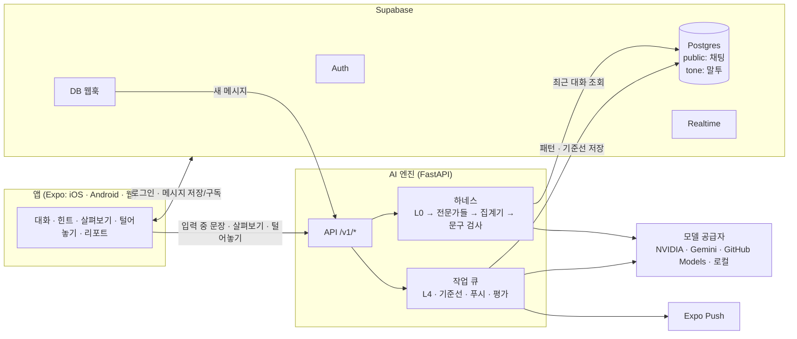
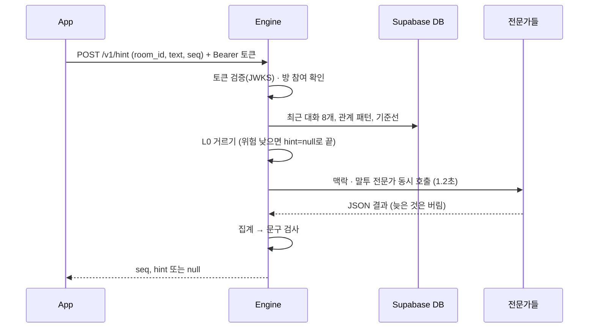

# ARCHITECTURE

1:1 채팅 앱 안에서, 내가 보내려는 문장이 상대에게 차갑거나 성의 없게 읽힐 수 있을 때 나에게만 조용히 알려 준다. 판단에는 상대가 AI에게만 남긴 피드백이 쓰이지만, 누가 남겼는지는 드러나지 않는다.

범위는 수업 프로젝트다. 2~3명이 1~2달 동안 만들고, 20~30명(10~15쌍)이 1주 파일럿을 한다. 출시 기준은 잡지 않는다.

---

## 1. 구성 요소



| 구성 요소 | 맡는 일 | 맡지 않는 일 |
|---|---|---|
| 앱 (`apps/mobile`) | 화면 8개(로그인, 대화 목록, 1:1 대화, 힌트 영역, 살펴보기 시트, 털어놓기 시트, 리포트, 설정). 메시지는 Supabase에 직접 쓰고 Realtime으로 받는다. 입력이 0.5초 멈추면 엔진에 힌트를 요청한다 | 말투 판단, 모델·서비스 키 보관 |
| Supabase | 로그인, Postgres, RLS 권한, 메시지 실시간 전달, 새 메시지를 엔진에 알리는 DB 웹훅 | 모델 호출 |
| AI 엔진 (`engine`) | `/v1/hint`, `/v1/detail`, `/v1/feedback`, `/v1/stats/me`, `/hooks/message`. 하네스, 전문가 레지스트리, 집계기, 작업 큐, trace 기록 | 메시지 저장·전달, 로그인 |
| 모델 공급자 | OpenAI 호환 `/chat/completions` | 상태 저장 |

**경계 규칙**
- 채팅은 엔진 없이 돈다. 엔진이 죽어도 메시지는 오간다.
- 엔진은 앱이 보낸 맥락을 믿지 않는다. 최근 대화는 엔진이 DB에서 직접 읽는다.
- `tone` 스키마는 API에 공개하지 않는다. 엔진만 서비스 키로 접근한다.

---

## 2. 저장소 구조 (목표)

```text
tone-chat/
  ARCHITECTURE.md
  CLAUDE.md
  docs/tasks.md
  apps/mobile/            Expo (expo-router, TypeScript strict)
    app/                  화면
    lib/supabase.ts
    lib/engine.ts         엔진 호출 (OpenAPI에서 생성한 타입 사용)
    lib/types/            생성된 타입 (손으로 고치지 않음)
  engine/                 Python 3.11+, FastAPI
    app/                  main.py, routes/, auth.py, contracts.py, db.py, settings.py
    harness/              router.py, providers.py, schemas.py, korean.py, pii.py, prompts.py
    experts/              base.py(인터페이스), registry.py, llm.py, classifier.py
    layers/               gate.py, aggregate.py, guard.py, rewrite.py
    pipeline.py           realtime / detail / feedback 경로
    jobs/                 queue.py, feedback.py, baseline.py, push.py, eval.py
    config/models.yaml    공급자 · 전문가 · 경로 · 집계 설정
    prompts/*.md
    tests/
  supabase/
    migrations/           표 · RLS · 함수 · 웹훅
    seed.sql
  eval/
    contrast_set.jsonl
    run_eval.py
  prototype/tone-harness/ 참고용 기존 프로토타입 (수정하지 않음)
```

---

## 3. 주요 흐름

### 3-1. 메시지 보내기
1. 앱이 `public.messages`에 insert한다. RLS가 방 참여자인지, `sender_id = auth.uid()`인지 확인한다.
2. Realtime(`postgres_changes`, `room_id` 필터)이 상대 앱에 전달한다. 구독자마다 RLS가 다시 확인된다.
3. DB 웹훅이 `POST /hooks/message`를 부른다. 엔진은 작업 큐에 기준선 갱신과 상대에게 보낼 Expo 푸시를 넣는다.

### 3-2. 입력 중 힌트 (실시간 경로)



- 앱은 0.5초 디바운스로 보내고, 새 입력이 오면 `AbortController`로 이전 요청을 취소한다. 응답은 최신 `seq`만 표시한다.
- 전체 1.5초(디바운스 제외)를 넘기면 엔진은 `hint=null`을 돌려준다.
- 힌트가 떠 있어도 보내기는 막지 않는다.

| 구간 | 목표 |
|---|---|
| 앱 → 엔진 | 약 100ms |
| 토큰 검증(JWKS 캐시) | 5ms 이하 |
| DB 조회 | 약 50ms |
| L0 | 10ms 이하 |
| 전문가 (동시) | 1,200ms 이하 |
| 집계 + 문구 검사 | 10ms 이하 |
| 엔진 → 앱 | 약 100ms |

### 3-3. 살펴보기 (상세 경로, 8초)
1. `POST /v1/detail`.
2. 큰 맥락 전문가 + 말투 전문가 여러 개 → 집계. 의견 차이가 크면 심판 전문가.
3. 위험하면 고쳐 쓰기 후보 2개 → 세 가지 확인(의도 유지, 존댓말·반말 유지, 실제로 덜 부정적) → 통과한 것만 보낸다.
4. 점수 계산 근거(`reason`, 가중치)는 응답에 넣지 않는다.

### 3-4. 털어놓기 (비동기)
1. 받은 메시지의 "⋯" → `POST /v1/feedback (room_id, message_id, text)`.
2. 엔진은 그 메시지가 요청자가 **받은** 메시지인지 확인하고, 큐에 넣은 뒤 202와 안내 문구를 바로 돌려준다.
3. 큐: 메시지 내용 + 하소연 → L4 피드백 전문가 → 패턴 태그 → `tone.pair_patterns`, `tone.global_patterns` 갱신, `tone.feedback_log` 기록.
4. 하소연 원문은 메모리에서만 쓰고 버린다. 무엇이 추출됐는지는 털어놓은 사람에게도 보여 주지 않는다.

---

## 4. API 계약 (앱 ↔ 엔진)

모든 `/v1/*`는 `Authorization: Bearer <Supabase access token>`. 엔진은 `https://<project>.supabase.co/auth/v1/.well-known/jwks.json`으로 검증한다(공개키 캐시는 10분 이하).

| 메서드 | 경로 | 요청 | 응답 |
|---|---|---|---|
| POST | `/v1/hint` | `{room_id, text(1~500자), seq}` | `{seq, hint: {title, detail} \| null, trace_id}` |
| POST | `/v1/detail` | `{room_id, text, intent?}` | `{alert, top_reading, readings: {읽힘: "자주"\|"가끔"\|"드물어요"}, why: [str], options: [{label, text, keep, change}], footnote, trace_id}` |
| POST | `/v1/feedback` | `{room_id, message_id, text(1~1000자)}` | 202 `{ack}` |
| GET | `/v1/stats/me` | 없음 | `{hints, details, fixed, fix_rate}` |
| POST | `/hooks/message` | Supabase 웹훅 페이로드 `{type, table, schema, record, old_record}` + `X-Hook-Secret` 헤더 | 202 |
| GET | `/health` | 없음 | `{ok, models: {id: "up"\|"down"}}` |

- 오류: 401(토큰), 403(방 참여자 아님 / 받은 메시지 아님), 422(형식), 429(사용자별 요청 한도).
- 읽힘 키는 `차갑게, 성의없게, 화나게, 무난하게, 따뜻하게` 다섯 개로 고정.
- 요청·응답 모델은 `engine/app/contracts.py`의 pydantic이 원본이다. 앱 타입은 OpenAPI에서 `openapi-typescript`로, DB 타입은 `supabase gen types typescript`로 생성한다.

---

## 5. 데이터 모델

| 표 | 칸 | 읽기 | 쓰기 |
|---|---|---|---|
| `public.profiles` | id(=auth.users.id), name, tone_hint_on, created_at | 본인, 대화 상대 | 본인 |
| `public.invites` | code, inviter_id, used_by, expires_at | 초대한 사람 | `accept_invite(code)` 함수만 |
| `public.rooms` | id, user_a, user_b, relation, created_at | 두 참여자 | `accept_invite` 함수만 |
| `public.messages` | id, room_id, sender_id, text, created_at | 두 참여자 | 참여자, `sender_id = auth.uid()`만. 수정·삭제 없음 |
| `public.push_tokens` | user_id, token, platform | 본인 | 본인 |
| `public.tone_events` | id, room_id, user_id, kind, risk, top_reading, signals(jsonb), choice, created_at | 본인 | 본인 행 insert만 |
| `tone.feedback_log` | id, room_id, reporter_id, message_id, usable, pattern_count, created_at | 엔진 | 엔진 |
| `tone.pair_patterns` | room_id, trigger, count, strength, feeling, updated_at | 엔진 | 엔진 |
| `tone.global_patterns` | trigger, count | 엔진 | 엔진 |
| `tone.baselines` | user_id, avg_len, polite_rate, softener_rate, n | 엔진 | 엔진 |
| `tone.analysis_traces` | trace_id, path, user_id, room_id, experts(jsonb), risk, alert, latency_ms, created_at | 엔진 | 엔진 |

- `tone_events.kind`: `hint_shown`, `detail_opened`(엔진이 기록), `option_chosen`(choice: A/B/original), `sent_with_hint`, `sent_after_fix`.
- 하소연 원문 칸은 어디에도 없다. `analysis_traces`에도 문장 원문은 넣지 않는다(겉 신호와 전문가 출력만).
- 관계 ID는 `room_id`를 그대로 쓴다(1:1 방 = 관계 하나).

---

## 6. AI 엔진 설계

### 6-1. 레이어

| 단계 | 하는 일 | 구현 |
|---|---|---|
| L0 거르기 | 겉 신호(이유 없는 거절, 마침표, 짧은 답 등)와 상대 말의 무게, 기준선 이탈, 관계 패턴 일치로 사전점수 | 규칙 (`layers/gate.py`) |
| L1 맥락 전문가 | 상대 직전 말의 의도, 상태, 기대할 답의 요소 | LLM |
| L2 말투 전문가 | 다섯 가지 읽힘의 분포 + 근거 표현 | LLM 여러 개 + 분류기 |
| L3 집계기 | 계산식 앙상블, 의견 차이, 기권 | 코드 (`layers/aggregate.py`) |
| 심판 | 상세 경로에서 의견이 갈릴 때만 | LLM |
| 고쳐 쓰기 | 최소 수정 후보 2개 + 세 가지 확인 | LLM + 코드 |
| 문구 검사 | 템플릿 + 금지어 | 코드 (`layers/guard.py`) |
| L4 피드백 전문가 | 받은 메시지 + 하소연 → 패턴 태그 | LLM (비동기) |

### 6-2. 전문가 인터페이스

모델은 모두 같은 규격의 전문가로 꽂는다. 새 모델 추가 = `models.yaml`에 항목 추가.

```python
class ExpertRequest(BaseModel):
    path: Literal["realtime", "detail"]
    draft: str                 # 개인정보 가린 상태
    turns: list[Turn]          # 최근 8개, 개인정보 가린 상태
    relation: str
    signals: list[str]         # L0 결과

class ExpertResult(BaseModel):
    expert_id: str
    role: Literal["context", "tone", "judge", "rewrite", "feedback"]
    output: ContextReading | ToneReading | JudgeOut | RewriteSet | FeedbackResult
    confidence: float
    latency_ms: int
    model: str                 # 실제로 응답한 provider:model

class Expert(Protocol):
    id: str
    role: str
    paths: set[str]
    weight: float
    async def run(self, req: ExpertRequest, deadline: float) -> ExpertResult: ...
```

- `LLMExpert`: 프롬프트 + 라우터(폴백 목록) + 출력 스키마 검사.
- `ClassifierExpert`: KcELECTRA 같은 분류기. 같은 `ToneReading`을 돌려준다.
- 레지스트리는 경로별로 쓸 전문가 목록을 만든다.

```yaml
# engine/config/models.yaml (형식)
providers:
  nvidia: {base_url: https://integrate.api.nvidia.com/v1, api_key_env: NVIDIA_API_KEY, rpm: 40}
  gemini: {base_url: https://generativelanguage.googleapis.com/v1beta/openai, api_key_env: GEMINI_API_KEY, rpm: 15}
  github: {base_url: https://models.github.ai/inference, api_key_env: GITHUB_TOKEN, rpm: 10}
  local:  {base_url: http://localhost:8080/v1, api_key_env: LOCAL_API_KEY, rpm: 600}
  mock:   {}
experts:
  - {id: ctx_fast,   role: context, model: nvidia:deepseek-ai/deepseek-v4.1-flash, prompt: context, paths: [realtime]}
  - {id: ctx_deep,   role: context, model: nvidia:moonshotai/kimi-k3,              prompt: context, paths: [detail]}
  - {id: tone_ds,    role: tone,    model: nvidia:deepseek-ai/deepseek-v4.1-flash, prompt: tone,    paths: [realtime, detail], weight: 1.0}
  - {id: tone_hcx,   role: tone,    model: local:HyperCLOVAX-SEED-Text-Instruct-1.5B, prompt: tone, paths: [realtime, detail], weight: 1.0, optional: true}
  - {id: tone_gem,   role: tone,    model: gemini:gemini-flash-latest,             prompt: tone,    paths: [detail], weight: 1.0}
  - {id: tone_kce,   role: tone,    model: classifier:kcelectra-tone,              paths: [realtime], weight: 0.5, optional: true}
  - {id: judge,      role: judge,   model: nvidia:moonshotai/kimi-k3,              prompt: judge,   paths: [detail]}
  - {id: rewrite,    role: rewrite, model: nvidia:deepseek-ai/deepseek-v4.1-flash, prompt: rewrite, paths: [detail]}
  - {id: feedback,   role: feedback,model: nvidia:moonshotai/kimi-k3,              prompt: feedback,paths: [async]}
fallback:            # 전문가 모델이 실패하면 순서대로
  nvidia:deepseek-ai/deepseek-v4.1-flash: [github:openai/gpt-4.1-mini, mock:auto]
paths:
  realtime: {deadline_ms: 1500, expert_deadline_ms: 1200, gate_threshold: 0.3}
  detail:   {deadline_ms: 8000}
  async:    {deadline_ms: 60000}
aggregate:
  weights: {bias: -2.2, prior: 1.6, neg: 2.4, violation: 1.4, pattern: 0.9}
  alert_threshold: 0.6
  max_disagreement: 0.35
  min_confidence: 0.4
  global_min_obs: 5
```

모델 ID는 2026-10 기준 build.nvidia.com 무료 엔드포인트다. 목록이 자주 바뀌므로 설정에서만 바꾼다.

### 6-3. 집계기

```
risk = sigmoid( w0 + w1·prior + w2·Σk(αk·negk)/Σk(αk) + w3·violation + w4·pattern )
```

- `negk`: k번째 말투 전문가의 부정 읽힘(차갑게 + 성의없게 + 화나게) 확률. `αk = weight × confidence`.
- `violation`: 맥락 전문가의 기대 요소 중 문장에 없는 비율.
- `pattern`: 관계 패턴 일치 점수. `global_patterns[trigger] ≥ global_min_obs`일 때만 반영.
- 의견 차이 = 말투 전문가 `neg`의 최대 − 최소. `max_disagreement`를 넘으면 실시간은 기권, 상세는 심판.
- 시간 안에 못 온 전문가는 빼고 계산한다. 말투 전문가가 하나도 없으면 기권.
- 가중치(w, α)는 평가 세트가 30쌍 이상 모이면 trace에서 학습한다(로지스틱 회귀). 기준값은 정밀도 0.8 이상이 되는 값.

### 6-4. 라우터

- 역할별 전문가는 동시에 부른다(`asyncio.gather` + 전문가별 deadline).
- 공급자·모델별 토큰 버킷. 한도에 걸리면 기다리지 않고 폴백.
- 같은 모델 3회 연속 실패 → 60초 건너뜀.
- 같은 (전문가, 입력) 결과는 캐시.
- 출력은 `<think>…</think>` 제거 → 첫 JSON 객체 추출 → pydantic 검사. 실패하면 폴백.
- 선택 기능: 실시간 경로에서 같은 역할의 빠른 모델 두 개에 동시에 보내고 먼저 온 유효한 답을 쓴다(지연 편차 감소, 호출 2배).
- 외부로 보내기 전 `pii.mask`(전화번호, 이메일, 주민번호·계좌 모양 숫자).

### 6-5. 문구 규칙
- 제목 템플릿: "차갑게 / 성의 없게 / 화난 것처럼 느껴질 수도 있어요".
- 이유 문구는 신호별 고정 문장에서 고른다.
- 금지어: 확실히, 분명히, 반드시, 상대가 말하길, 피드백을 남겼, 싫어했어요 등. 걸리면 내보내지 않는다.
- 상세 각주: "비슷한 대화에서 모인 반응을 바탕으로 한 조언이라 틀릴 수도 있어요. 누가 어떤 반응을 남겼는지는 알 수 없어요."

---

## 7. 품질 조건

| 항목 | 기준 |
|---|---|
| 실시간 힌트 | 디바운스 후 1.5초 이내, 넘으면 표시 안 함 |
| 알림 정밀도 | 대조 세트 기준 0.8 이상 (재현율보다 우선) |
| 장애 시 | 엔진·모델 장애가 채팅을 막지 않음. 힌트만 사라짐 |
| 개인정보 | 하소연 원문 미저장, 외부 전송 전 마스킹, 실제 대화는 Gemini 무료 등급 금지 |
| 무료 한도 | 파일럿 30명 기준 NVIDIA 모델당 분당 40회 안에서 운영 (L0 통과율 10% 가정) |
| Supabase 무료 플랜 | DB 500MB, Realtime 동시 연결 200, 1주 비활성 시 일시정지 |

---

## 8. 환경 변수

| 위치 | 변수 |
|---|---|
| 앱 | `EXPO_PUBLIC_SUPABASE_URL`, `EXPO_PUBLIC_SUPABASE_ANON_KEY`, `EXPO_PUBLIC_ENGINE_URL` |
| 엔진 | `SUPABASE_URL`, `SUPABASE_SERVICE_ROLE_KEY`, `SUPABASE_DB_URL`, `HOOK_SECRET`, `NVIDIA_API_KEY`, `GEMINI_API_KEY`, `GITHUB_TOKEN`, `LOCAL_API_KEY`, `EXPO_ACCESS_TOKEN`(선택), `FORCE_MOCK` |

---

## 9. 기존 프로토타입 재사용 (`prototype/tone-harness`)

| 프로토타입 | 옮길 곳 | 바꿀 점 |
|---|---|---|
| `harness/router.py`, `providers.py`, `schemas.py`, `korean.py`, `pii.py`, `prompts.py`, `mock_rules.py` | `engine/harness/` | 역할 이름 대신 전문가 ID로 호출 |
| `layers/gate.py` | `engine/layers/gate.py` | 그대로 |
| `layers/judge.py` | `engine/layers/aggregate.py` | 전문가 N개, α 가중치 |
| `layers/hint.py` | `engine/layers/guard.py` | 그대로 |
| `layers/rewrite.py`, `context.py`, `tone.py`, `feedback.py` | `engine/experts/` + `pipeline.py` | 전문가 인터페이스로 감싸기 |
| `harness/store.py` | `engine/app/db.py` | JSON 파일 → `tone` 스키마 표 |
| `prompts/*.md`, `eval/` | `engine/prompts/`, `eval/` | 그대로 |
| `server/` (FastAPI 채팅), `server/static/index.html` | 쓰지 않음 | 채팅은 Supabase, 화면은 Expo |

---

## 10. 결정과 대안

| 결정 | 이유 | 버린 대안 |
|---|---|---|
| Expo 하나로 앱·웹 | 2~3명이 코드 하나로 세 플랫폼 | 웹 따로(Next.js) + 앱 따로 |
| 채팅은 Supabase | 로그인·실시간·권한을 직접 안 만듦 | FastAPI WebSocket 채팅 서버 직접 구현 |
| AI 엔진은 별도 FastAPI | 모델·프롬프트를 채팅과 따로 바꾸고 배포, Python 생태계 | Supabase Edge Functions(TypeScript)에서 모델 호출 |
| 힌트는 HTTP 요청 | 디바운스 + 취소로 충분, 서버가 연결 상태를 안 가짐 | 엔진 WebSocket |
| 전문가 플러그인 + 계산식 집계 | 모델 추가가 설정 한 줄, 결과 설명·학습 가능 | 모델 투표, 단일 대형 모델 |
| 작업 큐는 엔진 안 asyncio | 서버 하나 | Redis + arq (재시작 시 작업 유실이 문제 되면 전환) |
| Realtime은 postgres_changes | 설정 간단, 파일럿 규모에 충분 | Broadcast (구독자 수천 명 이상일 때) |
