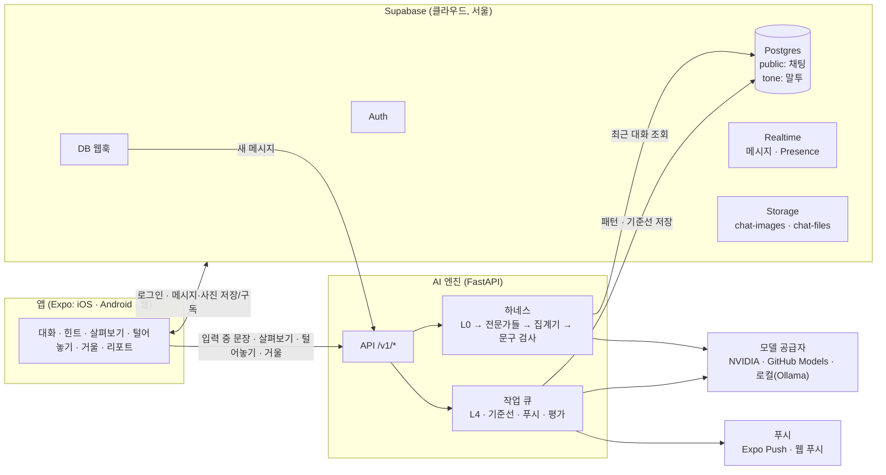
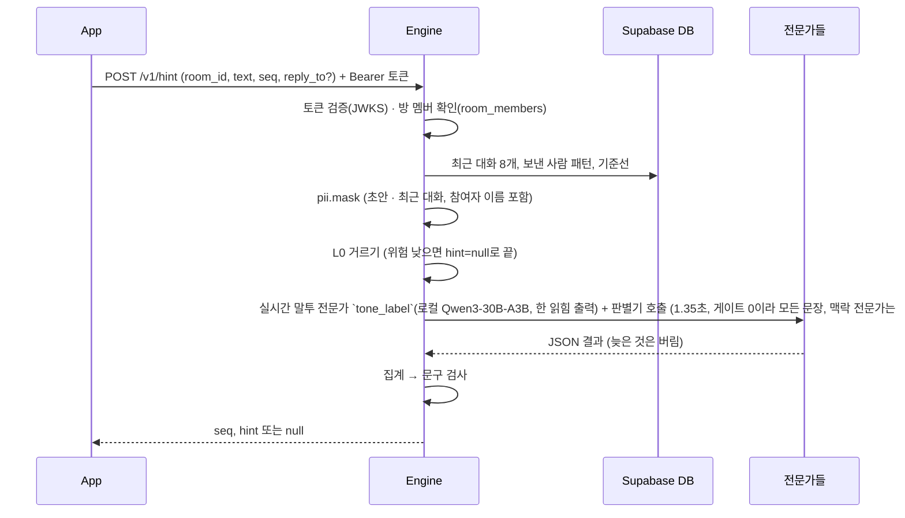

# ARCHITECTURE

> 지금 돌고 있는 구성의 그림(9장)은 [`docs/architecture-diagrams.md`](docs/architecture-diagrams.md). 이 문서는 설계와 결정의 원본이다.

1:1·그룹 채팅 앱 안에서, 내가 보내려는 문장이 상대에게 차갑거나 성의 없게 읽힐 수 있을 때 나에게만 조용히 알려 준다. 판단에는 상대가 AI에게만 남긴 피드백이 쓰이지만, 누가 남겼는지는 시스템이 알려 주지 않는다. 하루 2분 거울 세션으로 내 문장이 어떻게 읽히는지 스스로 맞혀 보게 한다.

범위는 수업 프로젝트다. 2~3명이 1~2달 동안 만들고, 20~30명(10~15쌍 + 팀 그룹방)이 1주 파일럿을 한다. 출시 기준은 잡지 않는다.

---

## 1. 구성 요소



| 구성 요소 | 맡는 일 | 맡지 않는 일 |
|---|---|---|
| 앱 (`apps/mobile`) | 화면 11개(시작·동의, 로그인, 대화 목록, 대화방, 살펴보기 시트, 털어놓기 시트, 방 만들기·초대, 방 정보, 거울, 리포트, 설정). 하단 탭은 대화 · 거울 · 리포트 · 설정. 메시지·공감·읽음·사진은 Supabase에 직접 쓰고 Realtime으로 받는다. 입력 중 표시는 Presence로만 한다. 입력이 0.5초 멈추면 엔진에 힌트를 요청한다 | 말투 판단, 모델·서비스 키 보관 |
| Supabase | 로그인, Postgres, RLS 권한, 메시지 실시간 전달, 입력 중 표시(Presence), 사진·파일 저장(Storage), 새 메시지를 엔진에 알리는 DB 웹훅 | 모델 호출 |
| AI 엔진 (`engine`) | `/v1/hint`, `/v1/detail`, `/v1/feedback`, `/v1/mirror/*`, `/v1/stats/me`, `/hooks/message`. 하네스, 전문가 레지스트리, 집계기, 작업 큐, 푸시(Expo · 웹), trace 기록 | 메시지 저장·전달, 로그인 |
| 모델 공급자 | OpenAI 호환 `/chat/completions` | 상태 저장 |

**배포 형태**: 앱은 Expo 개발 빌드/EAS 빌드로 만든 네이티브 앱으로 배포한다(Expo Go 아님). 파일럿 기본 경로는 Android = EAS preview APK + FCM(Expo Push 경유), 웹 = 웹 푸시이고, 아이폰 참가자는 웹 빌드를 홈 화면에 추가해 웹 푸시로 받는다. iOS 네이티브(APNs·TestFlight)는 Apple 개발자 계정이 생길 때만 하는 선택 사항이다. 앱이 열려 있을 때는 Supabase Realtime으로, 닫혀 있을 때는 푸시(Android FCM, 웹은 웹 푸시, iOS 네이티브를 하면 APNs)로 새 메시지를 알리고, 다시 열리면 재연결해 놓친 메시지를 불러온다. 빌드 설정은 `apps/mobile/eas.json`(development · preview · production), 푸시 자격 증명(FCM `google-services.json`, iOS 네이티브를 할 때만 APNs 키)은 T-28에서 넣는다.

**경계 규칙**
- 채팅은 엔진 없이 돈다. 엔진이 죽어도 메시지는 오간다.
- 엔진은 앱이 보낸 맥락을 믿지 않는다. 최근 대화는 엔진이 DB에서 직접 읽는다.
- `tone` 스키마는 API에 공개하지 않는다. 엔진만 서비스 키로 접근한다.
- 사진·파일은 모델에 보내지 않는다(파일 이름도). 판정은 텍스트만 한다.
- Gemini는 대조 세트·상황 카드 같은 합성 문장 평가에만 쓴다. 실제 대화 문장이 지나가는 경로(실시간·상세·털어놓기·거울)와 폴백 목록에는 넣지 않는다.

---

## 2. 저장소 구조 (목표)

```text
tone-chat/
  ARCHITECTURE.md
  CLAUDE.md
  README.md
  .env.example            엔진·협업 변수 이름만 (값은 .env, git 밖). 앱 변수는 apps/mobile/.env.example
  docs/
    tasks.md
    COLLAB.md             두 계정 협업 (claim · land)
    superpowers/          설계 보완(specs), 단계별 계획(plans)
  scripts/                claim, land, check
  apps/mobile/            Expo (expo-router, TypeScript strict)
    app/                  화면
    lib/supabase.ts
    lib/engine.ts         엔진 호출 (OpenAPI에서 생성한 타입 사용)
    lib/tokens.json       디자인 토큰 (D-01)
    lib/types/            생성된 타입 (손으로 고치지 않음)
  engine/                 Python 3.11+, FastAPI
    app/                  main.py, routes/, auth.py, contracts.py, db.py, settings.py
    harness/              router.py, providers.py, schemas.py, korean.py, pii.py, prompts.py
    experts/              base.py(인터페이스), registry.py, llm.py, classifier.py
    layers/               gate.py, aggregate.py, guard.py, rewrite.py
    pipeline.py           realtime / detail / feedback / mirror 경로
    jobs/                 queue.py, feedback.py, baseline.py, push.py, eval.py
    config/models.yaml    공급자 · 전문가 · 경로 · 집계 설정
    content/mirror_cards.yaml  거울 상황 카드
    prompts/*.md
    tests/
  supabase/
    migrations/           표 · RLS · 함수 (이름에 _platform이 붙은 파일은 실제 Supabase에서만). DB 웹훅은 여기 없고 대시보드 Database → Webhooks에서 만든다(docs/OPERATIONS.md)
    tests/                PGlite로 RLS 테스트 (Docker 없이)
    seed.sql
  eval/
    contrast_set.jsonl
    run_eval.py
    baseline.json         land 평가 게이트 기준
  design-system/tone-chat/MASTER.md  디자인 규칙
  design/                 HTML 목업, 대비 검사
  prototype/tone-harness/ 참고용 기존 프로토타입 (수정하지 않음)
  .coord/                 작업 잡기 · 잠금 · 기록 (git 밖, 같은 맥에서 공유)
```

저장소는 `~/Projects/tone-chat`에 둔다. Desktop은 iCloud 동기화 중이라 node_modules·.venv를 두면 동기화가 엉킨다. 작업용 worktree는 `~/Projects/tone-chat-wt/<브랜치>`에 생긴다(`docs/COLLAB.md`).

---

## 3. 주요 흐름

### P-34 전송 시점 확인 (2026-11-03 사용자 승인, 아래 입력 중 힌트 설명보다 우선)

- 타이핑 중에는 모델을 호출하지 않는다. 보내기를 누른 문장·답장 대상·멘션을 고정하고 기존 `/v1/hint`를 한 번 요청한다.
- 앱에서 토큰 갱신·네트워크 왕복까지 포함해 최대 1,500ms만 기다린다. 그 전에 경고 없음 응답이면 즉시 전송, 경고면 즉시 기존 스타일의 시트로 수정하기/그대로 보내기를 묻는다. 경고는 안전 판정의 반대가 아니라 주의 안내다.
- 오류·기권·시간 초과는 전송한다. API의 `hint=null`은 경고 없음과 분석 실패를 구분하지 않으며 이번 동작에서는 둘 다 전송한다. API·모델·DB 변경은 없다.
- 경고창은 자동 전송하지 않는다. 수정하기·닫기·배경·뒤로는 원문을 보존하고 전송을 취소한다. 그대로 보내기는 재분석 없이 한 번만 전송한다. 기존 살펴보기는 경고창에서 열 수 있다.
- 대기 중에는 초안을 입력창에 보존하고 편집을 잠시 잠근다. `전송 확인 중…`만 추가한다. DB insert·Realtime·푸시는 실제 전송 이후에만 시작한다.
- 분석 중 연타를 무시하며, 방 이탈·백그라운드 전환·언마운트는 대기를 취소한다. 기한 뒤 늦은 결과는 버린다. 실제 DB 전송이 시작된 뒤에는 기존처럼 다음 문장을 입력할 수 있다.
- 힌트 설정이 꺼졌거나 텍스트가 500자를 넘으면 분석 없이 전송한다(기존 힌트 API 한도). 사진·파일은 기존대로 전송한다.
- 지표 `hint_shown`은 확인창 표시, `sent_with_hint`는 경고 후 원문 전송 성공, `sent_after_fix`는 경고 후 수정 전송 성공을 뜻한다. 과거 입력 중 힌트 지표와 직접 비교하지 않는다.
- 동의 문구에 전송 시점 확인과 최대 대기를 반영해 `CONSENT_VERSION=2`로 올렸다. 기존 참가자는 업데이트 후 다시 동의한다. 실기기 확인과 전체 검사 후 별도 배포한다.

### 3-1. 메시지 보내기
1. 앱이 `public.messages`에 insert한다. RLS가 방 멤버인지(`is_member(room_id)`), `sender_id = auth.uid()`인지 확인한다. 답장이면 `reply_to`가 같은 방 메시지여야 한다. 사진은 먼저 Storage `chat-images/<room_id>/…`에 올리고 `image_path`를 넣는다. 파일(≤20MB)은 Storage `chat-files/<room_id>/…`에 올리고 `file_path`·`file_name`·`file_size`를 함께 넣는다(사진과 한 메시지에 같이 못 담는다). 파일은 서명 주소에 `download`를 붙여 첨부 파일로만 내려받는다(앱 출처에서 열리지 않게).
2. Realtime(`postgres_changes`, `room_id` 필터)이 다른 멤버 앱에 전달한다. 구독자마다 RLS가 다시 확인된다. 공감(`reactions`)과 읽음(`room_members.last_read_at`)도 같은 방식으로 받는다.
3. DB 웹훅이 `POST /hooks/message`를 부른다. 엔진은 작업 큐에 기준선 갱신과 푸시를 넣는다. 푸시는 방 멤버 전원(보낸 사람·알림 끈 사람 제외)에게, `push_tokens.platform`에 따라 Expo Push(안드로이드) 또는 웹 푸시(`pywebpush`, VAPID)로 보낸다.
4. 입력 중 표시는 Realtime Presence(방 채널)로만 하고 DB에 남기지 않는다.

### 3-2. 입력 중 힌트 (실시간 경로)



- 앱은 0.5초 디바운스로 보내고, 새 입력이 오면 `AbortController`로 이전 요청을 취소한다. 응답은 최신 `seq`만 표시한다.
- 전체 1.5초(디바운스 제외)를 넘기면 엔진은 `hint=null`을 돌려준다. 예외: 학교 GPU가 꺼져 Mac에서 NVIDIA로 임시 운영할 때는 3초(`scripts/mac-engine`이 설정 복사본의 `paths.realtime`만 바꾼다, 2026-11-15 사용자 결정). 앱은 가장 긴 마감 + 왕복인 3.2초(`SEND_REVIEW_MS`)까지 기다린다.
- 힌트가 떠 있어도 보내기는 막지 않는다.
- 맥락 = 최근 8개 + 화자 표시 + 답장 대상 맨 앞. 최근 대화 8개에는 화자 표시(나 / 1:1은 상대 / 그룹방은 처음 나온 순서로 상대1, 상대2…)를 붙인다. 입력 중인 문장이 답장이면(`reply_to`, 4장) 원문 메시지를 `답장 대상 · 상대N` 표시로 맥락 맨 앞에 넣는다. 사진만 있는 메시지는 `(사진)`, 파일만 있는 메시지는 `(파일)`이다(`engine/app/context.py`).
- 그룹방 판정 기준은 "이 방 사람들이 읽을 때"다. 관계는 방 단위 하나다.

| 구간 | 목표 |
|---|---|
| 앱 → 엔진 | 약 100ms |
| 토큰 검증(JWKS 캐시) | 5ms 이하 |
| DB 조회 | 약 50ms |
| L0 | 10ms 이하 |
| 전문가 (동시) | 1,350ms 이하 (전체 1,500ms는 그대로) |
| 집계 + 문구 검사 | 10ms 이하 |
| 엔진 → 앱 | 약 100ms |

### 3-3. 살펴보기 (상세 경로, 8초)
1. `POST /v1/detail`.
2. 큰 맥락 전문가 + 말투 전문가 여러 개 → 집계. 의견 차이가 크면 심판 전문가. 이 판정 단계에는 의도(`intent`)를 넣지 않는다.
   - 심판은 의견이 갈린 기권(반올림 전 disagreement > `max_disagreement`)만 푼다. 자신 없는 기권(confidence < `min_confidence`)은 심판을 부르지 않고 기권으로 둔다. 심판이 실패해도 기권 그대로다.
3. 알림(`alert`)이거나 어긋남(아래 표, 의도 칩 원래 값으로 본다)이 있으면 고쳐 쓰기 후보(앞의 2개만 본다. 의도는 여기에만, 가린 값으로 넣는다) → 세 가지 확인(의도 유지: 괄호 빈칸을 빼고 거절은 거절로, 존댓말·반말 유지, 원문을 읽은 첫 말투 전문가로 다시 읽어 부정 확률이 0.1 이상 낮음) → 통과한 것만 보낸다. 라벨은 원래 순번대로 "조금만 바꾼 문장" / "가장 부드럽게 바꾼 문장"이다.
   - 후보의 자리표시는 응답 직전에 `Masker.restore`로 되돌린다. 되돌리지 못한 자리표시 모양(모델이 지어낸 `[이름7]`, 번호 없는 `[이름]`, 기호가 붙은 `[이름_7]` 등. 사용자가 원문에 직접 쓴 대괄호 말은 제외)이 남았거나 `keep`·`change`가 문구 검사에 걸리면 그 후보를 버린다.
4. 점수 계산 근거(`reason`, 가중치)는 응답에 넣지 않는다.
5. 시간 안에 못 끝나거나(`paths.detail.deadline_ms`) 말투 전문가가 하나도 답하지 못하면 503 `engine_unavailable`이다.
6. `detail_opened`(`public.tone_events`)는 시트를 처음 열 때(`intent` 없는 호출)만 작업 큐로 남긴다. risk는 넣지 않고 `top_reading`과 `signals: {signals: [L0 신호 태그], trace_id}`만 둔다. 칩을 바꾼 재호출은 기록하지 않는다.

**의도 칩과 바뀐 곳 강조**
- 시트 맨 위에 "단호하게 / 미안하게 / 가볍게" 칩이 있다. 고르지 않아도 된다.
- 시트가 열린 뒤 칩을 누르면 `/v1/detail`을 `intent`만 바꿔 다시 부른다. 판정 전문가 입력에는 의도가 없으므로 라우터 캐시(같은 전문가, 같은 입력)에 걸리고 고쳐 쓰기만 새로 돈다. 별도 API는 없다.
- 어긋남 표시는 가장 많이 읽힌 뜻(다섯 읽힘 중 최대)이 아래 표에 해당할 때만 한 줄 띄운다. 단호한 거절이 "차갑게" 읽히는 것은 어긋남으로 보지 않는다(단호함을 지키는 것도 사용자의 선택이다).
- 그 한 줄은 엔진이 만들어 응답의 `mismatch` 칸에 넣는다("단호하게 말하려던 것과 달리 화난 것처럼 읽힐 수도 있어요"처럼, 문구 검사 통과). 앱은 이 값을 그대로 보여 주고, 없으면(`null`) 아무것도 띄우지 않는다.

| 의도 칩 | 어긋남으로 보는 읽힘 |
|---|---|
| 단호하게 | 화나게, 성의없게 |
| 미안하게 | 차갑게, 화나게, 성의없게 |
| 가볍게 | 차갑게, 화나게 |

- 후보 문장은 원문과 달라진 어절만 강조한다. 비교는 앱에서 어절(띄어쓰기) 단위로 한다.

### 3-4. 털어놓기 (비동기)
1. 받은 메시지의 "⋯" → `POST /v1/feedback (room_id, message_id, text)`. 1:1 방과 그룹방 모두에 있다.
2. 엔진은 그 메시지가 요청자가 **이 방에서 받은** 메시지인지 확인하고(아니면 403 `not_received`), 하소연과 대상 메시지를 `Masker` 하나로 함께 가린 뒤(방 멤버 이름 + 개인정보 패턴, 두 문장에서 같은 사람은 같은 자리표시) 털어놓기 전용 큐(워커 1개, 대기 `jobs.feedback.QUEUE_MAXSIZE`=20개, push·기준선 큐와 따로)에 넣고 202와 안내 문구를 바로 돌려준다(큐가 가득 차거나 넣기가 실패해도 같은 202, 로그에는 예외 종류만). 같은 (신고자, 메시지)는 작업 하나(멱등 키 `feedback:<신고자>:<메시지>`), 이미 남긴 신고나 이번 주 상한에 걸린 (보낸 사람, 관계)는 같은 202만 주고 큐에 넣지 않는다(어느 쪽인지 알리지 않음). 작업은 재시도하지 않는다(`max_attempts=1`).
3. 큐: 작업이 메시지·방을 id로 다시 읽고, 이번 주 상한이면 L4를 부르지 않는다(usable false로 기록). 아니면 가린 대상 메시지 + 가린 하소연 → L4 피드백 전문가(`paths.async.deadline_ms`, 작업 자체 제한 시간 있음, 라우터 캐시 안 씀) → 패턴 태그. `FeedbackResult` 검사가 고정 어휘(`TRIGGERS`)의 태그와 부정 읽힘만 먼저 거른 뒤 trigger별 첫 것 3개를 남긴다 → 아래 반영 규칙대로 `tone.sender_patterns`, `tone.global_patterns` 갱신, `tone.feedback_log` 기록.
4. 하소연은 메모리에서만 쓰고 버린다. 큐 인자는 id와 가린 하소연·대상 메시지뿐이고 메모리 큐에만 있다(작업 repr·실패 로그에 인자 없음). 큐를 Redis 같은 저장형으로 바꾸면 요청 안에서 분류하고 분류 결과만 넣는다. 무엇이 추출됐는지는 털어놓은 사람에게도 보여 주지 않는다.

**반영 규칙** (시스템은 누가 털어놓았는지 알려 주지 않는다. 다만 1:1 방에서는 상대가 짐작할 수 있다)
- 패턴의 주인은 털어놓기 대상 메시지를 **보낸 사람**이다. 키는 (보낸 사람, 관계, 신호)다. 그 사람이 같은 관계의 어느 방에서 쓰든 적용하고, 털어놓은 사람의 문장에는 적용하지 않는다.
- 모든 방(1:1·2명·그룹)의 하소연이 `tone.sender_patterns`에 들어간다(규칙 14, 2026-10-31 사용자 결정). `active_from`은 신고 시각이다(남긴 즉시 반영, 2026-10-31 사용자 결정: 힌트 변화와 특정 하소연이 연결되기 쉬워지는 것을 받아들임). 보낸 사람·관계는 `apply_feedback`가 메시지 id로 DB에서 읽는다(호출자 값을 믿지 않는다). 신고마다 자기 `active_from`(신고 시각) 행이 생기고 읽을 때 trigger별로 합쳐서, 재신고가 이미 켜진 패턴을 끄지 않고 count도 이중으로 세어지지 않는다(count는 신고자마다 1). count는 (보낸 사람, 관계, 신호)마다 서로 다른 신고자 수다(`tone.sender_pattern_reporters`): 한 사람이 되풀이해도 1이다. 관계별 주간 상한은 (보낸 사람, 관계)마다 KST ISO 주(월요일 0시부터) 5건이다.
- 하소연은 `tone.global_patterns`(신호별 전체 수)에도 더한다. 1:1 방에서는 보낸 사람 패턴이 곧 상대 한 명의 신고라서, 상대가 누가 털어놓았는지 짐작할 수 있다. 이 위험은 사용자가 받아들였다(익명성보다 효과).
- 반영은 L0 사전점수와 L3 `pattern` 항으로만 하고, `global_patterns[trigger] ≥ global_min_obs`일 때만 한다. 원래 패널이 낼 법한 경고만 강해지고, 없던 경고를 새로 만들지 않는다.

### 3-5. 거울 세션 (하루 2분, 카드 3장)
`POST /v1/mirror/today`로 오늘의 카드 3장을 받고, 카드마다 `POST /v1/mirror/answer`로 답한다.

1. **역할극**: AI 인물(예: 팀원 민지)이 상황 메시지를 먼저 보낸다 → 내가 평소처럼 답한다 → "받았을 때 속마음" 한 줄, 읽힘(자주/가끔/드물어요), If case(그대로 / A / 직접 고치기).
2. **되돌려 받기**: 내가 예전에 보낸 문장을 AI 인물이 보낸 것처럼 보여 준다 → "받으면 얼마나 차갑게 느껴지나요" 1~5점 → 공개("이건 지난주 목요일에 당신이 팀원에게 보낸 문장이에요"). 보낸 문장이 아직 없으면 상황 카드 문장으로 대신한다.
3. **예측 맞히기**: 내 문장과 관계("선배라면?")를 보여 주고 "얼마나 부정적으로 읽을까" 1~5점을 먼저 고르게 한다. 패널의 부정 확률(차갑게 + 성의없게 + 화나게)을 0.2 간격으로 1~5칸에 나눠 비교한다. `gap = |예측 칸 − 패널 칸|`이 자기객관화 점수다. 되돌려 받기 점수도 같은 방식으로 gap을 낸다.

- 문장 출처: 본인이 보낸 메시지(엔진이 서비스 키로 읽음)와 `engine/content/mirror_cards.yaml`(팀플 상황 카드: 일정 조율, 역할 요청, 거절, 마감 독촉. 20장부터 시작).
- 받은·예측 카드의 `context`는 보낸 문장 바로 앞 상대의 말(답장이면 답장 대상, 사진뿐이면 "(사진)", 파일뿐이면 "(파일)", 120자 제한)이고 카드 문장이면 카드의 `message`다. 답할 때 엔진이 다시 읽어 가린 뒤 문장 앞 한 턴으로 판정에 넣고, 로그·trace에는 남기지 않는다(P-19).
- `card_id`는 엔진이 서명한 값이다. 앱이 문장 출처를 위조할 수 없다.
- 실제 대화에서 뽑은 카드도 `pii.mask`를 거치고, Gemini에 보내지 않는다.
- 피드백은 문장에만 한다. 점수는 "예측과 한 칸 차이"처럼 차이로만 보여 준다. 점수 폭죽, 연속 출석 압박은 없다.
- 결과는 `public.mirror_attempts`에 남긴다. 문장 원문은 넣지 않는다.

---

## 4. API 계약 (앱 ↔ 엔진)

모든 `/v1/*`는 `Authorization: Bearer <Supabase access token>`. 엔진은 `https://<project>.supabase.co/auth/v1/.well-known/jwks.json`으로 검증한다(공개키 캐시는 10분 이하).

| 메서드 | 경로 | 요청 | 응답 |
|---|---|---|---|
| POST | `/v1/hint` | `{room_id, text(1~500자, 앞뒤 공백 제외), seq(0 이상), reply_to?(같은 방이 아니면 422)}` | `{seq, hint: {title, detail} \| null, trace_id}` |
| POST | `/v1/detail` | `{room_id, text, intent?, reply_to?(같은 방이 아니면 422)}` | `{alert, top_reading, readings: {읽힘: "자주"\|"가끔"\|"드물어요"}, why: [str], options: [{label, text, keep, change}], mismatch?: str \| null, footnote, trace_id}` |
| POST | `/v1/feedback` | `{room_id, message_id(이 방에서 받은 메시지), text(1~1000자)}` | 202 `{ack}`(큐가 가득 차도 같은 202) |
| POST | `/v1/mirror/today` | 없음 | `{cards: [{card_id, kind: "roleplay"\|"receive"\|"predict", persona, relation, situation, message, context?}]}` |
| POST | `/v1/mirror/answer` | `{card_id, reply?, score?, predicted?}` | `{readings, inner_voice?, reveal?, options?, gap?}` |
| GET | `/v1/stats/me` | 없음 | `{hints, details, fixed, fix_rate, predict_gap_trend, hints_by_week}` |
| POST | `/hooks/message` | Supabase 웹훅 페이로드 `{type, table, schema, record, old_record}` + `X-Hook-Secret` 헤더 | 202 |
| GET | `/health` | 없음 | `{ok, models: {id: "up"\|"down"}, providers: {공급자: "up"\|"down"}, failures: {공급자: {종류: 횟수}}}` (`failures`는 프로세스 시작 뒤 모델 호출이 실패·건너뛴 횟수. 종류는 예외 타입, `unavailable`(키 없음), `breaker_open`, `rate_limited`뿐이고 원문은 없다) |

- 오류: 401(토큰), 403(방 멤버 아님 / 받은 메시지 아님), 413(`too_large`: `/v1/*`·`/hooks/*` 본문이 64 KB 초과. JSON 파싱·인증보다 먼저, Content-Length가 없는 스트림은 읽는 중에 끊는다), 422(형식: 본문은 항상 `{"detail":"invalid_request"}`이고 입력값은 되돌려 주지 않는다), 503(엔진·모델 일시 불가: `engine_unavailable`(예기치 못한 오류도 로그에는 타입만 남기고 이 코드, CORS 헤더 유지), DB 주소가 없어 DB가 필요한 요청만 `db_unavailable`, 그리고 공개키를 받지 못해 토큰을 검증할 수 없는 `auth_unavailable`. 앱이 다시 시도한다); 429(`rate_limited`, `Retry-After` 초: 사용자 1명이 1분에 보낼 수 있는 /v1/* 요청 수를 넘음. 인증 뒤·방 멤버 확인 앞에서 세고, 401은 세지 않는다. 값은 `models.yaml`의 `limits:`(hint 90, 나머지 default 20), 프로세스 안 메모리 슬라이딩 윈도우라 프로세스를 늘리면 Redis로 옮긴다).
- 토큰은 서명·`exp`·`aud`(authenticated)·`iss`와 `role=authenticated`를 모두 통과해야 한다. 익명 로그인(`is_anonymous`)과 `anon`·`service_role` 토큰은 401이다. 알고리즘은 ES256·RS256만 받는다.
- 방 멤버 확인은 `room_members`로 한다. `room_id`를 받는 모든 `/v1/*`는 방을 읽기 전에 `ensure_member`를 거친다(`test_every_room_route_checks_membership_before_reading`이 라우트를 모두 돈다).
- CORS: 허용 origin은 `CORS_ORIGINS`(쉼표로 나눔, 기본 `http://localhost:8081`), 메서드 GET·POST·OPTIONS, 헤더 Authorization·Content-Type. 쿠키를 쓰지 않아 credentials는 켜지 않는다.
- `reply_to`는 답장 대상 메시지 id다. 엔진은 같은 방 메시지인지 확인하고(없거나 다른 방이면 422 `reply_to not in room`), 그 문장은 DB에서 읽는다. 앱이 보낸 문장은 믿지 않는다. 이 메시지를 맥락 맨 앞에 넣는다.
- 읽힘 키는 `차갑게, 성의없게, 화나게, 무난하게, 따뜻하게` 다섯 개로 고정.
- `intent`는 의도 칩 `단호하게, 미안하게, 가볍게` 중 하나다. 고쳐 쓰기에만 들어간다(3-3).
- 요청·응답 모델은 `engine/app/contracts.py`의 pydantic이 원본이다. 앱 타입은 OpenAPI에서 `openapi-typescript`로, DB 타입은 `supabase gen types typescript`로 생성한다. `npm run gen:engine:pull`(`engine/app/openapi_dump.py`)은 엔진 OpenAPI를 그대로 앱 타입의 원본으로 쓴다(seed에서 옮기던 단계는 E9에서 없앴다).

---

## 5. 데이터 모델

| 표 | 칸 | 읽기 | 쓰기 |
|---|---|---|---|
| `public.profiles` | id(=auth.users.id), name, tone_hint_on, created_at | 본인, 같은 방 멤버 | 본인 |
| `public.invites` | code(8자 A–Z0–9), inviter_id, room_id(그룹 초대면 채움), relation, max_uses, uses, expires_at | 초대한 사람 | `create_invite`, `accept_invite` 함수만 |
| `public.rooms` | id, kind(`direct`·`group`), title(그룹만), relation, created_by, created_at | 방 멤버 | `create_group`, `accept_invite` 함수만 |
| `public.room_members` | room_id, user_id, joined_at, last_read_at, muted. PK(room_id, user_id) | 방 멤버 | 추가는 함수만. 본인 행의 last_read_at, muted만 수정 |
| `public.messages` | id(bigint), room_id, sender_id, text(≤2000자), image_path(`<room_id>/<이름>`), file_path(`<room_id>/<이름>`)·file_name(≤200자, 제어 문자 없음)·file_size(1~20MB)는 셋이 함께 있거나 함께 없고 image_path와 둘 중 하나만, reply_to(bigint, 같은 방, 원문이 지워지면 null), mentions(uuid[], ≤8, 방 멤버만), created_at | 방 멤버 | 멤버, `sender_id = auth.uid()`만. 수정·삭제 없음 |
| `public.reactions` | message_id, user_id, emoji(고정 6개 중), created_at. PK(message_id, user_id) | 방 멤버 | 멤버, 본인 행만 |
| `public.push_tokens` | user_id, token, platform(`ios`·`android`·`web`) | 본인 | 본인 |
| `public.tone_events` | id, room_id, user_id, kind, risk, top_reading, signals(jsonb), choice, created_at | 본인 | 본인 행 insert만 |
| `public.mirror_attempts` | id, user_id, kind(`roleplay`·`receive`·`predict`), card_ref, answer_score, predicted, panel_bin, gap, created_at | 본인 | 엔진(서비스 키) |
| Storage `chat-images` | 경로 `<room_id>/…` | 방 멤버 | 방 멤버 |
| Storage `chat-files` | 경로 `<room_id>/…`, 비공개, 파일당 20MB, 앱은 attachment로 내려받음 | 방 멤버 | 방 멤버 |
| `tone.feedback_log` | id, room_id, reporter_id, message_id, usable, pattern_count, created_at | 엔진 | 엔진 |
| `tone.sender_patterns` | sender_id, relation, trigger, count, strength, feeling, active_from, updated_at. PK(sender_id, relation, trigger, active_from). count는 서로 다른 신고자 수. 읽을 때 `active_from <= now`인 행을 trigger별로 묶어 count 합 · strength count 가중 평균 · feeling은 가장 늦게 켜진 행 | 엔진 | 엔진 |
| `tone.sender_pattern_reporters` | sender_id, relation, trigger, reporter_id, created_at. PK(sender_id, relation, trigger, reporter_id). 보낸 사람 패턴에 같은 신고자를 한 번만 세려고 둔다 | 엔진 | 엔진 |
| `tone.global_patterns` | trigger, count(서로 다른 신고자 수) | 엔진 | 엔진 |
| `tone.pattern_reporters` | trigger, reporter_id, created_at. PK(reporter_id, trigger). 같은 신고자를 한 번만 세려고 둔다 | 엔진 | 엔진 |
| `tone.baselines` | user_id, avg_len, polite_rate, softener_rate, n | 엔진 | 엔진 |
| `tone.analysis_traces` | trace_id, path, user_id, room_id, experts(jsonb), risk, alert, latency_ms, created_at | 엔진 | 엔진 |

- RLS는 `is_member(room_id)` security definer 함수 하나로 통일한다. 방·초대는 함수(`create_group`, `create_invite`, `accept_invite`)로만 만든다. `accept_invite(code)`는 1:1 방을 만들거나 그룹에 참여시킨다.
- 그룹방은 최대 8명(1:1은 2명)이다. 상한은 `room_members` insert 트리거가 방 행을 잠그고 센다(READ COMMITTED 전제).
- 초대 코드는 8자(A–Z0–9), 72시간 유효. 1:1 초대는 `max_uses` 1, 그룹 초대는 7이고 그룹 멤버만 만든다. 이미 그 방 멤버(1:1은 이미 방이 있는 두 사람)가 다시 수락하면 만료·소진 여부와 관계없이 그 방을 돌려준다.
- `messages.reply_to`는 `bigint references messages(id) on delete set null`이고 같은 방 메시지만 가리킨다. `image_path`·`file_path`는 `<room_id>/<이름>` 한 단계만 허용한다(이름은 `[A-Za-z0-9_-][A-Za-z0-9._-]*`, `..` 금지). `mentions`는 8개 이하, 그 방 멤버만. 셋 다 DB 제약·insert 트리거로 막는다.
- `push_tokens.platform = 'web'`이면 token 칸에 웹 푸시 구독 JSON을 넣는다.
- 입력 중 표시는 DB에 남기지 않는다(Realtime Presence). 채널은 private `typing:<room_id>`이고(`{config: {private: true}}`), `realtime.messages` RLS 정책이 방 멤버만 읽고 보내게 한다(`_platform.sql`).
- `tone_events.kind`: `hint_shown`, `option_chosen`(choice: A/B/original), `sent_with_hint`, `sent_after_fix`는 앱이 본인 JWT로 기록하고, `detail_opened`는 엔진이 기록한다.
- 하소연 원문 칸은 어디에도 없다. `analysis_traces`, `mirror_attempts`에도 문장 원문은 넣지 않는다(`analysis_traces`는 겉 신호와 전문가 출력만).
- 관계는 방마다 하나다(`rooms.relation`: 친구, 팀원 등). 보낸 사람 패턴은 (보낸 사람, 관계) 단위라 같은 관계의 다른 방에도 적용된다(3-4).

---

## 6. AI 엔진 설계

### 6-1. 레이어

| 단계 | 하는 일 | 구현 |
|---|---|---|
| L0 거르기 | 겉 신호(이유 없는 거절, 마침표, 짧은 답 등)와 상대 말의 무게, 기준선 이탈, 보낸 사람 패턴 일치로 사전점수 | 규칙 (`layers/gate.py`) |
| L1 맥락 전문가 | 상대 직전 말의 의도, 상태, 기대할 답의 요소 | LLM |
| L2 말투 전문가 | 다섯 가지 읽힘의 분포 + 근거 표현 | LLM 여러 개 + 분류기 |
| L3 집계기 | 계산식 앙상블, 의견 차이, 기권 | 코드 (`layers/aggregate.py`) |
| 심판 | 상세 경로에서 의견이 갈릴 때만 | LLM |
| 고쳐 쓰기 | 최소 수정 후보 2개 + 세 가지 확인. 의도는 여기에만 넣는다 | LLM + 코드 |
| 문구 검사 | 템플릿 + 금지어 | 코드 (`layers/guard.py`) |
| L4 피드백 전문가 | 받은 메시지 + 하소연 → 패턴 태그 | LLM (비동기) |

### 6-2. 전문가 인터페이스

모델은 모두 같은 규격의 전문가로 꽂는다. 새 모델 추가 = `models.yaml`에 항목 추가.

```python
ExpertPath = Literal["realtime", "detail", "mirror", "async"]

class ExpertRequest(BaseModel):
    path: ExpertPath
    draft: str                 # 개인정보 가린 상태
    turns: list[Turn] = []     # 최근 8개(DB가 자름, 오래된 것 → 최신, 그룹방은 label로 화자 표시), 가린 상태
    relation: str
    signals: list[str] = []    # L0 결과
    reply_to: Turn | None = None   # 답장 대상(가린 상태). 프롬프트 맥락 맨 앞 줄
    room_kind: Literal["direct", "group"] = "direct"
    intent: str | None = None  # rewrite 전문가에게만 전달된다. 판정 전문가는 None이라 캐시에 걸린다
    extra: dict[str, Any] = {} # judge: context/tone_a/tone_b/risk, feedback: text/about

class ExpertResult(BaseModel):
    expert_id: str
    role: Literal["context", "tone", "judge", "rewrite", "feedback"]
    output: ContextReading | ToneReading | JudgeOut | RewriteSet | FeedbackResult
    confidence: float
    latency_ms: int
    model: str                 # 실제로 응답한 provider:model

class Expert(Protocol):
    id: str
    role: str
    paths: set[str]
    weight: float
    async def run(self, req: ExpertRequest, deadline: float) -> ExpertResult: ...
```

- `LLMExpert`(`experts/llm.py`): 프롬프트 + 라우터(사슬) + 출력 스키마 검사. role별 스키마(context → `ContextReading`, tone → `ToneReading`, judge → `JudgeOut`, rewrite → `RewriteSet`, feedback → `FeedbackResult`). confidence는 출력에 있으면 그 값, 없으면 1.0.
- `ClassifierExpert` (P-14): KcELECTRA 이진 분류기는 별도 `ColdSignal(cold_score, model_id, latency_ms)`을 돌려준다. `cold_score`는 `negative`나 최종 `risk`와 다르며 `confidence`를 대체하지 않는다. `ToneReading`으로 변환하지 않는다. 선택적 최상위 `classifiers` 설정으로 `Registry.classifiers`에 별도 등록되며 운영 설정은 http 백엔드 `clf_cold` 하나이고 `USE_LOCAL_MODEL=1`일 때만 켜진다(`force_mock`에는 없다). 연구 호출자는 이미 가려진 `ExpertRequest`와 deadline을 전달한다. **P-28(2026-11-01 사용자 결정)**: 실시간·상세 파이프라인이 `classifiers`를 말투 전문가와 같은 마감 안에서 동시에 부르고, 가장 높은 `cold_score`를 집계의 `clf` 항으로 넣는다(6-3). `backend: http`(`HttpBackend`, httpx, 클라이언트 재사용, 호출당 150ms)는 학교 GPU `ml/classifier_shim.py`(:11481)를 부르며 `USE_LOCAL_MODEL=1`일 때만 켜진다. 실패·시간 초과·잘못된 응답은 신호 없음이고 예외는 올리지 않는다. 가린 문장만 보낸다(규칙 16).
- 레지스트리(`experts/registry.py`)는 경로·역할별로 쓸 전문가 목록을 설정 순서대로 만든다. `force_mock`인데 사슬에 mock이 없는 전문가, `optional`인데 첫 모델 공급자를 쓸 수 없는 전문가는 빠진다. 로드할 때 role, prompt 파일, 사슬의 공급자가 `providers`에 있는지, `mock:<이름>`이 `mock_rules`에 있는지 검사한다(실패하면 시작 실패).
- `run_all`은 전문가를 동시에 돌리고, 시간 안에 못 온 전문가와 모든 모델이 실패한 전문가는 뺀다.

```yaml
# engine/config/models.yaml (형식)
providers:
  nvidia: {base_url: https://integrate.api.nvidia.com/v1, api_key_env: NVIDIA_API_KEY, rpm: 40}
  gemini: {base_url: https://generativelanguage.googleapis.com/v1beta/openai, api_key_env: GEMINI_API_KEY, rpm: 15}  # 합성 문장 평가만. experts·fallback에 넣지 않는다
  github: {base_url: https://models.github.ai/inference, api_key_env: GITHUB_TOKEN, rpm: 10}
  local:  {base_url: http://localhost:11434/v1, api_key_env: LOCAL_API_KEY, rpm: 600, allow_no_key: true}   # SEED llama-server. USE_LOCAL_MODEL=1일 때만 쓴다
  local_fast: {base_url: http://localhost:11435/v1, api_key_env: LOCAL_API_KEY, rpm: 600, allow_no_key: true}   # 실시간 Gemma3-4B(P-12). 이름이 local로 시작하면 USE_LOCAL_MODEL=1일 때만
  mock:   {}
experts:
  - {id: tone_label, role: tone,    model: local_detail:qwen3-30b-a3b,             prompt: tone_label, paths: [realtime], weight: 1.0, mock: tone}   # 실시간 유일한 말투 전문가(P-33), 출력 {"l":읽힘,"s":부정 강도,"c":확신}
  - {id: tone_fast, role: tone,     model: local_fast:gemma-3-4b-it,               prompt: tone_fast, paths: [], weight: 1.0, mock: tone}   # 옛 실시간(P-12) Gemma, 출력 {"r":[5개],"c":확신}. 부정 셋을 못 갈라 뺐다
  - {id: ctx_fast,  role: context,  model: nvidia:deepseek-ai/deepseek-v4.1-flash, prompt: context,  paths: []}   # 실시간에서 뺌(1.2초에 못 옴)
  - {id: ctx_deep,  role: context,  model: nvidia:moonshotai/kimi-k3,              prompt: context,  paths: [detail, mirror]}
  - {id: tone_ds,   role: tone,     model: nvidia:deepseek-ai/deepseek-v4.1-flash, prompt: tone,     paths: [detail, mirror], weight: 1.0}
  - {id: tone_kimi, role: tone,     model: nvidia:moonshotai/kimi-k3,              prompt: tone,     paths: [detail, mirror], weight: 1.0, mock: tone_alt}
  - {id: tone_hcx,  role: tone,     model: local:naver-hyperclovax/HyperCLOVAX-SEED-Text-Instruct-1.5B, prompt: tone, paths: [detail, mirror], weight: 1.0, optional: true}
  - {id: judge,     role: judge,    model: nvidia:moonshotai/kimi-k3,              prompt: judge,    paths: [detail, mirror]}
  - {id: rewrite,   role: rewrite,  model: nvidia:deepseek-ai/deepseek-v4.1-flash, prompt: rewrite,  paths: [detail, mirror]}
  - {id: feedback,  role: feedback, model: nvidia:moonshotai/kimi-k3,              prompt: feedback, paths: [async]}
fallback:   # 실제 문장이 지나가므로 gemini 금지
  local_fast:gemma-3-4b-it: [mock:auto]   # NVIDIA 폴백 없음: GPU가 꺼지면 실시간은 기권
  nvidia:deepseek-ai/deepseek-v4.1-flash: [github:openai/gpt-4.1-mini, mock:auto]
  nvidia:moonshotai/kimi-k3: [nvidia:deepseek-ai/deepseek-v4.1-flash, mock:auto]
paths:
  realtime: {deadline_ms: 1500, expert_deadline_ms: 1350, gate_threshold: 0.1}   # 0.3이면 pilot 요청이 전부 게이트에서 멈췄다(P-12)
  detail:   {deadline_ms: 8000}
  mirror:   {deadline_ms: 8000}
  async:    {deadline_ms: 60000}
aggregate:
  weights: {bias: -2.2, prior: 1.6, neg: 2.4, violation: 1.4, pattern: 0.9, clf: 2.0}
  alert_threshold: 0.6
  max_disagreement: 0.35
  min_confidence: 0.4
  global_min_obs: 5     # 신호별 서로 다른 신고자 수(테스트 중 env PATTERN_MIN_OBS로 덮음, P-32)
```

- 전문가의 사슬 = `[model, *fallback[model]]`. `mock:auto`는 `mock:<전문가의 mock>`(없으면 prompt 이름)으로 바뀐다.
- **mock은 폴백이 아니다**(2026-10-30 사용자 결정, P-04): `mock:` 항목은 `force_mock`(테스트·평가·키 없는 로컬 시연)일 때만 쓰이고, 그때는 mock 항목만 쓴다. `force_mock`이 아닐 때 사슬의 실제 모델이 모두 실패·건너뛰기면 그 전문가는 결과 없음(`NoResult`)이고 규칙 3대로 기권한다(힌트 없음, 상세·거울은 503, 털어놓기는 신고를 소비하지 않음). 무엇이 왜 막혔는지는 로그(항목 이름 + 예외 타입/`unavailable`/`breaker_open`/`rate_limited`, HTTP 4xx·5xx 분류만. 문장·메시지 없음), 시작 때 쓸 수 없는 항목마다 경고 한 줄, `/health`의 `providers`·`failures`로 본다.

모델 ID는 2026-10 기준 build.nvidia.com 무료 엔드포인트다. 목록이 자주 바뀌므로 설정에서만 바꾼다.

- Gemini는 실제 대화 문장이 지나가는 경로(실시간·상세·털어놓기·거울)의 전문가와 폴백 목록에 넣지 않는다. 대조 세트·상황 카드 같은 합성 문장 평가에만 쓴다.
- 상세 경로의 두 번째 말투 전문가(`tone_kimi`)는 `tone_ds`와 다른 계열의 NVIDIA 모델로 고른다. 앙상블의 의견 차이·심판·전문가 비교(T-20)는 NVIDIA 두 계열 + 로컬 SEED로 한다.
- `local`은 Ollama(GGUF 양자화)다. `optional: true`라 없어도 돈다.

### 6-3. 집계기

```
risk = sigmoid( w0 + w1·prior + w2·Σk(αk·negk)/Σk(αk) + w3·violation + w4·pattern [+ w5·clf] )
```

- `negk`: k번째 말투 전문가의 부정 읽힘(차갑게 + 성의없게 + 화나게) 확률. `αk = weight × confidence`.
- `violation`: 맥락 전문가의 기대 요소 중 문장에 없는 비율.
- `pattern`: 보낸 사람 패턴(`tone.sender_patterns`, `active_from`이 지난 것 = 신고 즉시) 일치 점수. `global_patterns[trigger] ≥ global_min_obs`일 때만 반영.
- `clf` (P-28): 학습된 판별기(KcELECTRA)의 `cold_score` 중 최댓값(0~1). 판별기가 시간 안에 못 오면 항 자체를 뺀다(0 가중이 아님, `features`에도 없음). 의견 차이·확신에는 들어가지 않는다. 가중치 `weights.clf`는 live 측정으로 골랐다(AGENTS §8).
- 의견 차이 = 말투 전문가 `neg`의 최대 − 최소. `max_disagreement`를 넘으면 실시간은 기권, 상세는 심판. 심판은 의견이 갈린 기권만 풀고, 자신 없는 기권(confidence < `min_confidence`)은 심판 없이 기권으로 둔다. 둘 다 반올림 전 값(`features`)으로 본다(3-3).
- 시간 안에 못 온 전문가는 빼고 계산한다. 말투 전문가가 하나도 없으면 기권.
- 가중치(w, α)는 평가 세트가 30쌍 이상 모이면 trace에서 학습한다(로지스틱 회귀). 기준값은 정밀도 0.8 이상이 되는 값.

### 6-4. 라우터

- 라우터는 전문가 ID로 부른다: `Router.call(expert_id, …)`가 그 전문가의 사슬을 앞에서부터 시도한다.
- 역할별 전문가는 동시에 부른다(`asyncio.gather` + 전문가별 deadline).
- 공급자·모델별 토큰 버킷. 한도에 걸리면 기다리지 않고 폴백.
- 같은 모델 3회 연속 실패 → 60초 건너뜀.
- 같은 (전문가, 입력) 결과는 캐시. 의도 칩만 바꾼 상세 재호출에서는 판정 전문가가 여기 걸린다(3-3). 캐시는 `CACHE_MAX`(2048)를 넘으면 통째로 비운다. 넣을 때와 꺼낼 때 깊은 복사를 해서 한 요청의 이름 복원이 다른 요청에 새지 않는다. trace는 최근 1000개만 두고 원문은 없다.
- 출력은 `<think>…</think>` 제거 → 첫 JSON 객체 추출 → pydantic 검사. 실패하면 폴백. 공급자 응답 모양이 틀려도(`choices` 없음 등) `ProviderError`로 폴백·차단기에 넘긴다. 오류 메시지에 요청·응답 본문을 넣지 않는다.
- 선택 기능(지금은 안 씀): 실시간 경로에서 같은 역할의 빠른 모델 두 개에 동시에 보내고 먼저 온 유효한 답을 쓴다(지연 편차 감소, 호출 2배).
- 입구 가리기: 파이프라인 입구에서 요청마다 `pii.Masker`(참여자 이름 포함)를 한 번 거치고, 모든 레이어는 가린 문장만 받는다. 가리는 것: 전화번호(`.`·공백·`-` 구분, `+82` 형식), 이메일(전각 `＠` 포함), 주민·외국인등록번호, 카드번호(16자리), 계좌 모양 숫자, 긴 숫자, 참여자 이름(2글자 이상, 3글자 한글 이름은 뒤 2글자도, 영문은 대소문자 무시). 날짜(`YYYY-MM-DD`·`YYYY.MM.DD`·`YYYY/MM/DD`, `MM/DD`)와 시각(`19:30`)은 말투 맥락이라 가리지 않는다(계좌 규칙보다 앞에서 뺀다). 규칙은 정규식 하나로 한 번에 돌린다(같은 위치에서는 앞 규칙이 이긴다). 대상: 초안, 최근 대화(그룹방 화자 label 포함), 답장 대상, 의도, 하소연, 거울 카드 문장.
- 자리표시는 종류별로 등장 순서대로 번호를 붙이고 같은 값은 같은 자리표시를 받는다(`[이름1]`, `[전화번호1]` …). 고쳐 쓰기 후보(거울 `options` 포함)는 엔진이 응답 직전에 `Masker.restore`로 되돌린다. 대응표는 그 요청의 `Masker` 메모리에만 두고 로그·trace·큐 인자에 남기지 않는다.
- 안전망: 그 위에 `Router.call`이 `mock`이 아닌 공급자로 보내기 직전에 system, user, payload 안의 모든 문자열(중첩 포함)에 `pii.mask`(이름 없이 패턴만)를 한 번 더 쓴다. `local`도 원격 주소를 가리킬 수 있어 예외로 두지 않는다. `pii`를 import하는 곳은 `pipeline.py`와 `harness/router.py`뿐이다(테스트로 고정).

### 6-5. 문구 규칙
- 제목 템플릿: "차갑게 / 성의 없게 / 화난 것처럼 느껴질 수도 있어요".
- 제목 읽힘(알림일 때): 켜진 하소연 패턴의 느낌(가장 센 것) → 실시간만 분명한 겉 신호(비속어·따지는 말투→화나게, 자음만 쓴 답·감정 표현/상대 말에 비해 짧은 답→성의없게) → 모델 부정 셋 최대(P-32·P-33). 비속어는 초성·띄어쓰기 변형도 잡고, 비슷한 낱말(시발점·시바견·새끼손가락)은 뺀다.
- 이유 문구는 신호별 고정 문장에서 고른다. 제목을 정한 신호가 있으면 그 신호의 문장.
- 금지어: 확실히, 분명히, 반드시, 상대가 말하길, 피드백을 남겼, 싫어했어요 등. 걸리면 내보내지 않는다.
- 상세 각주: "비슷한 대화에서 모인 반응을 바탕으로 한 조언이라 틀릴 수도 있어요. 누가 어떤 반응을 남겼는지는 알 수 없어요."

---

## 7. 품질 조건

| 항목 | 기준 |
|---|---|
| 실시간 힌트 | 디바운스 후 1.5초 이내(Mac 임시 운영 3초), 넘으면 표시 안 함 |
| 알림 정밀도 | 대조 세트 기준 0.8 이상 (재현율보다 우선) |
| 장애 시 | 엔진·모델 장애가 채팅을 막지 않음. 힌트만 사라짐 |
| 개인정보 | 하소연 원문 미저장, 파이프라인 입구에서 한 번 마스킹, 실제 대화(거울 카드 포함)는 Gemini 금지, 사진·파일은 모델에 보내지 않음 |
| 무료 한도 | 파일럿 30명 기준 NVIDIA 모델당 분당 40회 안에서 운영 (L0 통과율 10% 가정) |
| Supabase 무료 플랜 | DB 500MB, Realtime 동시 연결 200, 1주 비활성 시 일시정지 |

---

## 8. 환경 변수와 실행 환경

| 위치 | 변수 |
|---|---|
| 앱 (`apps/mobile/.env`) | `EXPO_PUBLIC_SUPABASE_URL`, `EXPO_PUBLIC_SUPABASE_ANON_KEY`, `EXPO_PUBLIC_ENGINE_URL`, `EXPO_PUBLIC_VAPID_PUBLIC_KEY` |
| 엔진 (루트 `.env`) | `SUPABASE_URL`, `SUPABASE_DB_URL`, `HOOK_SECRET`, `NVIDIA_API_KEY`, `GEMINI_API_KEY`(합성 문장 평가만), `GITHUB_TOKEN`, `LOCAL_API_KEY`, `USE_LOCAL_MODEL`(`1`이면 로컬 모델 사용), `MODELS_PATH`(선택, 기본 `engine/config/models.yaml`), `EXPO_ACCESS_TOKEN`(선택), `FORCE_MOCK`, `VAPID_PRIVATE_KEY`, `VAPID_SUBJECT`, `CORS_ORIGINS`(선택, 쉼표로 나눔, 비우면 `http://localhost:8081`), `MIRROR_SECRET`(선택, 거울 `card_id` 서명 키, 32바이트 이상. 없으면 프로세스마다 임의 키) |
| 협업 스크립트 | `TONE_ACCOUNT`(`a`·`b`, 셸에서 설정) |
| 개발 도구 | SUPABASE_PROJECT_REF (npm run gen:db 전용, 번들에 안 들어감) |

- 이름 목록은 `.env.example`(엔진·협업)과 `apps/mobile/.env.example`(앱)에 있다. 값은 `.env`(git 밖)에만 넣는다.
- **앱 변수는 `apps/mobile/.env`에 둔다.** Expo는 프로젝트 루트(`apps/mobile`)의 dotenv 파일만 읽으므로, 저장소 루트 `.env`에 채워도 앱의 `supabase`는 `null`로 남는다(개발 중에는 콘솔 경고가 뜬다). 엔진은 `--env-file ../.env`로 루트 `.env`를 읽는다. 값을 바꾼 뒤에는 `npx expo start -c`.
- 웹 푸시 공개키는 앱이 `EXPO_PUBLIC_VAPID_PUBLIC_KEY`로 받아 구독에 쓴다. 개인키(`VAPID_PRIVATE_KEY`)와 `VAPID_SUBJECT`는 엔진에만 둔다.
- dev Supabase는 클라우드 프로젝트(서울 리전)다. 로컬 Supabase(Docker)는 쓰지 않는다. 로컬 SEED 말투 전문가는 GPU 서버(P100)의 llama-server에서 돌리고, 쓸 때만 ssh 터널로 연결한다(`scripts/gpu`, docs/OPERATIONS.md "GPU 서버"). DB 테스트는 PGlite로 한다(`supabase/tests`). pilot 프로젝트는 나중에 따로 만든다.
- dev 웹훅은 `cloudflared` 임시 터널로 로컬 엔진에 닿게 한다. pilot은 T-29의 배포 서버로 보낸다.
- 키가 없으면 `FORCE_MOCK`으로 엔진·평가·앱을 모두 돌린다. `FORCE_MOCK` 없이 키가 없으면 엔진은 뜨지만 그 모델은 쓰이지 않고(시작 경고, `/health` down) 결과 없음으로 기권한다.
- **엔진은 프로세스 하나(`uvicorn --workers 1`)로 돌린다.** 사용자별 요청 한도, 작업 큐와 멱등 키, 주간 상한 확인, JWKS 캐시가 프로세스 메모리에 있다. `MIRROR_SECRET`은 배포에서 필수(없으면 프로세스마다 임의 키라 재시작·여러 프로세스에서 거울 카드 서명이 깨진다). 배포 뒤 `/health`에서 `nvidia:*`가 up인지 확인한다. 프로세스를 늘리려면 한도·큐·잠금을 Redis/DB로 옮긴다.
- 아이폰 참가자는 기본으로 웹 빌드를 Safari '홈 화면에 추가'로 쓰고 웹 푸시를 받는다. 웹 푸시는 iOS 16.4 이상, 홈 화면에 추가한 경우만 동작한다. iOS 네이티브(APNs·TestFlight)는 Apple 개발자 계정이 있을 때만 추가한다.

---

## 9. 기존 프로토타입 재사용 (`prototype/tone-harness`)

| 프로토타입 | 옮길 곳 | 바꿀 점 |
|---|---|---|
| `harness/router.py`, `providers.py`, `schemas.py`, `korean.py`, `pii.py`, `prompts.py`, `mock_rules.py` | `engine/harness/` | 역할 이름 대신 전문가 ID로 호출 |
| `layers/gate.py` | `engine/layers/gate.py` | 그대로 |
| `layers/judge.py` | `engine/layers/aggregate.py` | 전문가 N개, α 가중치. 심판 호출(`arbitrate`)이 `pii.mask`를 빠뜨렸으니 입구에서 가린 문장을 받게 고친다 |
| `layers/hint.py` | `engine/layers/guard.py` | 그대로 |
| `layers/rewrite.py`, `context.py`, `tone.py`, `feedback.py` | `engine/experts/` + `pipeline.py` | 전문가 인터페이스로 감싸기. 레이어마다 하던 `pii.mask`는 파이프라인 입구 한 번으로 모은다(`rewrite.py`는 빠뜨렸다) |
| `harness/store.py` | `engine/harness/store.py` + `engine/app/db.py` | `harness/store.py`는 `app/context.py`가 요청마다 `app/db.Repo`에서 채우는 읽기 전용 스냅숏, 쓰기는 `app/db.py` |
| `prompts/*.md`, `eval/` | `engine/prompts/`, `eval/` | 그대로 |
| `server/` (FastAPI 채팅), `server/static/index.html` | 쓰지 않음 | 채팅은 Supabase, 화면은 Expo |

---

## 10. 결정과 대안

| 결정 | 이유 | 버린 대안 |
|---|---|---|
| Expo 하나로 앱·웹 | 2~3명이 코드 하나로 세 플랫폼 | 웹 따로(Next.js) + 앱 따로 |
| 채팅은 Supabase | 로그인·실시간·권한을 직접 안 만듦 | FastAPI WebSocket 채팅 서버 직접 구현 |
| AI 엔진은 별도 FastAPI | 모델·프롬프트를 채팅과 따로 바꾸고 배포, Python 생태계 | Supabase Edge Functions(TypeScript)에서 모델 호출 |
| 힌트는 HTTP 요청 | 디바운스 + 취소로 충분, 서버가 연결 상태를 안 가짐 | 엔진 WebSocket |
| 전문가 플러그인 + 계산식 집계 | 모델 추가가 설정 한 줄, 결과 설명·학습 가능 | 모델 투표, 단일 대형 모델 |
| 작업 큐는 엔진 안 asyncio | 서버 하나 | Redis + arq (재시작 시 작업 유실이 문제 되면 전환) |
| Realtime은 postgres_changes | 설정 간단, 파일럿 규모에 충분 | Broadcast (구독자 수천 명 이상일 때) |
| 그룹방 도입 (3~8명) | 파일럿의 팀플 상황. 하소연 익명성은 3명 이상 방에서 더 잘 지켜진다(1:1은 상대가 짐작할 수 있다) | 1:1 방만 |
| Gemini는 실제 문장 경로에서 뺌 | 상세 경로의 `tone_gem`이 실제 대화를 Gemini 무료 등급에 보내지 않는 규칙(CLAUDE.md 9)과 충돌했다. 합성 문장 평가에만 쓴다 | 상세 경로의 두 번째 말투 전문가로 Gemini |
| 엔진 DB 접근은 asyncpg + app/db.py 한 곳 | SQL이 한 파일에 모이고, 가짜와 진짜에 같은 테스트 | ORM, Supabase REST(tone 비공개) |
| PR 대신 `scripts/land` | 원격 저장소가 없다. 같은 맥의 두 계정이 worktree와 잠금으로 나눠 일하고, land가 테스트와 평가 게이트를 돌린다 | GitHub PR (사람 팀원이 다른 컴퓨터에서 같이 쓰게 되면 전환) |
