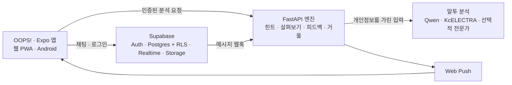

<div align="center">

# OOPS!

**보내려는 말이 차갑게 읽힐 수 있을 때, 보내기 전에 나에게만 조용히 알려 주는 채팅 앱**

CNU 2026-2 어드벤처디자인 프로젝트 · 파일럿 운영

</div>

---

## 서비스

- 웹 앱: [OOPS! 웹 앱](https://tone-chat.expo.app) — iPhone에서는 Safari에서 열고 **공유 → 홈 화면에 추가**해 앱처럼 사용할 수 있습니다.
- Android: [파일럿 APK](https://expo.dev/artifacts/eas/cofnccVScpUy2N8FrEJHcQUdos3MNIQRJqRTp6nsFhc.apk) (Android 지원은 우선순위가 낮아 새 빌드는 보장하지 않습니다.)
- 이메일로 받은 로그인 코드로 접속합니다.

## 기능

- 1:1 대화와 최대 8명 그룹 대화, 초대 코드
- 사진·파일 전송, 답장, 공감, 멘션, 읽음 표시, 입력 중 표시
- 입력 중 말투 힌트와 **살펴보기**: 문장이 어떻게 읽힐 수 있는지와 고쳐 쓰기 제안을 확인합니다.
- 거울 연습: 역할극, 되돌려 받기, 예측 맞히기
- 힌트는 보낸 사람에게만 보이며 전송을 막지 않습니다. 엔진이 응답하지 않으면 채팅은 계속 사용할 수 있습니다.
- 하소연 피드백은 원문을 저장하지 않고 말투 패턴 개선에만 사용합니다.

## 구성



| 영역 | 기술 |
|---|---|
| 앱 | Expo 58 · React Native · TypeScript · expo-router |
| 데이터·인증 | Supabase Auth · Postgres/RLS · Realtime · Storage |
| 엔진 | Python 3.11+ · FastAPI · pydantic v2 · asyncio |
| 분석 | 실시간 Qwen 말투 읽힘과 KcELECTRA 판별기 · 상세 경로의 선택적 전문가 |
| 배포 | 웹은 EAS Hosting · 엔진은 GPU 서버와 Tailscale Funnel · 파일럿 DB는 서울 리전 |

시스템의 상세 흐름은 [아키텍처 그림](docs/architecture-diagrams.md), 전체 설계는 [ARCHITECTURE.md](ARCHITECTURE.md)에서 확인할 수 있습니다.

## 개인정보와 안전

- 외부 모델로 보내기 전 이름과 개인정보 패턴을 가립니다.
- 하소연 원문은 데이터베이스, 로그, trace에 저장하지 않습니다.
- 채팅 전송은 AI 엔진과 분리되어 있어 엔진 장애가 채팅을 막지 않습니다.
- 사진과 파일은 말투 분석 모델에 보내지 않습니다.
- 실제 대화를 Gemini 무료 등급으로 보내지 않습니다.

세부 규칙은 [CLAUDE.md](CLAUDE.md)에 있습니다.

## 개발

필요한 도구: Node.js, Python 3.11+, `uv`.

```bash
git clone https://github.com/Daegyu519/Adventure_Design.git
cd Adventure_Design

cp .env.example .env
cp apps/mobile/.env.example apps/mobile/.env
# 비밀값과 개발 환경 설정은 각 env 파일에 입력합니다.

cd engine
uv sync
uv run uvicorn app.main:app --reload --env-file ../.env
```

앱은 별도 터미널에서 실행합니다.

```bash
cd apps/mobile
npm install
npx expo start
```

주요 확인 명령:

```bash
cd engine && uv run pytest -q
cd apps/mobile && npm test
cd supabase && npm test
scripts/check
```

환경 변수와 배포 절차는 팀 내부 문서 [docs/OPERATIONS.md](docs/OPERATIONS.md)를 참고하세요. 협업 절차는 [docs/COLLAB.md](docs/COLLAB.md), 진행 중인 작업은 [docs/tasks.md](docs/tasks.md)에 정리되어 있습니다.

## 저장소 안내

| 경로 | 내용 |
|---|---|
| `apps/mobile` | Expo 웹·네이티브 앱 |
| `engine` | FastAPI 말투 분석 엔진 |
| `supabase/migrations` | 데이터베이스 스키마와 정책 |
| `eval`, `ml` | 평가 도구와 분류기 실험 |
| `design`, `design-system` | 디자인 목업과 토큰 |
| `docs` | 아키텍처, 작업 현황, 운영 문서 |
| `scripts` | 개발·검사·배포 명령 |
