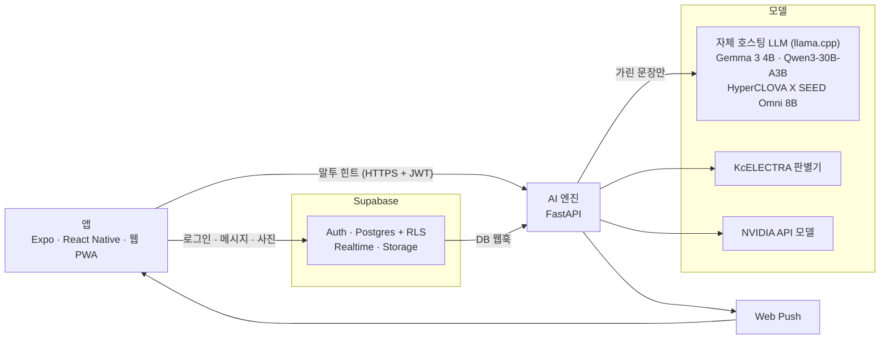

<div align="center">


# 톤챗 (tone-chat) 메롱

**보내기 전에, 이 문장이 차갑게 읽힐지 나에게만 조용히 알려 주는 1:1·그룹 채팅 앱**


CNU 2026-2 어드벤처디자인 수업 프로젝트

</div>

---

## 바로 써 보기

| 기기 | 방법 |
|---|---|
| 웹 | https://tone-chat.expo.app |
| Android | [APK 내려받기](https://expo.dev/artifacts/eas/cofnccVScpUy2N8FrEJHcQUdos3MNIQRJqRTp6nsFhc.apk). 설치할 때 "출처를 알 수 없는 앱" 허용이 필요하다 |
| iPhone | Safari에서 웹 주소를 열고 공유 → 홈 화면에 추가 |

로그인은 이메일로 받은 코드로 한다.

## 무엇을 하나

- 💬 **1:1 방과 그룹 방**(최대 8명). 초대 코드로 들어온다.
- 📎 사진, 공감(리액션), 답장, 멘션, 읽음 수, 푸시 알림(웹·Android)
- 🤫 **말투 힌트**: 입력하는 동안 실시간으로, 살펴보기에서는 이유와 고쳐 쓰기 제안까지 보여 준다. 힌트는 나에게만 보이고 **전송을 막지 않는다**.
- 🪞 **거울 세션**: 내 문장이 어떻게 읽히는지 스스로 맞혀 보는 짧은 연습
- 🔒 **피드백·하소연 학습**: 원문은 저장하지 않고 패턴만 남긴다.

## 어떻게 동작하나



| 구분 | 기술 |
|---|---|
| 앱 | Expo 58 · React Native 0.88 · TypeScript · expo-router (iOS · Android · 웹 PWA) |
| 백엔드 | Supabase (Auth · Postgres + RLS · Realtime · Storage) |
| AI 엔진 | Python 3.11 · FastAPI · pydantic v2 · httpx/asyncio |
| 모델 | 실시간: Qwen3-30B-A3B(한 읽힘) + KcELECTRA 판별기 · 상세: Qwen3-30B-A3B · HyperCLOVA X SEED Omni 8B · NVIDIA API 모델 (로컬 모델은 llama.cpp) |
| 배포·호스팅 | EAS Hosting (웹) · 자체 GPU 서버 (엔진·모델) · Tailscale (공개 HTTPS) |

더 자세한 그림(실시간 힌트·상세 보기·개인정보 경계): [`docs/architecture-diagrams.md`](docs/architecture-diagrams.md)

안전 원칙은 이렇다(전체 규칙은 [`CLAUDE.md`](CLAUDE.md)).

- 이름과 개인정보는 모델을 부르기 전에 가린다.
- 하소연(피드백) 원문은 DB·로그·trace 어디에도 저장하지 않는다.
- 엔진이 꺼져도 채팅은 멈추지 않는다. 힌트만 조용히 사라진다.
- 실시간 힌트는 1.5초를 넘기면 결과를 버린다.
- 실제 대화는 Gemini 무료 등급에 보내지 않는다. 예문·합성 데이터만 쓴다.

## 평가

대조 세트 라벨(T-16): 후보 30쌍(`eval/label/candidates_t16.jsonl`)은 **AI가 초안만 쓴 것**이고 최종 라벨은 사람 둘이 따로(블라인드) 정한다. 양식에는 어느 면이 의도였는지 나오지 않고, 쌍·면이 섞여 나온다. `key.json`(정답 대응표)은 합치기 전까지 보지 않는다.

```bash
python3 eval/label/label.py export                                  # eval/label/out/form.html + key.json
# 두 사람이 각자 form.html을 열어 라벨하고 JSON 저장 (서로 보지 않기)
python3 eval/label/label.py merge a.json b.json                     # 일치율·kappa·불일치 목록 + eval/contrast_set_t16.jsonl
uv run --project engine python eval/run_eval.py --set eval/contrast_set_t16.jsonl --mock   # 합의본으로 평가
```

## 개발 시작하기

P-14 후속 점검에서 기존 generic Fast 입력의 CLS/SEP 누락을 확인했다. 새 학습용 opt-in 입력 v2·epoch 모니터·실패 진단 명령은 [최종 점검 안내](ml/P14-final-hour.md)에 있다. 기존 모델은 보존했고 실제 재학습·경고 활성화는 하지 않았다.

P-14 실험용 이진 분류기의 실제 학습 결과·재현·선택적 엔진 연결은 [실행·인계 문서](ml/P14-phase1.md)를 참고한다. 현재 모델은 모든 예비 평가에서 양성 검출에 실패해 실제 경고에 연결하지 않는다.

P-14b: 로컬 Qwen3-30B 선생님 약지도(`ml/teacher.py`)·소프트 레이블 학습(`ml/train_soft.py`)·Gemma 앙상블 측정(`ml/ensemble_eval.py`) 결과는 [P-14b 결과](docs/handoff/P-14b-result.md). OR 결합은 채택 기준(정밀도 0.9)을 못 채웠지만, P-28(사용자 결정)에서 집계의 가중 항(`aggregate.weights.clf`)으로 엔진에 연결했다(자체 GPU 서버의 판별기 서비스, 선택).

```bash
git clone <이 저장소> && cd <폴더>
cp .env.example .env                              # 엔진·협업 값 (git에 넣지 않음)
cp apps/mobile/.env.example apps/mobile/.env      # 앱 값 (루트 .env는 앱이 읽지 않는다)

cd engine && uv run uvicorn app.main:app --reload --env-file ../.env   # 엔진 (:8000)
cd apps/mobile && npx expo start                                        # 앱
cd engine && uv run pytest -q                                           # 엔진 테스트
cd apps/mobile && npm test                                              # 앱 테스트
scripts/check                                                           # 전체 검사
```

전체 명령 표는 [`CLAUDE.md`](CLAUDE.md)의 "명령"을 본다.

## 폴더

| 경로 | 내용 |
|---|---|
| `apps/mobile` | Expo 앱 (iOS · Android · 웹) |
| `engine` | AI 엔진 (FastAPI, Python 3.11+) |
| `supabase/migrations` | DB 표 · RLS · 함수 (SQL) |
| `eval` | 대조 세트, 평가 스크립트 |
| `design` | HTML 목업, 대비 검사 |
| `docs` | 작업 목록, 협업 규칙, 설계 보완과 계획(`superpowers/`) |
| `scripts` | `claim`, `land`, `check` |
| `prototype/tone-harness` | 참고용 기존 프로토타입 (수정하지 않음) |

## 실행

명령은 `CLAUDE.md`의 "명령" 표를 본다. 환경 변수 이름은 `.env.example`(엔진·협업)과 `apps/mobile/.env.example`(앱)에 있고, 값은 각각 `.env`·`apps/mobile/.env`(git에 넣지 않음)에 직접 넣는다.

엔진은 Supabase JWKS로 토큰을 검증한다. JWKS가 비어 있으면(예전 HS256 프로젝트) 대시보드 Settings → JWT Keys에서 비대칭 키로 바꾼다.

운영(배포·서버·키 설정)은 팀 내부 문서 [`docs/OPERATIONS.md`](docs/OPERATIONS.md).

## 협업

두 Claude 계정이 같은 맥에서 나눠 작업한다. 작업 잡기와 합치기는 [`docs/COLLAB.md`](docs/COLLAB.md)를 따른다.

## 문서

- [`ARCHITECTURE.md`](ARCHITECTURE.md): 설계
- [`AGENTS.md`](AGENTS.md): 인수인계와 현재 상태(처음 보는 사람·AI 에이전트는 여기부터)
- [`docs/tasks.md`](docs/tasks.md): 작업 목록
- [`docs/COLLAB.md`](docs/COLLAB.md): 협업 규칙
- [`CLAUDE.md`](CLAUDE.md): 규칙과 명령 표
