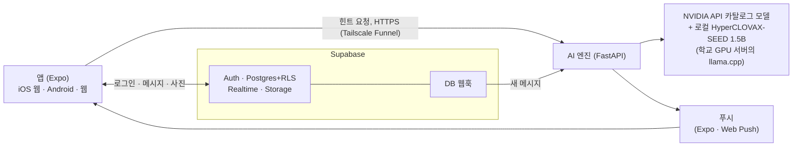

<div align="center">


# 톤챗 (tone-chat)

**보내기 전에, 이 문장이 차갑게 읽힐지 나에게만 조용히 알려 주는 1:1·그룹 채팅 앱**


CNU 2026-2 어드벤처디자인 수업 프로젝트

</div>

---

## 바로 써 보기

| 기기 | 방법 |
|---|---|
| 웹 | https://tone-chat.expo.app |
| Android | [APK 내려받기](https://expo.dev/artifacts/eas/cofnccVScpUy2N8FrEJHcQUdos3MNIQRJqRTp6nsFhc.apk). 설치할 때 "출처를 알 수 없는 앱" 허용이 필요하다 |
| iPhone | Safari에서 웹 주소를 열고 공유 → 홈 화면에 추가 |

로그인은 이메일로 받은 코드로 한다.

## 무엇을 하나

- 💬 **1:1 방과 그룹 방**(최대 8명). 초대 코드로 들어온다.
- 📎 사진, 공감(리액션), 답장, 멘션, 읽음 수, 푸시 알림(웹·Android)
- 🤫 **말투 힌트**: 입력하는 동안 실시간으로, 살펴보기에서는 이유와 고쳐 쓰기 제안까지 보여 준다. 힌트는 나에게만 보이고 **전송을 막지 않는다**.
- 🪞 **거울 세션**: 내 문장이 어떻게 읽히는지 스스로 맞혀 보는 짧은 연습
- 🔒 **피드백·하소연 학습**: 원문은 저장하지 않고 패턴만 남긴다.

## 어떻게 동작하나



안전 원칙은 이렇다(전체 규칙은 [`CLAUDE.md`](CLAUDE.md)).

- 이름과 개인정보는 모델을 부르기 전에 가린다.
- 하소연(피드백) 원문은 DB·로그·trace 어디에도 저장하지 않는다.
- 엔진이 꺼져도 채팅은 멈추지 않는다. 힌트만 조용히 사라진다.
- 실시간 힌트는 1.5초를 넘기면 결과를 버린다.
- 실제 대화는 Gemini 무료 등급에 보내지 않는다. 예문·합성 데이터만 쓴다.

## 개발 시작하기

```bash
git clone <이 저장소> && cd <폴더>
cp .env.example .env                              # 엔진·협업 값 (git에 넣지 않음)
cp apps/mobile/.env.example apps/mobile/.env      # 앱 값 (루트 .env는 앱이 읽지 않는다)

cd engine && uv run uvicorn app.main:app --reload --env-file ../.env   # 엔진 (:8000)
cd apps/mobile && npx expo start                                        # 앱
cd engine && uv run pytest -q                                           # 엔진 테스트
cd apps/mobile && npm test                                              # 앱 테스트
scripts/check                                                           # 전체 검사
```

전체 명령 표는 [`CLAUDE.md`](CLAUDE.md)의 "명령"을 본다.

## 폴더

| 경로 | 내용 |
|---|---|
| `apps/mobile` | Expo 앱 (iOS · Android · 웹) |
| `engine` | AI 엔진 (FastAPI, Python 3.11+) |
| `supabase/migrations` | DB 표 · RLS · 함수 (SQL) |
| `eval` | 대조 세트, 평가 스크립트 |
| `design` | HTML 목업, 대비 검사 |
| `docs` | 작업 목록, 협업 규칙, 설계 보완과 계획(`superpowers/`) |
| `scripts` | `claim`, `land`, `check` |
| `prototype/tone-harness` | 참고용 기존 프로토타입 (수정하지 않음) |

## 실행

명령은 `CLAUDE.md`의 "명령" 표를 본다. 환경 변수 이름은 `.env.example`(엔진·협업)과 `apps/mobile/.env.example`(앱)에 있고, 값은 각각 `.env`·`apps/mobile/.env`(git에 넣지 않음)에 직접 넣는다.

엔진은 Supabase JWKS로 토큰을 검증한다. JWKS가 비어 있으면(예전 HS256 프로젝트) 대시보드 Settings → JWT Keys에서 비대칭 키로 바꾼다.

## 운영 가이드

<details>
<summary>dev 웹훅 연결</summary>

### dev 웹훅 연결

DB 웹훅은 SQL 마이그레이션이 아니라 Supabase 대시보드에서 만든다. 엔진은 받는 쪽(`POST /hooks/message`)만 갖고 있다.

1. 엔진을 실행한다. `HOOK_SECRET`을 `.env`에 넣어 둔다. 값은 ASCII로, 예: `openssl rand -hex 32`(비어 있으면 모든 웹훅 요청을 401로 거절한다).
2. `cloudflared tunnel --url http://localhost:8000`으로 터널을 연다.
3. Supabase 대시보드 Database → Webhooks에서 만든다: 표 `public.messages`, 이벤트 Insert, HTTP POST `<터널 URL>/hooks/message`, 헤더 `X-Hook-Secret: <HOOK_SECRET>`.
4. 터널 URL은 실행할 때마다 바뀌므로 웹훅 URL도 고친다.

</details>

<details>
<summary>푸시 키 (엔진)</summary>

### 푸시 키 (엔진)

웹 푸시는 VAPID 키 한 쌍이 필요하다. 한 번만 만든다.

1. `npx web-push generate-vapid-keys`를 실행한다(키가 각각 한 줄로 나온다).
2. `Public Key`는 앱 `apps/mobile/.env`의 `EXPO_PUBLIC_VAPID_PUBLIC_KEY`에 넣는다.
3. `Private Key`는 엔진 `.env`의 `VAPID_PRIVATE_KEY`에 넣고, `VAPID_SUBJECT=mailto:<연락 이메일>`을 적는다. `pywebpush`는 이 한 줄 base64url 개인키를 그대로 받는다.

엔진은 공개키를 읽지 않는다(`VAPID_PUBLIC_KEY`는 없다). 키는 git에 넣지 않는다. `VAPID_PRIVATE_KEY`나 `VAPID_SUBJECT`가 비어 있으면 웹 푸시는 건너뛴다. Expo Push 보안을 켠 경우에만 `EXPO_ACCESS_TOKEN`을 넣는다.

</details>

<details>
<summary>학교 GPU 서버 (로컬 Gemma·SEED)</summary>

### 학교 GPU 서버 (로컬 Gemma·SEED)

로컬 모델 서버가 둘이다. 둘 다 학교 GPU 서버(P100 16GB, GPU 호스트는 여러 사람이 같이 쓰고, 컨테이너는 우리 것)의 llama.cpp `llama-server`에서 돈다. **쓸 때만 켠다.**

- `tone-llm`(포트 11434): HyperCLOVAX-SEED-Text-Instruct-1.5B, 말투 전문가 `tone_hcx`(상세·거울, 선택).
- `tone-llm-fast`(포트 11435, `--swa-full`): Gemma3-4B(`gemma-3-4b-it-q4_k_m.gguf`), 실시간 말투 전문가 `tone_fast`(짧은 출력, P-12). 서버가 없으면 실시간 힌트는 기권한다(NVIDIA 폴백 없음).

```bash
scripts/gpu up      # 서버에 llama-server 둘(각각 가장 한가한 GPU 1장) + 이 컴퓨터 127.0.0.1:11434·11435 터널
(cd engine && USE_LOCAL_MODEL=1 uv run uvicorn app.main:app --env-file ../.env --port 8000)
scripts/gpu down    # 끝나면 터널 닫고 GPU 반납 (scripts/gpu status로 상태 확인)
```

**GPU를 다른 일(학습 등)에 쓸 때**는 GPU 끄기 스위치를 켠다. 모델 서버를 끄고, 그 뒤로는 `scripts/deploy-school`·`scripts/gpu up`도 GPU 모델을 띄우지 않는다(엔진은 로컬 모델 없이 돈다: 실시간 힌트는 기권, 상세는 NVIDIA만, 채팅은 그대로).

```bash
ssh tone-gpu 'bash -s -- gpu-off' < deploy/school-gpu/up.sh   # 끄기(서버에 /root/tone-chat-deploy/gpu.off)
ssh tone-gpu 'bash -s -- gpu-on'  < deploy/school-gpu/up.sh   # 다시 쓰기
```

접속은 `~/.ssh/config`의 `Host tone-gpu`(키 인증. 주소·포트·계정은 저장소에 넣지 않는다, 다른 이름이면 `GPU_SSH=`). 서버는 바깥 포트를 열지 않는다(llama-server는 컨테이너의 127.0.0.1, 이 컴퓨터는 ssh 터널로만). 서버 로그(`/root/tone-chat-llm/tone-llm.log`, `tone-llm-fast.log`)에는 요청 문장이 남지 않는다(기본 로그 수준, 토큰 수·시간만). GPU 서버가 꺼져 있으면 엔진은 `tone_hcx` 없이 돌고(선택 전문가), 실시간 힌트는 기권한다(공유 NVIDIA 한도를 쓰지 않으려고 폴백하지 않는다).

서버 한 번 준비(`/root/tone-chat-llm`, 해 둠). Ollama 최신판은 P100(compute 6.0)에 드라이버 550 이상을 요구해서 이 서버(535)에서는 CPU로 떨어진다. 그래서 llama.cpp를 서버의 CUDA 12.2로 직접 빌드했다(llama.cpp 0ec4027).

```bash
cd /root/tone-chat-llm
curl -fL -o hcx-seed-1.5b-q4_k_m.gguf https://huggingface.co/naver-ellm/HyperCLOVAX-SEED-Text-Instruct-1.5B-GGUF/resolve/main/HyperCLOVAX-SEED-Text-Instruct-1.5B-Q4_K_M.gguf
apt-get install -y cmake && git clone --depth 1 https://github.com/ggml-org/llama.cpp && cd llama.cpp
PATH=/usr/local/cuda/bin:$PATH cmake -B build -DGGML_CUDA=ON -DCMAKE_CUDA_ARCHITECTURES=60 -DLLAMA_CURL=OFF -DCMAKE_BUILD_TYPE=Release
cmake --build build -j 32 --target llama-server
```

Gemma 한 번 내려받기(Hugging Face API로 파일 이름 확인함, 라이선스는 Gemma Terms of Use):

```bash
curl -fL -o /root/tone-chat-llm/gemma-3-4b-it-q4_k_m.gguf https://huggingface.co/unsloth/gemma-3-4b-it-GGUF/resolve/main/gemma-3-4b-it-Q4_K_M.gguf
```

</details>

<details>
<summary>배포: 학교 GPU 서버 + Tailscale Funnel (기본 경로)</summary>

**기본 경로: 학교 GPU 서버 + Tailscale Funnel.** 엔진은 학교 GPU 서버(로컬 SEED와 같은 서버)에서 상시로 돌고, 공개 HTTPS는 Tailscale Funnel(무료, 고정 `*.ts.net` 주소)로 낸다. 서버에는 systemd·docker가 없어 tmux 세션(`tone-llm`, `tone-engine`, `tone-ts`)으로 돌린다. 서버 쪽 스크립트는 `deploy/school-gpu/up.sh`(stdin으로 보내므로 서버에 복사본이 없다).

```bash
scripts/deploy-school --env <파일럿 엔진 env 파일>   # 처음. 이후 코드만 바꿨으면 --env 없이
ssh tone-gpu 'bash -s -- status' < deploy/school-gpu/up.sh   # 상태와 공개 URL
ssh tone-gpu 'bash -s -- stop' < deploy/school-gpu/up.sh     # 엔진만 끈다
```

`deploy-school`은 커밋된 `engine/`·`deploy/`(`git archive HEAD`)를 올리고 `uv sync --locked --no-dev --python 3.11` 후 `llm`·`engine`·`funnel`을 켠 다음 상태와 공개 URL을 보여 준다. 엔진 env 파일은 서버 `/root/tone-chat-deploy/engine.env`(권한 600)로 복사되며 값은 화면에 나오지 않는다. **형식은 `KEY=값` 한 줄씩만**(따옴표·공백·`$`·`&`·`;` 금지, DB 비밀번호는 퍼센트 인코딩, docker `--env-file`과 같은 형식). 어기면 `up.sh engine`이 거절한다. `CORS_ORIGINS`에 웹 앱 origin을 꼭 넣는다. 엔진은 `/docs`·`/redoc`·`/openapi.json`을 열지 않는다. 로컬 파일럿 값은 `.env.pilot`에 두면 된다(`.gitignore`됨). 엔진은 GPU 끄기 스위치가 없으면 `USE_LOCAL_MODEL=1`, 있으면 `0`으로 뜬다. `scripts/gpu down`은 `tone-engine`이 떠 있으면 llama-server를 끄지 않는다(`--force`로 끈다).

사람이 해야 할 것(한 번):
1. 처음 `deploy-school`이 `Tailscale login needed. Open: https://...`를 출력하고 종료 코드 3으로 멈추면, 그 링크를 열어 로그인한다. 그다음 `ssh tone-gpu 'bash -s -- funnel' < deploy/school-gpu/up.sh`를 다시 실행한다.
2. funnel이 활성화 링크를 출력하면(HTTPS·Funnel 미사용 상태) 링크를 열어 켜고 다시 실행한다.
3. 컨테이너가 재시작되면 tmux가 사라지므로 `scripts/deploy-school`(또는 `ssh tone-gpu 'bash -s -- all' < deploy/school-gpu/up.sh`)을 다시 실행한다. 엔진 프로세스가 죽으면 tmux 안에서 5초 뒤 다시 뜬다. 배포가 실패하면 `deploy-school`이 이전 `app`으로 되돌린다.
4. 공개 URL을 `scripts/deploy-smoke https://<호스트>.ts.net`으로 확인하고, pilot Supabase 웹훅과 앱의 `EXPO_PUBLIC_ENGINE_URL`을 그 주소로 맞춘다(아래 "파일럿 웹훅").

**감수하는 위험과 주의**: GPU 호스트 관리자는 컨테이너를 볼 수 있다. 파일럿이 끝나면 `HOOK_SECRET`·`MIRROR_SECRET`·NVIDIA 키·VAPID 키·DB 비밀번호를 바꾼다. 컨테이너 root 비밀번호를 바꾸고 키 로그인을 쓴다. userspace 모드의 Tailscale은 같은 tailnet의 다른 기기가 `:8000`·`:11434`에 닿을 수 있으므로, 이 tailnet에 다른 사람을 초대하지 않는다.

**파일럿 웹훅**: 공개 URL이 정해지면 pilot DB에 웹훅(pg_net 트리거)을 만든다. 비밀값(`SUPABASE_DB_URL`, `HOOK_SECRET`)은 엔진 env 파일에서 DB로만 보내고 화면·argv에는 남지 않는다. 다시 실행해도 된다(비밀값을 바꾸면 엔진 env와 함께 다시 실행).

```bash
scripts/pilot-webhook <엔진 URL> .env.pilot.engine
```

**웹 배포**: 앱 공개값(Supabase URL·publishable key·엔진 URL·VAPID 공개키)은 저장소가 아니라 EAS env(preview/production)에 있다. 웹은 같은 `EXPO_PUBLIC_*` 값을 셸 env로 넣고 export한 뒤 올린다.

```bash
cd apps/mobile
export EXPO_PUBLIC_SUPABASE_URL=... EXPO_PUBLIC_SUPABASE_ANON_KEY=... \
       EXPO_PUBLIC_ENGINE_URL=... EXPO_PUBLIC_VAPID_PUBLIC_KEY=...   # 공개 값만, EAS env와 같은 값
npx expo export -p web
npx eas-cli deploy --prod
```

</details>

<details>
<summary>배포: 다른 서버라면 Docker + Cloudflare Tunnel</summary>

**다른 서버라면** 아래 Docker + Cloudflare Tunnel 절차를 쓴다.

서버(학교 서버 또는 VM)와 Cloudflare 계정·도메인이 생기면 바로 올릴 수 있게 준비해 두었다(T-29, 서버 없이 로컬에서 확인한 것만 완료). 이미지 빌드 컨텍스트는 `engine/`이다. **프로세스는 반드시 1개**(`--workers 1`, Dockerfile CMD에 고정): 한도·큐·중복 제거·거울 키가 프로세스 메모리에 있다. 복제본도 늘리지 않는다.

**환경 변수** (값은 저장소에 없다. 서버의 env 파일, 예 `/etc/tone/engine.env`, 권한 600에만 적는다. 이미지에도 들어가지 않는다)

| 이름 | 필수 | 용도 |
|---|---|---|
| `MIRROR_SECRET` | 필수(배포) | 거울 card_id 서명 키, 32바이트 이상. 엔트리포인트가 비면 컨테이너를 띄우지 않는다(`HOOK_SECRET`·`SUPABASE_URL`·`SUPABASE_DB_URL`도 같고, `FORCE_MOCK`이 켜져 있으면 거절)(코드 자체는 개발용으로 경고만). 짧으면 엔진이 시작하지 않는다 |
| `SUPABASE_URL` | 필수 | pilot Supabase 프로젝트 URL(JWKS로 토큰 검증) |
| `SUPABASE_DB_URL` | 필수 | Postgres 접속 문자열(비밀번호 포함) |
| `HOOK_SECRET` | 필수 | `X-Hook-Secret` 웹훅 인증. 비면 모든 웹훅 401 |
| `NVIDIA_API_KEY` | 필수 | 실제 모델 호출. 없으면 `/health`에서 `nvidia:*` down, 기권 |
| `CORS_ORIGINS` | 필수 | 앱 웹 origin(쉼표 구분). 비면 `http://localhost:8081` |
| `VAPID_PRIVATE_KEY`, `VAPID_SUBJECT` | 웹 푸시 쓸 때 | 비면 웹 푸시 건너뜀. 위 "푸시 키" |
| `EXPO_ACCESS_TOKEN` | 선택 | Expo Push 보안을 켠 경우만 |
| `GITHUB_TOKEN` | 선택 | `nvidia` 실패 시 폴백 `github:openai/gpt-4.1-mini` |
| `GEMINI_API_KEY` | 쓰지 않음 | 합성 문장 평가 전용. 서버에 넣지 않는다 |
| `LOCAL_API_KEY`, `USE_LOCAL_MODEL` | 선택 | 로컬 모델(HyperCLOVA X, Ollama 등). `USE_LOCAL_MODEL=1`일 때만 |
| `MODELS_PATH` | 선택 | `models.yaml` 대체 경로(기본 이미지 안 `config/models.yaml`) |
| `FORCE_MOCK` | 쓰지 않음 | 테스트·평가용. 운영에서는 비운다 |

**1. 이미지** (Docker가 있는 서버에서)

```
docker build -t tone-engine engine
docker run --rm --env-file /etc/tone/engine.env -p 127.0.0.1:8000:8000 tone-engine
scripts/deploy-smoke http://localhost:8000
```

컨테이너는 비root(uid 10001)로 돌고 `.dockerignore`가 `.env`·`.venv`·`tests`를 뺀다. 의존성은 `uv.lock` 그대로(`uv sync --locked --no-dev`).

**2. Cloudflare Tunnel** (`deploy/cloudflared/config.example.yml` 참고)

```
cloudflared tunnel login
cloudflared tunnel create tone-engine            # UUID와 ~/.cloudflared/<UUID>.json 생성
cloudflared tunnel route dns tone-engine <engine.example.com>
cp deploy/cloudflared/config.example.yml ~/.cloudflared/config.yml   # UUID·hostname 채우고 credentials-file을 ~/.cloudflared/<UUID>.json 으로 고친다(호스트 실행)
cloudflared tunnel run tone-engine
```

컨테이너로 같이 띄우려면 `ENV_FILE=/etc/tone/engine.env CLOUDFLARED_DIR=/etc/tone/cloudflared docker compose -f deploy/compose.yml up -d --build`(config의 `credentials-file`은 `/etc/cloudflared/<UUID>.json`, `service`는 `http://engine:8000`; cloudflared 컨테이너는 uid 65532로 돌므로 자격 증명 JSON이 그 사용자에게 읽혀야 한다, 예 `chown 65532 <UUID>.json && chmod 400`). 엔진 포트는 밖에 열지 않고 터널로만 나간다.

**3. 요청 본문 64 KB 제한: 엔진과 가장자리 둘 다.** 엔진은 이미 `/v1/*`·`/hooks/*`에서 64 KB 초과를 413으로 거절한다(`app/limits.py`). 그래도 Cloudflare에서 한 번 더 막는다: 엔진까지 큰 본문이 도착하는 비용(터널 대역, 업로드 대기)을 줄이고, 엔진 버그나 우회가 있어도 바깥에서 막기 위해서다. Dashboard → Security → WAF → Custom rules에서 표현식 `(http.request.body.size gt 65536)` 동작 Block. 기본 응답은 403이다: 커스텀 응답을 413으로 정하거나 403을 그대로 받아들인다(`scripts/deploy-smoke`는 https에서 엔진이 제한하지 않는 `/nope`로 70 KB를 보내 403 또는 413이면 통과). 요금제에 따라 `http.request.body.size`를 못 쓰면 엔진 제한만 남으니, 그 사실을 기록한다. 

**4. 확인과 전환**

```
scripts/deploy-smoke https://<engine.example.com>   # /health 200, nvidia:* up, 413, 401, CORS
```

그다음 pilot Supabase 프로젝트의 DB 웹훅(`public.messages` Insert → `https://<engine.example.com>/hooks/message`, 헤더 `X-Hook-Secret`)을 만들고 앱의 `EXPO_PUBLIC_ENGINE_URL`을 공개 URL로 바꾼다("dev 웹훅 연결"과 같은 순서, 터널 URL은 고정).

사람이 해야 할 것: 서버/VM, Cloudflare 계정과 도메인, pilot Supabase 프로젝트, `NVIDIA_API_KEY`.

</details>

## 협업

두 Claude 계정이 같은 맥에서 나눠 작업한다. 작업 잡기와 합치기는 [`docs/COLLAB.md`](docs/COLLAB.md)를 따른다.

## 문서

- [`ARCHITECTURE.md`](ARCHITECTURE.md): 설계
- [`AGENTS.md`](AGENTS.md): 인수인계와 현재 상태(처음 보는 사람·AI 에이전트는 여기부터)
- [`docs/tasks.md`](docs/tasks.md): 작업 목록
- [`docs/COLLAB.md`](docs/COLLAB.md): 협업 규칙
- [`CLAUDE.md`](CLAUDE.md): 규칙과 명령 표
