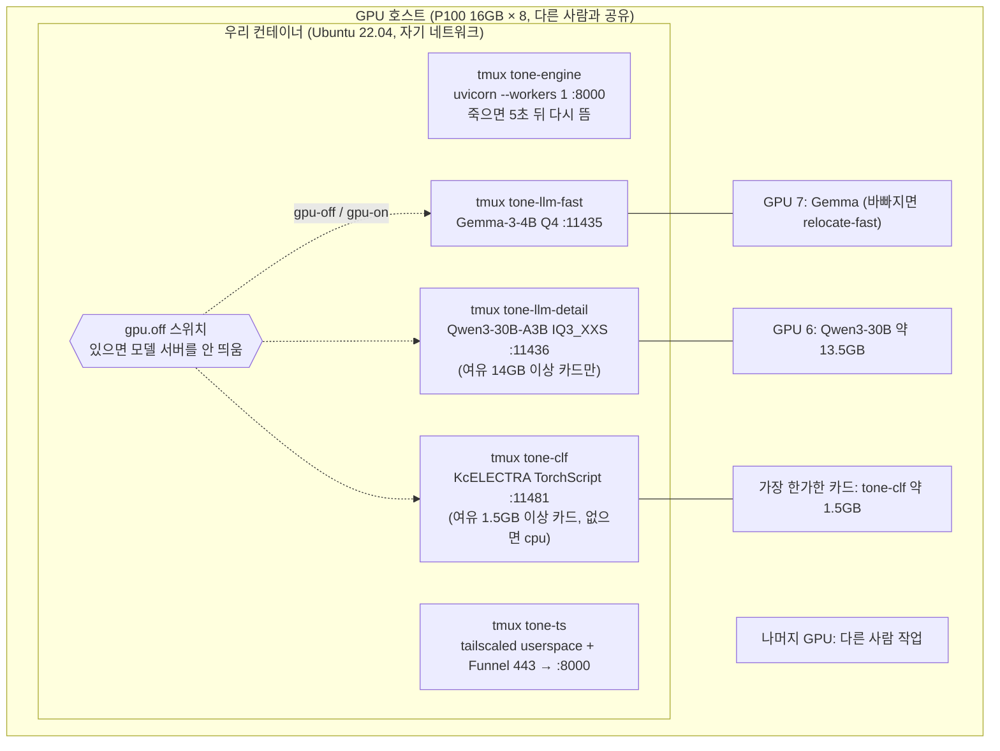
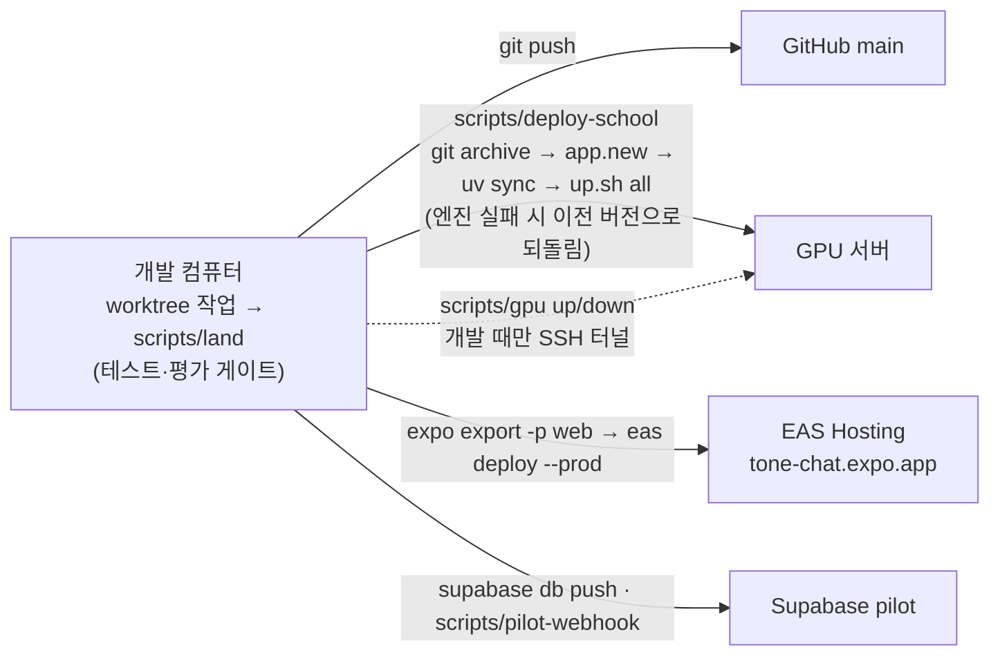

# 톤챗 운영 가이드 (내부)

> 팀 내부 운영 문서 — 공개 자료에는 README와 docs/architecture-diagrams.md만 쓴다.

## 운영 가이드

<details>
<summary>dev 웹훅 연결</summary>

### dev 웹훅 연결

DB 웹훅은 SQL 마이그레이션이 아니라 Supabase 대시보드에서 만든다. 엔진은 받는 쪽(`POST /hooks/message`)만 갖고 있다.

1. 엔진을 실행한다. `HOOK_SECRET`을 `.env`에 넣어 둔다. 값은 ASCII로, 예: `openssl rand -hex 32`(비어 있으면 모든 웹훅 요청을 401로 거절한다).
2. `cloudflared tunnel --url http://localhost:8000`으로 터널을 연다.
3. Supabase 대시보드 Database → Webhooks에서 만든다: 표 `public.messages`, 이벤트 Insert, HTTP POST `<터널 URL>/hooks/message`, 헤더 `X-Hook-Secret: <HOOK_SECRET>`.
4. 터널 URL은 실행할 때마다 바뀌므로 웹훅 URL도 고친다.

</details>

<details>
<summary>푸시 키 (엔진)</summary>

### 푸시 키 (엔진)

웹 푸시는 VAPID 키 한 쌍이 필요하다. 한 번만 만든다.

1. `npx web-push generate-vapid-keys`를 실행한다(키가 각각 한 줄로 나온다).
2. `Public Key`는 앱 `apps/mobile/.env`의 `EXPO_PUBLIC_VAPID_PUBLIC_KEY`에 넣는다.
3. `Private Key`는 엔진 `.env`의 `VAPID_PRIVATE_KEY`에 넣고, `VAPID_SUBJECT=mailto:<연락 이메일>`을 적는다. `pywebpush`는 이 한 줄 base64url 개인키를 그대로 받는다.

엔진은 공개키를 읽지 않는다(`VAPID_PUBLIC_KEY`는 없다). 키는 git에 넣지 않는다. `VAPID_PRIVATE_KEY`나 `VAPID_SUBJECT`가 비어 있으면 웹 푸시는 건너뛴다. Expo Push 보안을 켠 경우에만 `EXPO_ACCESS_TOKEN`을 넣는다.

</details>

<details>
<summary>GPU 서버 (로컬 Gemma·Qwen3-30B)</summary>

### GPU 서버 (로컬 Gemma·Qwen3-30B)

로컬 모델 서버가 셋이다(GPU 메모리 약 3 + 2.5 + 13.5GB). 둘 다 GPU 서버(P100 16GB, GPU 호스트는 여러 사람이 같이 쓰고, 컨테이너는 우리 것)의 llama.cpp `llama-server`에서 돈다. **쓸 때만 켠다.**

- SEED 1.5B(`tone-llm`, 포트 11434)는 어느 전문가도 안 써서 더는 띄우지 않는다(P-28). 예전에 떠 있으면 `status`·`gpu-off`가 계속 다룬다. `models.yaml`의 `local` 공급자는 안 쓰는 채로 남겨 뒀다.
- `tone-llm-detail`(포트 11436, `-c 8192 -np 4`): Qwen3-30B-A3B-Instruct-2507 UD-IQ3_XXS(`qwen3-30b-a3b-2507-iq3xxs.gguf`, Apache-2.0), 상세·거울 말투 전문가 `tone_hcx`(선택, P-24). 여유 메모리 14000MiB 이상·사용률 50% 이하인 GPU가 없으면 건너뛴다(엔진은 그대로 돈다).
- `tone-llm-fast`(포트 11435, `--swa-full`): Gemma3-4B(`gemma-3-4b-it-q4_k_m.gguf`). P-33부터 실시간에 쓰지 않는다(되돌릴 때를 위해 띄워 둠). 실시간 말투는 `tone-llm-detail`(Qwen, 11436)의 `tone_label`이라 **Qwen 서버가 없으면 실시간 힌트는 기권**한다(NVIDIA 폴백 없음). Qwen 카드가 바빠 1.35초를 넘기면 실시간이 기권한다.

- `tone-clf`(포트 11481, P-28): KcELECTRA 판별기(`ml/classifier_shim.py`, TorchScript, `127.0.0.1`만). 모델은 `/root/tone-chat-llm/clf/kcelectra-p14b/`, 코드는 `scripts/deploy-school`이 올리는 `/root/tone-chat-deploy/app/ml`, python은 `/root/p14-work/source/ml/.venv-demo/bin/python`. 여유 1500MiB 이상인 가장 한가한 GPU(없으면 cpu, 경고). 엔진은 `USE_LOCAL_MODEL=1`일 때만 `http://localhost:11481/score`를 150ms 제한으로 부르고, 못 오면 집계에서 `clf` 항만 뺀다. 요청 문장은 로그에 남지 않는다.
- `tone-hcx-8b`(포트 11491, P-29): HyperCLOVA X SEED Omni 8B(`bakeoff/clova-omni8b.gguf`, Q4_K_M, 약 7GB) — 상세·거울 말투 전문가 `tone_hcx8`(가중치 0.5). NAVER 공식 llama.cpp 개조판(`bakeoff/hcx-llama.cpp/build/bin/llama-server`, `--jinja -np 4 -c 8192`)으로만 열린다(일반 llama.cpp는 이 모델을 못 연다). 여유 7000MiB 이상·사용률 50% 이하 카드에만, 없으면 건너뜀. 개조판을 다시 빌드할 때는 외부 코드라 사람이 직접 실행한다.

```bash
scripts/gpu up      # 서버에 모델 서버(각각 가장 한가한 GPU 1장) + 이 컴퓨터 127.0.0.1:11435·11436·11481 터널 (11435 Gemma만 필수; 11436·11481은 선택: 없으면 경고만; 11481은 tone-clf)
(cd engine && USE_LOCAL_MODEL=1 uv run uvicorn app.main:app --env-file ../.env --port 8000)
scripts/gpu down    # 끝나면 터널 닫고 GPU 반납 (scripts/gpu status로 상태 확인)
```

**GPU를 다른 일(학습 등)에 쓸 때**는 GPU 끄기 스위치를 켠다. 모델 서버 셋을 모두 끄고, 그 뒤로는 `scripts/deploy-school`·`scripts/gpu up`도 GPU 모델을 띄우지 않는다(엔진은 로컬 모델 없이 돈다: 실시간 힌트는 기권, 상세는 NVIDIA만, 채팅은 그대로).

**Gemma가 있는 카드가 바빠져 실시간이 자꾸 기권하면**(응답이 1.35초를 넘음) Gemma만 평소 선택(사용률 50% 이하 우선, 그다음 여유 메모리)으로 다른 카드에 다시 띄운다. 그동안 몇 초 실시간 힌트가 기권한다.

```bash
ssh tone-gpu 'bash -s -- relocate-fast' < deploy/school-gpu/up.sh
```

```bash
ssh tone-gpu 'bash -s -- gpu-off' < deploy/school-gpu/up.sh   # 끄기(서버에 /root/tone-chat-deploy/gpu.off)
ssh tone-gpu 'bash -s -- gpu-on'  < deploy/school-gpu/up.sh   # 다시 쓰기
```

접속은 `~/.ssh/config`의 `Host tone-gpu`(키 인증. 주소·포트·계정은 저장소에 넣지 않는다, 다른 이름이면 `GPU_SSH=`). 서버는 바깥 포트를 열지 않는다(llama-server는 컨테이너의 127.0.0.1, 이 컴퓨터는 ssh 터널로만). 서버 로그(`/root/tone-chat-llm/tone-llm.log`, `tone-llm-fast.log`)에는 요청 문장이 남지 않는다(기본 로그 수준, 토큰 수·시간만). GPU 서버가 꺼져 있으면 엔진은 `tone_hcx`(Qwen3-30B) 없이 돌고(선택 전문가), 실시간 힌트는 기권한다(공유 NVIDIA 한도를 쓰지 않으려고 폴백하지 않는다).

P-24 한 번 할 일: 상세 모델 파일 이름 맞추기 `ssh tone-gpu 'mv /root/tone-chat-llm/bakeoff/x-qwen30b.gguf /root/tone-chat-llm/qwen3-30b-a3b-2507-iq3xxs.gguf'`(12.9GB, 같은 디스크라 즉시). `up.sh`는 이 이름을 기대하고, 없으면 건너뛴다.

서버 한 번 준비(`/root/tone-chat-llm`, 해 둠). Ollama 최신판은 P100(compute 6.0)에 드라이버 550 이상을 요구해서 이 서버(535)에서는 CPU로 떨어진다. 그래서 llama.cpp를 서버의 CUDA 12.2로 직접 빌드했다(llama.cpp 0ec4027).

```bash
cd /root/tone-chat-llm
curl -fL -o hcx-seed-1.5b-q4_k_m.gguf https://huggingface.co/naver-ellm/HyperCLOVAX-SEED-Text-Instruct-1.5B-GGUF/resolve/main/HyperCLOVAX-SEED-Text-Instruct-1.5B-Q4_K_M.gguf
apt-get install -y cmake && git clone --depth 1 https://github.com/ggml-org/llama.cpp && cd llama.cpp
PATH=/usr/local/cuda/bin:$PATH cmake -B build -DGGML_CUDA=ON -DCMAKE_CUDA_ARCHITECTURES=60 -DLLAMA_CURL=OFF -DCMAKE_BUILD_TYPE=Release
cmake --build build -j 32 --target llama-server
```

Gemma 한 번 내려받기(Hugging Face API로 파일 이름 확인함, 라이선스는 Gemma Terms of Use):

```bash
curl -fL -o /root/tone-chat-llm/gemma-3-4b-it-q4_k_m.gguf https://huggingface.co/unsloth/gemma-3-4b-it-GGUF/resolve/main/gemma-3-4b-it-Q4_K_M.gguf
```

</details>

<details>
<summary>배포: GPU 서버 + Tailscale Funnel (기본 경로)</summary>

**기본 경로: GPU 서버 + Tailscale Funnel.** 엔진은 GPU 서버(로컬 SEED와 같은 서버)에서 상시로 돌고, 공개 HTTPS는 Tailscale Funnel(무료, 고정 `*.ts.net` 주소)로 낸다. 서버에는 systemd·docker가 없어 tmux 세션(`tone-llm`, `tone-engine`, `tone-ts`)으로 돌린다. 서버 쪽 스크립트는 `deploy/school-gpu/up.sh`(stdin으로 보내므로 서버에 복사본이 없다).

```bash
scripts/deploy-school --env <파일럿 엔진 env 파일>   # 처음. 이후 코드만 바꿨으면 --env 없이
ssh tone-gpu 'bash -s -- status' < deploy/school-gpu/up.sh   # 상태와 공개 URL
ssh tone-gpu 'bash -s -- stop' < deploy/school-gpu/up.sh     # 엔진만 끈다
```

`deploy-school`은 커밋된 `engine/`·`deploy/`(`git archive HEAD`)를 올리고 `uv sync --locked --no-dev --python 3.11` 후 `llm`·`engine`·`funnel`을 켠 다음 상태와 공개 URL을 보여 준다. 엔진 env 파일은 서버 `/root/tone-chat-deploy/engine.env`(권한 600)로 복사되며 값은 화면에 나오지 않는다. **형식은 `KEY=값` 한 줄씩만**(따옴표·공백·`$`·`&`·`;` 금지, DB 비밀번호는 퍼센트 인코딩, docker `--env-file`과 같은 형식). 어기면 `up.sh engine`이 거절한다. `CORS_ORIGINS`에 웹 앱 origin을 꼭 넣는다. 테스트로 힌트를 자주 띄우려면 엔진 env에 `HINT_GATE_THRESHOLD`(실시간 문지기)·`HINT_ALERT_THRESHOLD`(알림 기준)·`HINT_MIN_CONFIDENCE`(0~1), 하소연 반영 기준 `PATTERN_MIN_OBS`(1 이상 정수, 신호별 신고자 수)를 넣는다(비우면 models.yaml 값). 엔진은 `/docs`·`/redoc`·`/openapi.json`을 열지 않는다. 로컬 파일럿 값은 `.env.pilot`에 두면 된다(`.gitignore`됨). 엔진은 GPU 끄기 스위치가 없으면 `USE_LOCAL_MODEL=1`, 있으면 `0`으로 뜬다. `scripts/gpu down`은 `tone-engine`이 떠 있으면 llama-server를 끄지 않는다(`--force`로 끈다).

사람이 해야 할 것(한 번):
1. 처음 `deploy-school`이 `Tailscale login needed. Open: https://...`를 출력하고 종료 코드 3으로 멈추면, 그 링크를 열어 로그인한다. 그다음 `ssh tone-gpu 'bash -s -- funnel' < deploy/school-gpu/up.sh`를 다시 실행한다.
2. funnel이 활성화 링크를 출력하면(HTTPS·Funnel 미사용 상태) 링크를 열어 켜고 다시 실행한다.
3. 컨테이너가 재시작되면 tmux가 사라지므로 `scripts/deploy-school`(또는 `ssh tone-gpu 'bash -s -- all' < deploy/school-gpu/up.sh`)을 다시 실행한다. 엔진 프로세스가 죽으면 tmux 안에서 5초 뒤 다시 뜬다. 배포가 실패하면 `deploy-school`이 이전 `app`으로 되돌린다.
4. 공개 URL을 `scripts/deploy-smoke https://<호스트>.ts.net`으로 확인하고, pilot Supabase 웹훅과 앱의 `EXPO_PUBLIC_ENGINE_URL`을 그 주소로 맞춘다(아래 "파일럿 웹훅").

**감수하는 위험과 주의**: GPU 호스트 관리자는 컨테이너를 볼 수 있다. 파일럿이 끝나면 `HOOK_SECRET`·`MIRROR_SECRET`·NVIDIA 키·VAPID 키·DB 비밀번호를 바꾼다. 컨테이너 root 비밀번호를 바꾸고 키 로그인을 쓴다. userspace 모드의 Tailscale은 같은 tailnet의 다른 기기가 `:8000`·`:11434`에 닿을 수 있으므로, 이 tailnet에 다른 사람을 초대하지 않는다.

**파일럿 웹훅**: 공개 URL이 정해지면 pilot DB에 웹훅(pg_net 트리거)을 만든다. 비밀값(`SUPABASE_DB_URL`, `HOOK_SECRET`)은 엔진 env 파일에서 DB로만 보내고 화면·argv에는 남지 않는다. 다시 실행해도 된다(비밀값을 바꾸면 엔진 env와 함께 다시 실행).

```bash
scripts/pilot-webhook <엔진 URL> .env.pilot.engine
```

**웹 배포**: 앱 공개값(Supabase URL·publishable key·엔진 URL·VAPID 공개키)은 저장소가 아니라 EAS env(preview/production)에 있다. 웹은 같은 `EXPO_PUBLIC_*` 값을 셸 env로 넣고 export한 뒤 올린다.

```bash
cd apps/mobile
export EXPO_PUBLIC_SUPABASE_URL=... EXPO_PUBLIC_SUPABASE_ANON_KEY=... \
       EXPO_PUBLIC_ENGINE_URL=... EXPO_PUBLIC_VAPID_PUBLIC_KEY=...   # 공개 값만, EAS env와 같은 값
npx expo export -p web
npx eas-cli deploy --prod
```

</details>

<details>
<summary>배포: 다른 서버라면 Docker + Cloudflare Tunnel</summary>

**다른 서버라면** 아래 Docker + Cloudflare Tunnel 절차를 쓴다.

서버(GPU 서버 또는 VM)와 Cloudflare 계정·도메인이 생기면 바로 올릴 수 있게 준비해 두었다(T-29, 서버 없이 로컬에서 확인한 것만 완료). 이미지 빌드 컨텍스트는 `engine/`이다. **프로세스는 반드시 1개**(`--workers 1`, Dockerfile CMD에 고정): 한도·큐·중복 제거·거울 키가 프로세스 메모리에 있다. 복제본도 늘리지 않는다.

**환경 변수** (값은 저장소에 없다. 서버의 env 파일, 예 `/etc/tone/engine.env`, 권한 600에만 적는다. 이미지에도 들어가지 않는다)

| 이름 | 필수 | 용도 |
|---|---|---|
| `MIRROR_SECRET` | 필수(배포) | 거울 card_id 서명 키, 32바이트 이상. 엔트리포인트가 비면 컨테이너를 띄우지 않는다(`HOOK_SECRET`·`SUPABASE_URL`·`SUPABASE_DB_URL`도 같고, `FORCE_MOCK`이 켜져 있으면 거절)(코드 자체는 개발용으로 경고만). 짧으면 엔진이 시작하지 않는다 |
| `SUPABASE_URL` | 필수 | pilot Supabase 프로젝트 URL(JWKS로 토큰 검증) |
| `SUPABASE_DB_URL` | 필수 | Postgres 접속 문자열(비밀번호 포함) |
| `HOOK_SECRET` | 필수 | `X-Hook-Secret` 웹훅 인증. 비면 모든 웹훅 401 |
| `NVIDIA_API_KEY` | 필수 | 실제 모델 호출. 없으면 `/health`에서 `nvidia:*` down, 기권 |
| `CORS_ORIGINS` | 필수 | 앱 웹 origin(쉼표 구분). 비면 `http://localhost:8081` |
| `VAPID_PRIVATE_KEY`, `VAPID_SUBJECT` | 웹 푸시 쓸 때 | 비면 웹 푸시 건너뜀. 위 "푸시 키" |
| `EXPO_ACCESS_TOKEN` | 선택 | Expo Push 보안을 켠 경우만 |
| `GITHUB_TOKEN` | 선택 | `nvidia` 실패 시 폴백 `github:openai/gpt-4.1-mini` |
| `GEMINI_API_KEY` | 쓰지 않음 | 합성 문장 평가 전용. 서버에 넣지 않는다 |
| `LOCAL_API_KEY`, `USE_LOCAL_MODEL` | 선택 | 로컬 모델(HyperCLOVA X, Ollama 등). `USE_LOCAL_MODEL=1`일 때만 |
| `MODELS_PATH` | 선택 | `models.yaml` 대체 경로(기본 이미지 안 `config/models.yaml`) |
| `FORCE_MOCK` | 쓰지 않음 | 테스트·평가용. 운영에서는 비운다 |

**1. 이미지** (Docker가 있는 서버에서)

```
docker build -t tone-engine engine
docker run --rm --env-file /etc/tone/engine.env -p 127.0.0.1:8000:8000 tone-engine
scripts/deploy-smoke http://localhost:8000
```

컨테이너는 비root(uid 10001)로 돌고 `.dockerignore`가 `.env`·`.venv`·`tests`를 뺀다. 의존성은 `uv.lock` 그대로(`uv sync --locked --no-dev`).

**2. Cloudflare Tunnel** (`deploy/cloudflared/config.example.yml` 참고)

```
cloudflared tunnel login
cloudflared tunnel create tone-engine            # UUID와 ~/.cloudflared/<UUID>.json 생성
cloudflared tunnel route dns tone-engine <engine.example.com>
cp deploy/cloudflared/config.example.yml ~/.cloudflared/config.yml   # UUID·hostname 채우고 credentials-file을 ~/.cloudflared/<UUID>.json 으로 고친다(호스트 실행)
cloudflared tunnel run tone-engine
```

컨테이너로 같이 띄우려면 `ENV_FILE=/etc/tone/engine.env CLOUDFLARED_DIR=/etc/tone/cloudflared docker compose -f deploy/compose.yml up -d --build`(config의 `credentials-file`은 `/etc/cloudflared/<UUID>.json`, `service`는 `http://engine:8000`; cloudflared 컨테이너는 uid 65532로 돌므로 자격 증명 JSON이 그 사용자에게 읽혀야 한다, 예 `chown 65532 <UUID>.json && chmod 400`). 엔진 포트는 밖에 열지 않고 터널로만 나간다.

**3. 요청 본문 64 KB 제한: 엔진과 가장자리 둘 다.** 엔진은 이미 `/v1/*`·`/hooks/*`에서 64 KB 초과를 413으로 거절한다(`app/limits.py`). 그래도 Cloudflare에서 한 번 더 막는다: 엔진까지 큰 본문이 도착하는 비용(터널 대역, 업로드 대기)을 줄이고, 엔진 버그나 우회가 있어도 바깥에서 막기 위해서다. Dashboard → Security → WAF → Custom rules에서 표현식 `(http.request.body.size gt 65536)` 동작 Block. 기본 응답은 403이다: 커스텀 응답을 413으로 정하거나 403을 그대로 받아들인다(`scripts/deploy-smoke`는 https에서 엔진이 제한하지 않는 `/nope`로 70 KB를 보내 403 또는 413이면 통과). 요금제에 따라 `http.request.body.size`를 못 쓰면 엔진 제한만 남으니, 그 사실을 기록한다. 

**4. 확인과 전환**

```
scripts/deploy-smoke https://<engine.example.com>   # /health 200, nvidia:* up, 413, 401, CORS
```

그다음 pilot Supabase 프로젝트의 DB 웹훅(`public.messages` Insert → `https://<engine.example.com>/hooks/message`, 헤더 `X-Hook-Secret`)을 만들고 앱의 `EXPO_PUBLIC_ENGINE_URL`을 공개 URL로 바꾼다("dev 웹훅 연결"과 같은 순서, 터널 URL은 고정).

사람이 해야 할 것: 서버/VM, Cloudflare 계정과 도메인, pilot Supabase 프로젝트, `NVIDIA_API_KEY`.

</details>

## 서버 배치·배포 흐름 (그림)

### GPU 서버 배치



- GPU 번호는 띄울 때 가장 한가한 카드를 고르므로 바뀔 수 있다(지금 배치는 2026-11-01 기준).
- 모델 서버는 기본 로그 수준이라 요청 문장을 남기지 않는다(`-v` 금지).
- 사용자가 학습에 GPU를 써야 하면 `ssh tone-gpu 'bash -s -- gpu-off' < deploy/school-gpu/up.sh`. 그동안 엔진은 로컬 모델 없이 돈다(실시간 힌트 기권, 상세는 NVIDIA만).
- 컨테이너가 다시 시작되면 `scripts/deploy-school`로 전부 다시 띄운다.

### 배포·운영 흐름



- 앱 공개값(Supabase URL·publishable key·엔진 URL·VAPID 공개키)은 EAS env와 빌드 때 셸 env로 넣는다.
- 비밀값은 저장소에 없다: 루트 `.env`(dev), `.env.pilot`·`.env.pilot.engine`(pilot), 서버 `/root/tone-chat-deploy/engine.env`(권한 600).
- push 전에는 비밀값 패턴 검사를 한다(`AGENTS.md` 7장).
