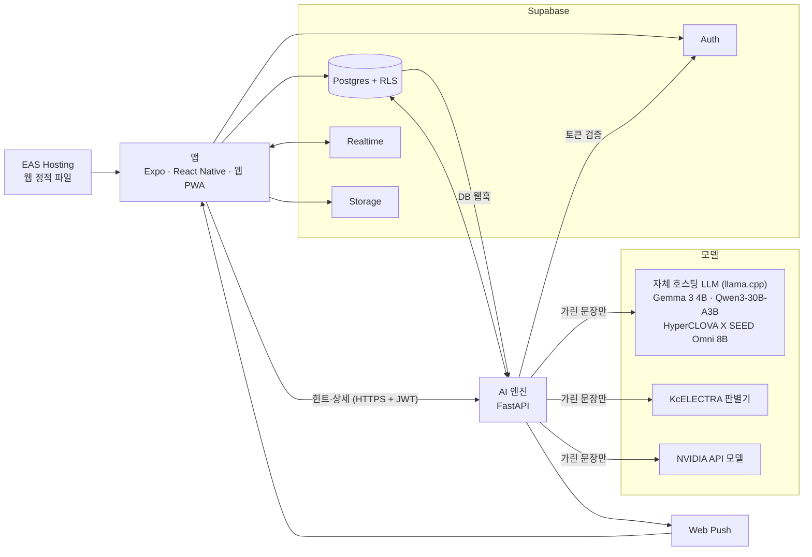
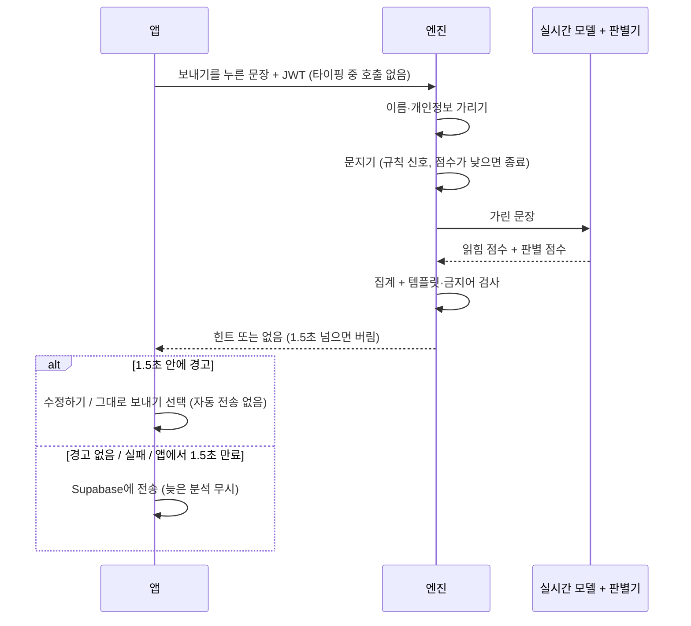
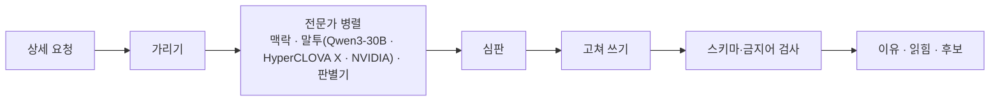

# 톤챗 아키텍처 그림 (2026-11-01 기준)

기술 수준의 요약이다. 글로 된 설계와 결정은 [`ARCHITECTURE.md`](../ARCHITECTURE.md), 진행 상태는 [`AGENTS.md`](../AGENTS.md)에 있다. 모델·경로 값의 원본은 `engine/config/models.yaml`.

## 1. 전체 구성

- 채팅은 엔진 없이 앱과 Supabase만으로 돈다. 엔진이 꺼져도 힌트만 사라진다.
- 앱은 모델을 직접 부르지 않는다.

## 2. 실시간 힌트 흐름 (1.5초 안)

## 3. 상세 보기 흐름

## 4. 개인정보 경계

| 데이터 | 어디까지 가나 | 어디에 남나 |
|---|---|---|
| 채팅 메시지·사진 | 앱 ↔ Supabase (RLS, 방 멤버만) | 메시지 표, 비공개 Storage |
| 힌트·상세용 문장 | 엔진 → 이름·개인정보를 가린 뒤 모델 | 남지 않음 (분석 기록에는 문장 없음) |
| 사진 | 모델로 보내지 않음 | Storage |
| 털어놓기 원문 | 엔진 메모리에서 가린 뒤 패턴만 추출 | 어디에도 저장 안 함, 패턴만 |
| 실제 대화 → Gemini | 보내지 않음 (합성 문장 평가 전용) | — |
| 비밀값 | 엔진 env, 개발자 로컬 파일 | 저장소·로그에 없음 |
