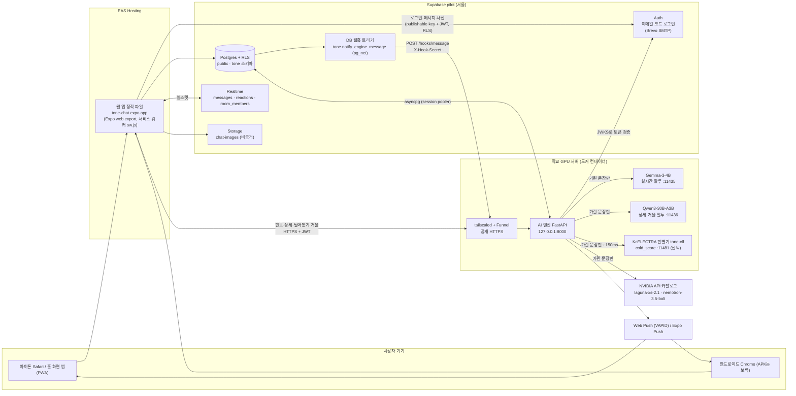
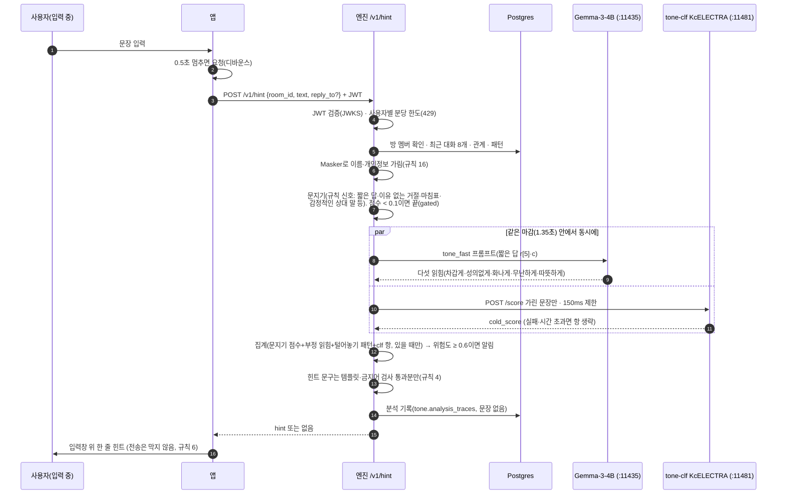
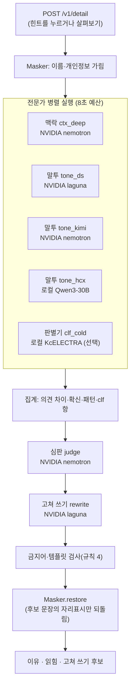
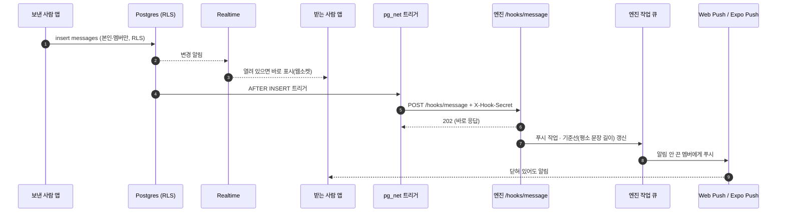
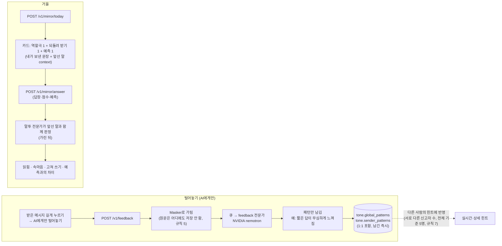
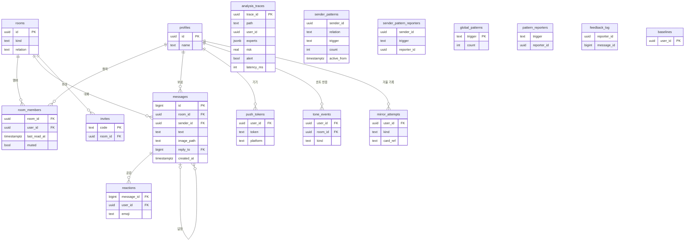
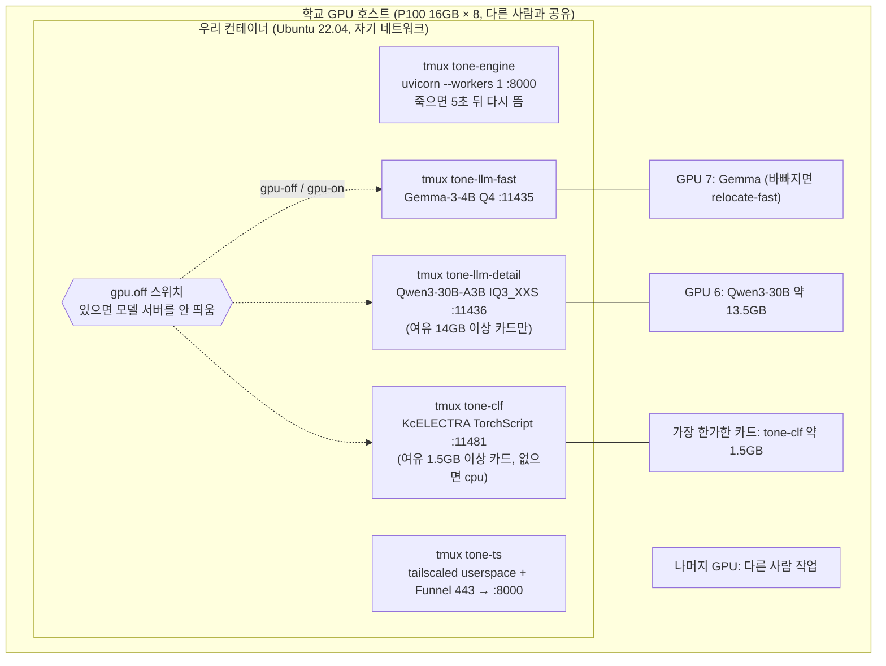
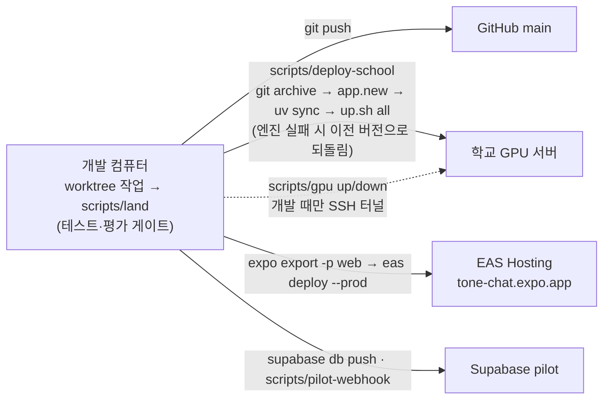

# 톤챗 아키텍처 그림 (2026-11-01 기준)

글로 된 설계와 결정은 [`ARCHITECTURE.md`](../ARCHITECTURE.md), 진행 상태는 [`AGENTS.md`](../AGENTS.md)에 있다. 이 문서는 **지금 실제로 돌고 있는 모습**을 그림으로 보여 준다. 모델·경로·값이 바뀌면 이 그림도 같이 고친다(값의 원본은 `engine/config/models.yaml`, `deploy/school-gpu/up.sh`).

목차
1. [전체 구성](#1-전체-구성)
2. [실시간 힌트](#2-실시간-힌트-입력-중-15초-안)
3. [상세 보기 (살펴보기·고쳐 쓰기)](#3-상세-보기-살펴보기고쳐-쓰기)
4. [메시지·웹훅·푸시](#4-메시지웹훅푸시)
5. [털어놓기와 거울](#5-털어놓기와-거울)
6. [데이터 모델](#6-데이터-모델)
7. [학교 GPU 서버 배치](#7-학교-gpu-서버-배치)
8. [배포·운영 흐름](#8-배포운영-흐름)
9. [개인정보 경계](#9-개인정보-경계)

---

## 1. 전체 구성

- **채팅은 엔진 없이 돈다.** 메시지·사진·읽음·공감은 앱 ↔ Supabase만으로 오간다. 엔진이 꺼져도 채팅은 그대로고 힌트만 사라진다(규칙 11).
- 엔진은 서버 컨테이너의 127.0.0.1에만 열리고, 바깥에서는 Tailscale Funnel 주소(`https://tone-chat.<tailnet>.ts.net`)로만 들어온다.
- 모델 서버(llama.cpp `llama-server`)도 127.0.0.1에만 열린다. 앱은 모델을 직접 부르지 않는다.

---

## 2. 실시간 힌트 (입력 중, 1.5초 안)

- 전체 1.5초를 넘기면 결과를 버린다(규칙 8). 학교 GPU가 꺼져 있으면 실시간 힌트만 조용히 기권한다(NVIDIA로 넘기지 않음).
- 테스트 중에는 서버 env로 기준을 낮출 수 있다: `HINT_GATE_THRESHOLD`·`HINT_ALERT_THRESHOLD`·`HINT_MIN_CONFIDENCE`(P-21).

---

## 3. 상세 보기 (살펴보기·고쳐 쓰기)

- 모든 LLM 출력은 pydantic 스키마를 통과해야 쓴다. 실패하면 폴백 사슬, 모두 실패하면 기권(규칙 3).
- 폴백: NVIDIA 두 모델은 서로를 폴백으로 쓴다. 로컬 Qwen이 없으면(GPU 꺼짐) 그 전문가만 빠진다.

---

## 4. 메시지·웹훅·푸시

- 웹훅 비밀값(`HOOK_SECRET`)은 엔진 env와 트리거 함수에만 있다(`scripts/pilot-webhook`로 만든다).
- 아이폰 웹 푸시는 "홈 화면에 추가"한 앱에서만 온다(iOS 16.4+).

---

## 5. 털어놓기와 거울

---

## 6. 데이터 모델

- 위의 9개(`profiles`~`mirror_attempts`)는 `public` 스키마로, 앱이 RLS를 거쳐 읽고 쓴다. 아래 7개(`analysis_traces`~`baselines`)는 `tone` 스키마로 **앱에서 접근 불가**(API 비공개), 엔진만 서비스 연결로 쓴다(규칙 10).
- `tone` 표 어디에도 대화 문장·하소연 원문이 없다. 분석 기록에는 경로·위험도·지연·전문가 결과 요약만 남는다.
- 열은 관계를 이해하는 데 필요한 것만 적었다. 정확한 정의는 `supabase/migrations/*.sql`.

---

## 7. 학교 GPU 서버 배치

- GPU 번호는 띄울 때 가장 한가한 카드를 고르므로 바뀔 수 있다(지금 배치는 2026-11-01 기준).
- 모델 서버는 기본 로그 수준이라 요청 문장을 남기지 않는다(`-v` 금지).
- 사용자가 학습에 GPU를 써야 하면 `ssh tone-gpu 'bash -s -- gpu-off' < deploy/school-gpu/up.sh`. 그동안 엔진은 로컬 모델 없이 돈다(실시간 힌트 기권, 상세는 NVIDIA만).
- 컨테이너가 다시 시작되면 `scripts/deploy-school`로 전부 다시 띄운다.

---

## 8. 배포·운영 흐름

- 앱 공개값(Supabase URL·publishable key·엔진 URL·VAPID 공개키)은 EAS env와 빌드 때 셸 env로 넣는다.
- 비밀값은 저장소에 없다: 루트 `.env`(dev), `.env.pilot`·`.env.pilot.engine`(pilot), 서버 `/root/tone-chat-deploy/engine.env`(권한 600).
- push 전에는 비밀값 패턴 검사를 한다(`AGENTS.md` 7장).

---

## 9. 개인정보 경계

| 데이터 | 어디까지 가나 | 어디에 남나 |
|---|---|---|
| 채팅 메시지·사진 | 앱 ↔ Supabase(RLS, 방 멤버만) | `public.messages`, `chat-images`(비공개) |
| 힌트·상세용 문장(초안·최근 대화) | 엔진 → **이름·개인정보 가린 뒤** 모델(로컬 Gemma·Qwen, NVIDIA) | 남지 않음(분석 기록은 문장 없이) |
| 사진 | 모델로 보내지 않음(규칙 12) | Storage |
| 털어놓기 원문 | 엔진 메모리에서 가린 뒤 패턴만 추출 | **어디에도 저장 안 함**(규칙 5), 패턴만 `tone.*` |
| 실제 대화 → Gemini | **보내지 않음**(규칙 9·13). Gemini는 합성 문장 평가 전용 | — |
| 비밀값(키·DB 비밀번호) | 엔진 env, EAS env(공개값만), 개발자 로컬 파일 | 저장소·로그에 없음 |
